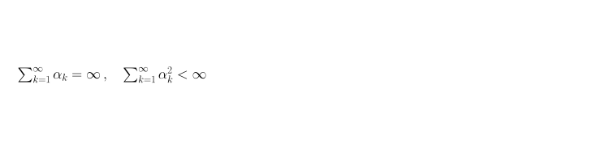

[← Previous: Bellman Optimality Derivation](c-bellman-optimality-derivation.md) | [Table of contents](../main.md#chapters) | [Next: Policy Gradient Theorem and Expectations](e-policy-gradient-theorem-and-expectations.md) →

# Appendix D: Robbins--Monro Step-Size Conditions

## D.1 Goal

Derive the two conditions on $\lbrace\alpha_n\rbrace$ used in Chapter 4 so that the incremental Monte Carlo update (4.3), for a fixed $\pi$ and a stationary environment $P$, has $V_n\to V^\pi$. First-visit returns from a state $s$ are i.i.d.\ with mean $\mu=V^\pi(s)$ and finite variance, so the sample mean (A.20) is unbiased for $\mu$ by (A.21) and converges by (A.23).

## D.2 Error, sample error, and unrolling

The incremental update (4.3), with step $\alpha_n$ on the $n$-th sample ($0<\alpha_n\le 1$), is

```math
V_{n+1}=V_n+\alpha_n(G_n-V_n).
```

$\mu=V^\pi(s)=\mathbb{E}[G]$. After enough steps we want the estimate $V$ to converge to that $\mu$. At a finite step $n$ it has not arrived. The estimation error is

```math
e_n=V_n-\mu.
```

The sample error $\xi_n$ is how far this sample return $G_n$ sits from $\mu$:

```math
\xi_n=G_n-\mu.
```

Then

```math
\mathbb{E}[\xi_n]=\mathbb{E}[G_n]-\mu=\mu-\mu=0.
```

```math
By (A.17),
```

```math
\mathrm{Var}(G_k)=\mathbb{E}[(G_k-\mu)^2]=\mathbb{E}[\xi_k^2].
```

Every $G_k$ is generated from the same policy $\pi$ and the same environment $P$, hence all $G_k$ have the same distribution, so the variance is the same constant $\sigma^2$ for every $k$: $\mathrm{Var}(G_k)=\mathbb{E}[\xi_k^2]=\sigma^2$.

Subtract $\mu$ from both sides of (D.1) and substitute $G_n-V_n=\xi_n-e_n$:

```math
e_{n+1}=V_{n+1}-\mu=(V_n-\mu)+\alpha_n(G_n-V_n)=e_n+\alpha_n(\xi_n-e_n)=(1-\alpha_n)e_n+\alpha_n\xi_n.
```

The first steps from $e_1$ are

```math
\begin{aligned}e_2&=(1-\alpha_1)e_1+\alpha_1\xi_1,\\e_3&=(1-\alpha_2)e_2+\alpha_2\xi_2=(1-\alpha_2)(1-\alpha_1)e_1+(1-\alpha_2)\alpha_1\xi_1+\alpha_2\xi_2,\\e_4&=(1-\alpha_3)e_3+\alpha_3\xi_3=(1-\alpha_3)(1-\alpha_2)(1-\alpha_1)e_1+(1-\alpha_3)(1-\alpha_2)\alpha_1\xi_1+(1-\alpha_3)\alpha_2\xi_2+\alpha_3\xi_3.\end{aligned}
```

The coefficient of $e_1$ is the product of every $(1-\alpha_k)$ so far. The coefficient of $\xi_k$ is $\alpha_k$ times the product of the later $(1-\alpha_j)$. After $n$ updates that is

```math
e_{n+1}=\underbrace{(\prod_{k=1}^{n}(1-\alpha_k))e_1}_{\text{Term 1: Initial Bias}}+\underbrace{\sum_{k=1}^{n}\alpha_k(\prod_{j=k+1}^{n}(1-\alpha_j))\xi_k}_{\text{Term 2: Accumulated Noise }(E_{\text{noise}})}.
```

Term 1 is the starting estimation error $e_1=V_1-\mu$, multiplied by every $(1-\alpha_k)$ so far. $V_1$ is an arbitrary initialization, not $\mu$, so this leftover from the start is the initial bias.

Term 2 is accumulated noise because it sums historical sample errors $\xi_k=G_k-\mu$ from $k=1$ to $k=n$, each scaled by $\alpha_k$ when it enters and then by the later $(1-\alpha_j)$.

To converge, we need $\lim_{n\to\infty}e_{n+1}=0$. In that case $V_n\to V^\pi$. Term 1 is leftover start and dies in the long run. Term 2 is random with mean $0$, so it cannot cancel Term 1. Each term must go to $0$ on its own. The two conditions of Robbins and Monro, 1951 below are what force that.

We will derive those two conditions. Before that, for all real $x$:

```math
1-x\le e^{-x}.
```

Let $f(x)=e^{-x}-(1-x)$. Then $f'(x)=1-e^{-x}$, so $f'(x)=0$ at $x=0$. The second derivative is $f''(x)=e^{-x}$, and $f''(0)=1>0$, so $x=0$ is a minimum. Also $f(0)=0$. Hence $f(x)\ge 0$ for all real $x$: $1-x\le e^{-x}$.

## D.3 Term 1 $\to 0$ $\Rightarrow\sum\alpha_n=\infty$

The first term is $\bigl(\prod_{k=1}^{n}(1-\alpha_k)\bigr)e_1$. For this to go to $0$ for every initial $e_1$, we need $\prod_{k=1}^{n}(1-\alpha_k)\to 0$. Taking $x=\alpha_k$ in (D.6) gives $1-\alpha_k\le e^{-\alpha_k}$, so

```math
\prod_{k=1}^{n}(1-\alpha_k)\le\prod_{k=1}^{n}e^{-\alpha_k}= e^{-\sum_{k=1}^{n}\alpha_k}.
```

If $\sum_{k=1}^{\infty}\alpha_k=\infty$, the exponent goes to $-\infty$, so $e^{-\sum\alpha_k}\to 0$, hence the product $\to 0$ and the first term vanishes.

```math
\sum_{k=1}^{\infty}\alpha_k=\infty.
```

If that sum is finite, $e^{-\sum\alpha}$ stays a positive number. Then (for $\alpha_k\le 1/2$) the product stays away from $0$, so a leftover fraction of $e_1$ remains and $e_{n+1}\not\to 0$.

## D.4 Term 2 $\to 0$ $\Rightarrow\sum\alpha_n^2<\infty$

The second term is

```math
\sum_{k=1}^{n}\alpha_k\Biggl(\prod_{j=k+1}^{n}(1-\alpha_j)\Biggr)\xi_k.
```

Take its expectation. The products of $(1-\alpha_j)$ are numbers, so they come out of $\mathbb{E}$:

```math
\mathbb{E}\Biggl[\sum_{k=1}^{n}\alpha_k\Biggl(\prod_{j=k+1}^{n}(1-\alpha_j)\Biggr)\xi_k\Biggr]=\sum_{k=1}^{n}\alpha_k\Biggl(\prod_{j=k+1}^{n}(1-\alpha_j)\Biggr)\mathbb{E}[\xi_k]=0,
```

because $\mathbb{E}[\xi_k]=0$. The mean of the second term is always $0$. To force that sum itself to $0$, we control its variance. The mean is $0$, so (A.19) gives $\mathrm{Var}(X)=\mathbb{E}[X^2]$.
The accumulated-noise variance is $\mathrm{Var}(E_{\text{noise}})$. Mean already $0$, so

```math
\mathrm{Var}(E_{\text{noise}})=\mathbb{E}\Biggl[\Biggl(\sum_{k=1}^{n}\alpha_k\prod_{j=k+1}^{n}(1-\alpha_j)\,\xi_k\Biggr)^2\Biggr].
```

When the square of the sum is expanded, the combinations of $\xi_k$ that appear are $\xi_k^2$ (the same $k$ twice) and $\xi_k\xi_m$ for $k\neq m$:

```math
\Biggl(\sum_{k=1}^{n}\alpha_k\prod_{j=k+1}^{n}(1-\alpha_j)\,\xi_k\Biggr)^2=\sum_{k=1}^{n}\Biggl(\alpha_k\prod_{j=k+1}^{n}(1-\alpha_j)\Biggr)^2\xi_k^2+\sum_{k\neq m}\alpha_k\alpha_m\Biggl(\prod_{j=k+1}^{n}(1-\alpha_j)\Biggr)\Biggl(\prod_{j=m+1}^{n}(1-\alpha_j)\Biggr)\xi_k\xi_m.
```

For $k\neq m$, $\xi_k$ and $\xi_m$ are independent: $\xi_k=G_k-\mu$ and $\xi_m=G_m-\mu$ come from first-visit returns in separate episodes. So $\mathbb{E}[\xi_k\xi_m]=\mathbb{E}[\xi_k]\mathbb{E}[\xi_m]=0$, every cross term drops, and the expected square equals

```math
\sum_{k=1}^{n}\Biggl(\alpha_k^2\Biggl(\prod_{j=k+1}^{n}(1-\alpha_j)\Biggr)^2\mathbb{E}[\xi_k^2]\Biggr).
```

From above, $\mathrm{Var}(G_k)=\sigma^2$, so $\mathbb{E}[\xi_k^2]=\sigma^2$. That common number comes out of the sum:

```math
\sigma^2\sum_{k=1}^{n}\alpha_k^2\Biggl(\prod_{j=k+1}^{n}(1-\alpha_j)\Biggr)^2.
```

Since $0\le\alpha_j\le 1$, each factor $1-\alpha_j$ lies in $[0,1]$, so each product is at most $1$, and its square is at most $1$. Hence

```math
\mathrm{Var}(E_{\text{noise}})\le\sigma^2\sum_{k=1}^{n}\alpha_k^2.
```

As $n\to\infty$, the right-hand side stays finite iff

```math
\sum_{k=1}^{\infty}\alpha_k^2<\infty.
```

This condition is necessary and sufficient to keep the step-size energy small enough so that the accumulated-noise variance $\mathrm{Var}(E_{\text{noise}})$ vanishes.

Next we show $\mathrm{Var}(E_{\text{noise}})\to 0\implies E_{\text{noise}}\to 0$ via Chebyshev's inequality. For a random variable $X$ with mean $\mu$ and standard deviation $\sigma_X$ from (A.18), and any $k>0$,

```math
\mathbb{P}(\lvert X-\mu\rvert\ge k\sigma_X)\le\frac{1}{k^2}.
```

Set $\varepsilon=k\sigma_X$, so $k=\varepsilon/\sigma_X$:

```math
\mathbb{P}(\lvert X-\mu\rvert\ge\varepsilon)\le\frac{\sigma_X^2}{\varepsilon^2}=\frac{\mathrm{Var}(X)}{\varepsilon^2}.
```

Take $X=E_{\text{noise}}$ (Term 2), with mean $\mu=0$ and variance $\mathrm{Var}(E_{\text{noise}})$:

```math
\mathbb{P}(\lvert E_{\text{noise}}\rvert\ge\varepsilon)\le\frac{\mathrm{Var}(E_{\text{noise}})}{\varepsilon^2}.
```

Let $n\to\infty$, where $\mathrm{Var}(E_{\text{noise}})\to 0$:

```math
\lim_{n\to\infty}\mathbb{P}(\lvert E_{\text{noise}}\rvert\ge\varepsilon)\le\frac{0}{\varepsilon^2}=0.
```

The sample errors $\xi_k$ never stop, but because $\sum\alpha_k^2<\infty$, the steps shrink fast enough that $\mathrm{Var}(E_{\text{noise}})\to 0$. For every $\varepsilon>0$, $\lim_{n\to\infty}\mathbb{P}(\lvert E_{\text{noise}}\rvert\ge\varepsilon)=0$, so $E_{\text{noise}}\to 0$ in probability: $\lim_{n\to\infty}E_{\text{noise}}=0$.

The two conditions are



[← Previous: Bellman Optimality Derivation](c-bellman-optimality-derivation.md) | [Table of contents](../main.md#chapters) | [Next: Policy Gradient Theorem and Expectations](e-policy-gradient-theorem-and-expectations.md) →
