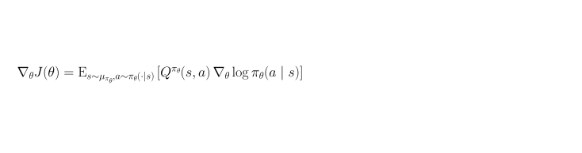

[← Previous: Robbins--Monro Step-Size Conditions](d-robbins-monro-step-size-conditions.md) | [Table of contents](../main.md#chapters) | [Next: KL Non-Negativity](f-kl-non-negativity.md) →

# Appendix E: Policy Gradient Theorem and Expectations

## E.1 Goal

First show that the expected score is zero, and that past-reward and baseline terms in the policy gradient therefore have mean zero (used in Chapters 9--10). Then derive the **policy gradient theorem**: rewrite $\nabla_\theta J(\theta)$ as an average of $Q^{\pi_\theta}\,\nabla_\theta\log\pi_\theta$ under on-policy discounted state visits, and show that it equals (9.7a).

## E.2 The expected score is zero

Fix a state $s$. The policy $\pi_\theta(\cdot\mid s)$ is a distribution over actions whose probabilities depend on the parameters $\theta$. The actions are fixed; the probability of each action is a function of $\theta$. For example, for a loaded coin with loading factor $\theta$, the outcomes are heads and tails, and $P(\text{heads})=\theta$, $P(\text{tails})=1-\theta$. The gradient $\nabla_\theta\log\pi_\theta(a\mid s)$ is called the **score**. Writing its expectation as a sum over actions (A.12), and using $\nabla_\theta\log u=\frac{1}{u}\nabla_\theta u$ with $u=\pi_\theta(a\mid s)$,

```math
\begin{aligned}\mathbb{E}_{A\sim\pi_\theta(\cdot\mid s)}\bigl[\nabla_\theta\log\pi_\theta(A\mid s)\bigr]&=\sum_{a}\pi_\theta(a\mid s)\,\nabla_\theta\log\pi_\theta(a\mid s)\\&=\sum_{a}\nabla_\theta\pi_\theta(a\mid s)\\&=\nabla_\theta\sum_{a}\pi_\theta(a\mid s)\\&=\nabla_\theta 1\\&=0.\end{aligned}
```

The probabilities sum to $1$ for every $\theta$, so a change in $\theta$ only moves probability between actions, and the changes cancel.

## E.3 Past-reward terms have expectation zero

Let $H_t=(S_0,A_0,R_1,\ldots,R_t,S_t)$ be the history up to $S_t$. For $k<t$, the reward $R_{k+1}$ is part of $H_t$, so it is a fixed number once $H_t$ is given. Given $H_t$, the agent draws $A_t$ from $\pi_\theta(\cdot\mid S_t)$, so $\mathbb{E}\bigl[\nabla_\theta\log\pi_\theta(A_t\mid S_t)\bigm|H_t\bigr]=0$ by (E.1). Then

```math
\begin{aligned}\mathbb{E}\bigl[R_{k+1}\,\nabla_\theta\log\pi_\theta(A_t\mid S_t)\bigr]&=\mathbb{E}\Bigl[\mathbb{E}\bigl[R_{k+1}\,\nabla_\theta\log\pi_\theta(A_t\mid S_t)\bigm|H_t\bigr]\Bigr]\quad\text{[A.8]}\\&=\mathbb{E}\Bigl[R_{k+1}\,\mathbb{E}\bigl[\nabla_\theta\log\pi_\theta(A_t\mid S_t)\bigm|H_t\bigr]\Bigr]\quad\text{[A.5; }R_{k+1}\text{ is fixed given }H_t\text{]}\\&=\mathbb{E}[R_{k+1}\cdot 0]\quad\text{[E.1]}\\&=0.\end{aligned}
```

## E.4 The baseline term has expectation zero

The state $S_t$ is random: different episodes reach different states at time $t$, depending on the start state, the actions sampled from $\pi_\theta$, and the environment's transitions. The expectation therefore averages over both the state and the action, 

```math
\mathbb{E}\bigl[b(S_t)\,\nabla_\theta\log\pi_\theta(A_t\mid S_t)\bigr]=\sum_{s}P(S_t=s)\sum_{a}\pi_\theta(a\mid s)\,b(s)\,\nabla_\theta\log\pi_\theta(a\mid s),
```

 and $b(S_t)$ takes a different value in each state, so it cannot be taken outside the whole expectation. Within the inner sum the state $s$ is fixed and only the action varies, so $b(s)$ is a constant there. The tower property (A.8) separates the two sums: first fix $S_t$ and average over actions, then average over states. With the same steps as in E.2, conditioning on $S_t$ instead of $H_t$,

```math
\begin{aligned}\mathbb{E}\bigl[b(S_t)\,\nabla_\theta\log\pi_\theta(A_t\mid S_t)\bigr]&=\mathbb{E}\Bigl[\mathbb{E}\bigl[b(S_t)\,\nabla_\theta\log\pi_\theta(A_t\mid S_t)\bigm|S_t\bigr]\Bigr]\quad\text{[A.8]}\\&=\mathbb{E}\Bigl[b(S_t)\,\mathbb{E}\bigl[\nabla_\theta\log\pi_\theta(A_t\mid S_t)\bigm|S_t\bigr]\Bigr]\quad\text{[A.5; }b(S_t)\text{ is fixed given }S_t\text{]}\\&=\mathbb{E}[b(S_t)\cdot 0]\quad\text{[E.1]}\\&=0.\end{aligned}
```

The second line needs the baseline to be fixed given $S_t$. A weight $b(S_t,A_t)$ that differs between actions cannot be taken outside the expectation over $A_t$, and its product with the score need not have mean zero.

## E.5 Policy gradient theorem

As in Chapter 9, $J(\theta)=V^{\pi_\theta}(s_0)$: expected return from start state $s_0$ under $\pi_\theta$, horizon $T$, discount $\gamma$. (Infinite horizon: same with $T\to\infty$.)

Start at $s_0$ and follow $\pi_\theta$. The state $s$ may appear at several times. The weight 

```math
\mu_{\pi_\theta}(s)=\sum_{t=0}^{T-1}\gamma^t\,P\bigl(S_t=s\mid S_0=s_0,\pi_\theta\bigr)
```

 is the **discounted visitation** of $s$: add $\gamma^t$ whenever the probability of being in $s$ at time $t$ is counted. Early visits weigh more than late ones. States never reached from $s_0$ under $\pi_\theta$ have $\mu_{\pi_\theta}(s)=0$.

**Theorem (policy gradient; Sutton et al., 2000.} $\nabla_\theta J(\theta)$ equals the sum over states of $\mu_{\pi_\theta}(s)$ times the sum over actions of $(\nabla_\theta\pi_\theta(a\mid s))\,Q^{\pi_\theta}(s,a)$. Only how $\theta$ changes the policy in visited states, and how good those actions are, enter. The transition kernel does not appear in the gradient: 

```math
\nabla_\theta J(\theta)=\sum_s\mu_{\pi_\theta}(s)\sum_a\bigl(\nabla_\theta\pi_\theta(a\mid s)\bigr)\,Q^{\pi_\theta}(s,a).
```

 Equivalently, with $\nabla_\theta\pi_\theta=\pi_\theta\,\nabla_\theta\log\pi_\theta$,



**Proof of (E.4).** Write $\pi$ for $\pi_\theta$ and $V$, $Q$ for $V^{\pi_\theta}$, $Q^{\pi_\theta}$.

Step 1 --- differentiate $V$. From (B.19) and (B.11), 

```math
V(s)=\sum_a\pi(a\mid s)\,Q(s,a).
```

 Both $\pi$ and $Q$ depend on $\theta$. Differentiate the product term by term: 

```math
\nabla_\theta V(s)=\sum_a\bigl(\nabla_\theta\pi(a\mid s)\bigr)\,Q(s,a)+\sum_a\pi(a\mid s)\,\nabla_\theta Q(s,a).
```

Step 2 --- differentiate $Q$. From (B.18), 

```math
Q(s,a)=\sum_{s',r}P(s',r\mid s,a)\bigl(r+\gamma V(s')\bigr).
```

 Apply $\nabla_\theta$ inside the sum. The factors $P(s',r\mid s,a)$ and $r$ do not depend on $\theta$, so 

```math
\begin{aligned}\nabla_\theta Q(s,a)&=\sum_{s',r}P(s',r\mid s,a)\,\nabla_\theta\bigl(r+\gamma V(s')\bigr)\\&=\sum_{s',r}P(s',r\mid s,a)\,\gamma\,\nabla_\theta V(s')\\&=\gamma\sum_{s'}\Biggl(\sum_r P(s',r\mid s,a)\Biggr)\nabla_\theta V(s')\\&=\gamma\sum_{s'}P(s'\mid s,a)\,\nabla_\theta V(s').\end{aligned}
```

Step 3 --- substitute into $(*)$. 

```math
\begin{aligned}\nabla_\theta V(s)&=\sum_a\bigl(\nabla_\theta\pi(a\mid s)\bigr)\,Q(s,a)+\sum_a\pi(a\mid s)\Biggl(\gamma\sum_{s'}P(s'\mid s,a)\,\nabla_\theta V(s')\Biggr)\\&=\sum_a\bigl(\nabla_\theta\pi(a\mid s)\bigr)\,Q(s,a)+\gamma\sum_{s'}\Biggl(\sum_a\pi(a\mid s)\,P(s'\mid s,a)\Biggr)\nabla_\theta V(s').\end{aligned}
```

 The inner sum is the next-state distribution under $\pi$: 

```math
P^\pi(s'\mid s)=\sum_a\pi(a\mid s)\,P(s'\mid s,a)=P(S_{t+1}=s'\mid S_t=s,\pi).
```

 Write 

```math
\phi(s)=\sum_a\bigl(\nabla_\theta\pi(a\mid s)\bigr)\,Q(s,a)
```

 for the first sum. Then 

```math
\nabla_\theta V(s)=\phi(s)+\gamma\sum_{s'}P^\pi(s'\mid s)\,\nabla_\theta V(s').
```

Step 4 --- unroll $(**)$ from $s_0$. Apply $(**)$ at $s=s_0$: 

```math
\nabla_\theta V(s_0)=\phi(s_0)+\gamma\sum_{s_1}P^\pi(s_1\mid s_0)\,\nabla_\theta V(s_1).
```

 Apply $(**)$ again to every $\nabla_\theta V(s_1)$: 

```math
\begin{aligned}\nabla_\theta V(s_0)&=\phi(s_0)+\gamma\sum_{s_1}P^\pi(s_1\mid s_0)\Biggl(\phi(s_1)+\gamma\sum_{s_2}P^\pi(s_2\mid s_1)\,\nabla_\theta V(s_2)\Biggr)\\&=\phi(s_0)+\gamma\sum_{s_1}P(S_1=s_1\mid S_0=s_0,\pi)\,\phi(s_1)\\&\qquad+\gamma^2\sum_{s_2}P(S_2=s_2\mid S_0=s_0,\pi)\,\nabla_\theta V(s_2).\end{aligned}
```

 Repeat the same substitution for $\nabla_\theta V(s_2),\ldots,\nabla_\theta V(s_{T-1})$. After $T$ substitutions, 

```math
\begin{aligned}\nabla_\theta V(s_0)&=\sum_{t=0}^{T-1}\gamma^t\sum_sP(S_t=s\mid S_0=s_0,\pi)\,\phi(s)\\&\qquad+\gamma^T\sum_sP(S_T=s\mid S_0=s_0,\pi)\,\nabla_\theta V(s).\end{aligned}
```

 With horizon $T$ there is no return after time $T$, so the value after the last step is identically zero and the remainder vanishes. (If $T\to\infty$ and $\lvert\gamma\rvert<1$ with bounded rewards, the remainder tends to zero as well.) Therefore 

```math
\nabla_\theta V(s_0)=\sum_{t=0}^{T-1}\sum_s\gamma^t\,P(S_t=s\mid S_0=s_0,\pi)\,\phi(s).
```

Step 5 --- pack the weights into $\mu_\pi$. Interchange the finite sums over $t$ and $s$: 

```math
\nabla_\theta V(s_0)=\sum_s\Biggl(\sum_{t=0}^{T-1}\gamma^t\,P(S_t=s\mid S_0=s_0,\pi)\Biggr)\phi(s)=\sum_s\mu_\pi(s)\,\phi(s).
```

 Restore $\phi(s)=\sum_a(\nabla_\theta\pi(a\mid s))\,Q(s,a)$ and $J(\theta)=V(s_0)$: 

```math
\nabla_\theta J(\theta)=\sum_s\mu_\pi(s)\sum_a\bigl(\nabla_\theta\pi(a\mid s)\bigr)\,Q(s,a), which is (E.4).
```

**Proof of (E.5).** Start from (E.4): 

```math
\nabla_\theta J(\theta)=\sum_s\mu_{\pi_\theta}(s)\sum_a\bigl(\nabla_\theta\pi_\theta(a\mid s)\bigr)\,Q^{\pi_\theta}(s,a).
```

Step 1 --- score identity. Fix $(s,a)$ with $\pi_\theta(a\mid s)>0$. Set $u=\pi_\theta(a\mid s)$. Then 

```math
\nabla_\theta\log u=\frac{1}{u}\,\nabla_\theta u,
```

 so 

```math
\nabla_\theta u=u\,\nabla_\theta\log u,
```

 i.e. 

```math
\nabla_\theta\pi_\theta(a\mid s)=\pi_\theta(a\mid s)\,\nabla_\theta\log\pi_\theta(a\mid s).
```

 If $\pi_\theta(a\mid s)=0$, that action is absent from both sums in (E.4) and (E.5), so it may be omitted.

Step 2 --- substitute into the inner sum. For each fixed $s$, 

```math
\begin{aligned}\sum_a\bigl(\nabla_\theta\pi_\theta(a\mid s)\bigr)\,Q^{\pi_\theta}(s,a)&=\sum_a\pi_\theta(a\mid s)\,Q^{\pi_\theta}(s,a)\,\nabla_\theta\log\pi_\theta(a\mid s)\\&=\mathbb{E}_{a\sim\pi_\theta(\cdot\mid s)}\bigl[Q^{\pi_\theta}(s,a)\,\nabla_\theta\log\pi_\theta(a\mid s)\bigr],\end{aligned}
```

 where the last line is the definition of expectation under $\pi_\theta(\cdot\mid s)$ (A.12).

Step 3 --- put the outer sum back. 

```math
\begin{aligned}\nabla_\theta J(\theta)&=\sum_s\mu_{\pi_\theta}(s)\sum_a\pi_\theta(a\mid s)\,Q^{\pi_\theta}(s,a)\,\nabla_\theta\log\pi_\theta(a\mid s)\\&=\sum_s\mu_{\pi_\theta}(s)\,\mathbb{E}_{a\sim\pi_\theta(\cdot\mid s)}\bigl[Q^{\pi_\theta}(s,a)\,\nabla_\theta\log\pi_\theta(a\mid s)\bigr].\end{aligned}
```

 The notation $\mathbb{E}_{s\sim\mu_{\pi_\theta},\,a\sim\pi_\theta(\cdot\mid s)}$ in (E.5) means this double expression: weight each state by $\mu_{\pi_\theta}(s)$ (these weights need not sum to $1$), and given $s$ draw $a\sim\pi_\theta(\cdot\mid s)$. That is exactly the display above, so (E.5) holds.

## E.6 Link to (9.7a)

Sampling a trajectory from $\pi_\theta$ starting at $s_0$ produces pairs $(S_t,A_t)$ whose discounted occupancy is $\mu_{\pi_\theta}$: averaging $\gamma^t f(S_t,A_t)$ along the trajectory has the same mean as averaging $f(s,a)$ under $s\sim\mu_{\pi_\theta}$, $a\sim\pi_\theta(\cdot\mid s)$. Taking $f=Q\,\nabla\log\pi$ in (E.5) recovers (9.7a): 

```math
\nabla_\theta J(\theta)=\mathbb{E}_{\tau\sim\pi_\theta}\Biggl[\sum_{t=0}^{T-1}\gamma^{t}Q^{\pi_\theta}(S_t,A_t)\,\nabla_\theta\log\pi_\theta(A_t\mid S_t)\Biggr].
```

 Replacing $Q^{\pi_\theta}(S_t,A_t)$ by the sample return $G_t$ gives (9.7). Replacing $Q$ by the advantage $A^{\pi_\theta}=Q^{\pi_\theta}-V^{\pi_\theta}$ is valid by (E.3) and yields (10.6).

[← Previous: Robbins--Monro Step-Size Conditions](d-robbins-monro-step-size-conditions.md) | [Table of contents](../main.md#chapters) | [Next: KL Non-Negativity](f-kl-non-negativity.md) →
