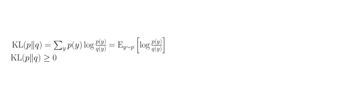

[← Previous: Policy Gradient Theorem and Expectations](e-policy-gradient-theorem-and-expectations.md) | [Table of contents](../main.md#chapters) | [Next: PPO Derivations](g-ppo-derivations.md) →

# Appendix F: KL Non-Negativity

## F.1 Goal

Show that the KL divergence used in Section 11.4 is always at least zero.

## F.2 Proof

Let $p$ and $q$ be distributions on the same finite set, with $q(y)>0$ whenever $p(y)>0$. The KL divergence is



Since $-\log$ is convex, Jensen's inequality (Jensen, 1906) applies: for a convex function $f$, the function of the average is at most the average of the function. For finitely many points that is 

```math
f\Bigl(\frac{x_1+\cdots+x_n}{n}\Bigr)\le\frac{f(x_1)+\cdots+f(x_n)}{n},
```

 and in expectation form 

```math
f\bigl(\mathbb{E}[X]\bigr)\le\mathbb{E}\bigl[f(X)\bigr].
```

 (The inequality is about averages, not about $f(x_1)+\cdots+f(x_n)$ versus $f(x_1+\cdots+x_n)$.) With $f=-\log$ and any positive random variable $X$, this is 

```math
-\log\mathbb{E}[X]\le\mathbb{E}[-\log X],
```

 or equivalently $\mathbb{E}[-\log X]\ge-\log\mathbb{E}[X]$. Take $X=q(y)/p(y)$ with $y\sim p$. Then 

```math
\begin{aligned}\mathrm{KL}(p\|q)&=\mathbb{E}_{y\sim p}\bigl[-\log X\bigr]\\&\ge-\log\mathbb{E}_{y\sim p}[X]\\&=-\log\sum_y p(y)\cdot\frac{q(y)}{p(y)}\\&=-\log\sum_y q(y)\\&=-\log 1\\&=0.\end{aligned}
```

 Equality holds in Jensen for strictly concave $\log$ only when $X$ is constant on the support of $p$. With $\sum_y p(y)=\sum_y q(y)=1$, that forces $p=q$.

In Section 11.4, $p=\pi_\theta(\cdot\mid x)$ and $q=\pi_{\text{ref}}(\cdot\mid x)$, so 

```math
\mathrm{KL}\bigl(\pi_\theta(\cdot\mid x)\,\|\,\pi_{\text{ref}}(\cdot\mid x)\bigr)\ge 0,
```

 with equality only when the two distributions agree.

[← Previous: Policy Gradient Theorem and Expectations](e-policy-gradient-theorem-and-expectations.md) | [Table of contents](../main.md#chapters) | [Next: PPO Derivations](g-ppo-derivations.md) →
