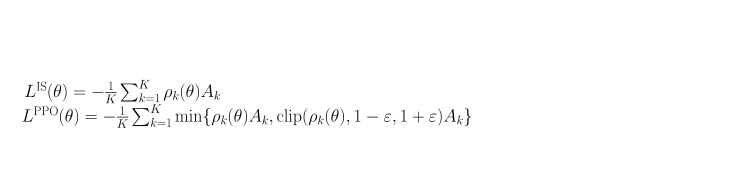

[← Previous: KL Non-Negativity](f-kl-non-negativity.md) | [Table of contents](../main.md#chapters) | [Next: Rejection Sampling](h-rejection-sampling.md) →

# Appendix G: PPO Derivations

Details for Section 11.6 that are not repeated there: the autodiff check that $\nabla_\theta L^{\mathrm{IS}}$ matches (11.8), the clip cases and tables for (11.9), and the clip-versus-KL contrast (Schulman et al., 2017).

## G.1 Gradient of $L^{\mathrm{IS}}$

Section 11.6 uses



with $A_k$ and $\pi_{\theta_{\mathrm{old}}}$ fixed. Differentiating,

```math
\nabla_\theta L^{\mathrm{IS}}=-\frac{1}{K}\sum_{k=1}^{K}A_k\,\nabla_\theta\rho_k(\theta).
```

For each $k$,

```math
\nabla_\theta\rho_k=\frac{\nabla_\theta\pi_\theta(y_k\mid x)}{\pi_{\theta_{\mathrm{old}}}(y_k\mid x)}=\rho_k(\theta)\,\nabla_\theta\log\pi_\theta(y_k\mid x),
```

using $\nabla_\theta\pi_\theta=\pi_\theta\,\nabla_\theta\log\pi_\theta$. Therefore

```math
\nabla_\theta L^{\mathrm{IS}}=-\frac{1}{K}\sum_{k=1}^{K}\rho_k(\theta)\,A_k\,\nabla_\theta\log\pi_\theta(y_k\mid x),
```

which is the sample estimate of $\nabla_\theta L$ in Section 11.6. Descent on $L^{\mathrm{IS}}$ implements (11.8). When $\theta=\theta_{\mathrm{old}}$, every $\rho_k=1$ and the display reduces to (11.6).

## G.2 Clip cases and tables

Section 11.6 minimizes the PPO objective shown above. The clipping rule is

```math
\mathrm{clip}(\rho)=\begin{cases}1-\varepsilon & \text{if }\rho<1-\varepsilon,\\\rho & \text{if }1-\varepsilon\le\rho\le 1+\varepsilon,\\1+\varepsilon & \text{if }\rho>1+\varepsilon.\end{cases}
```

So the score on one reply is

```math
\min\bigl(\rho A,\ \mathrm{clip}(\rho)\,A\bigr)=\begin{cases}\min\bigl(\rho A,\ (1-\varepsilon)A\bigr) & \text{if }\rho<1-\varepsilon,\\\rho A & \text{if }1-\varepsilon\le\rho\le 1+\varepsilon,\\\min\bigl(\rho A,\ (1+\varepsilon)A\bigr) & \text{if }\rho>1+\varepsilon.\end{cases}
```

**Range** as $\rho$ runs over $(0,\infty)$:

|  | score range | what is capped |
| --- | --- | --- |
| $A>0$ | $(0,\ (1+\varepsilon)A]$ | cannot run to $+\infty$ when $\rho\to\infty$ |
| $A<0$ | $(-\infty,\ (1-\varepsilon)A]$ | cannot improve past $(1-\varepsilon)A$ when $\rho\to 0$; still $\to-\infty$ when $\rho\to\infty$ |

```math
**Numbers --- $A>0$ (e.g. $A=2$, $\varepsilon=0.2$).**
```

| $\rho$ | $\rho A$ | $\mathrm{clip}(\rho)$ | $\mathrm{clip}(\rho)\,A$ | $\min(\rho A,\mathrm{clip}\,A)$ |
| --- | --- | --- | --- | --- |
| $1.0$ | $2.0$ | $1.0$ | $2.0$ | $2.0$ |
| $1.1$ | $2.2$ | $1.1$ | $2.2$ | $2.2$ |
| $1.2$ | $2.4$ | $1.2$ | $2.4$ | $2.4$ |
| $1.5$ | $3.0$ | $1.2$ | $2.4$ | $2.4$ |
| $2.0$ | $4.0$ | $1.2$ | $2.4$ | $2.4$ |

From $\rho=1$ to $1.2$ the score rises; past $1.2$ the $\min$ stays at $2.4$.

```math
**Numbers --- $A<0$ (e.g. $A=-2$, $\varepsilon=0.2$).**
```

| $\rho$ | $\rho A$ | $\mathrm{clip}(\rho)$ | $\mathrm{clip}(\rho)\,A$ | $\min(\rho A,\mathrm{clip}\,A)$ |
| --- | --- | --- | --- | --- |
| $1.0$ | $-2.0$ | $1.0$ | $-2.0$ | $-2.0$ |
| $0.9$ | $-1.8$ | $0.9$ | $-1.8$ | $-1.8$ |
| $0.8$ | $-1.6$ | $0.8$ | $-1.6$ | $-1.6$ |
| $0.5$ | $-1.0$ | $0.8$ | $-1.6$ | $-1.6$ |
| $0.2$ | $-0.4$ | $0.8$ | $-1.6$ | $-1.6$ |

From $\rho=1$ to $0.8$ the score improves; below $0.8$ the $\min$ stays at $-1.6$. If instead $\rho$ rises with $A<0$, $\min$ follows $\rho A\to-\infty$ (e.g. $\rho=2$ gives $\min(-4,-2.4)=-4$), so there is no protection against making a bad reply more likely.

## G.3 Clip versus KL to $\pi_{\mathrm{ref}}$

|  | Clip in (11.9) | KL in Section 11.4 |
| --- | --- | --- |
| Compares | $\pi_\theta$ to $\pi_{\theta_{\mathrm{old}}}$ (who generated this batch) | $\pi_\theta$ to $\pi_{\mathrm{ref}}$ (trusted SFT model) |
| Fixes | unstable **reuse** of one batch | drift or reward hacking over training |
| Resets | every time $\theta_{\mathrm{old}}\to\theta$ | $\pi_{\mathrm{ref}}$ stays fixed |

Both can appear together: $R_k$ may include a KL penalty to $\pi_{\mathrm{ref}}$ as in (11.4), while (11.9) still clips $\rho_k$ against $\pi_{\theta_{\mathrm{old}}}$.

[← Previous: KL Non-Negativity](f-kl-non-negativity.md) | [Table of contents](../main.md#chapters) | [Next: Rejection Sampling](h-rejection-sampling.md) →
