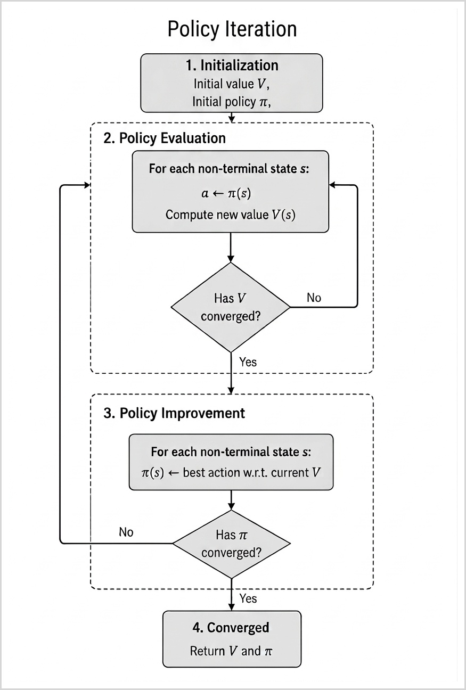

# Chapter 3: Dynamic Programming

[← Previous: Value Functions and the Bellman Equations](02-value-functions-the-bellman-equations.md) | [Table of contents](../main.md#chapters) | [Next: Monte Carlo Methods](04-monte-carlo-methods.md) →


When the model $P$ is known, the Bellman equations are two computations: obtain $V^\pi$ for a given $\pi$, and obtain $V^*$ (and a $\pi^*$). The first obtains $V^\pi$, the expected return from each state under a given $\pi$, and is therefore called **prediction**. The second finds a $\pi^*$ that chooses, at each state, an action that maximizes expected return, and is therefore called **control**. $V^*$ is the value of that policy.

For a *fixed* policy $\pi$, the Bellman expectation equation is linear in the unknowns $V^\pi(s)$. In matrix form that is $\mathbf{V}^\pi=\mathbf{R}^\pi+\gamma\mathbf{P}^\pi\mathbf{V}^\pi$, which rearranges to the linear solve (2.6):

```math
\mathbf{V}^\pi=(I-\gamma\mathbf{P}^\pi)^{-1}\mathbf{R}^\pi.
```

One solve gives every $V^\pi(s)$ at once. No iteration is required.

For the *optimal* values $V^*$, the Bellman optimality equation (2.8) has a $\max$ over actions. That $\max$ makes the system nonlinear, so the same matrix rearrange and solve no longer applies. At one state, the $\max$ only compares action scores—and each score still needs $V^*(s')$ at the next states, which are unknown and coupled across the whole table. Trying every $a$ at one state therefore cannot produce $V^*$ in a single pass.

Dynamic programming (DP) iterates the second computation: when $P$ is known, apply (2.8) over all states repeatedly until the value table converges to $V^*$. That iteration replaces the linear solve we had for $V^\pi$.

Two standard DP algorithms do this:

- **Value iteration** updates the value table by repeatedly applying (2.8) until it converges to $V^*$, then reads off a greedy policy (Section 3.1).

- **Policy iteration** alternates *policy evaluation* and *policy improvement* until the policy stops changing (Section 3.2).

Both need the model $P$. If $P$ is unknown, DP does not apply; later chapters use sample-based methods instead (Monte Carlo, then TD), which learn from experience rather than from summing over $P$.

## 3.1 Value Iteration

Value iteration computes $V^*$ by repeatedly applying (2.8), then a greedy $\pi^*$. On non-terminal states the starting table $V_0$ may be any guess; the updates still converge. After a terminal state there are no further rewards, so the return from there is $0$. Those entries stay at $V(\text{terminal})=0$ and are not updated. Each round then updates every non-terminal value by (2.8) on the current table $V_k$. The policy at $s$ is (2.10) on that same table:

```math
\begin{aligned}V_{k+1}(s)&\leftarrow\max_{a} \sum_{s',r} P(s',r \mid s,a) \left[ r + \gamma V_k(s') \right],\\\pi_{k+1}(s)&\leftarrow\arg\max_{a} \sum_{s',r} P(s',r \mid s,a) \left[ r + \gamma V_k(s') \right].\end{aligned}\quad (3.1)
```

Equation (3.1) uses the previous-round table $V_k$ at every next state $s'$, for both $V_{k+1}$ and $\pi_{k+1}$. The algorithm below writes the new number into $V(s)$ before moving to the next state in the loop, so a later state’s value and action may already read that new $V(s)$. Repeating this backup still improves the table: an early $V_k$ is only a guess, a later $V_k$ is closer to $V^*$. For $\gamma\in[0,1)$, $V_k$ converges to $V^*$, and the greedy $\pi_k$ at that limit is an approximate $\pi^*$. Exact $V^*$ is a limit of infinitely many sweeps. In practice one sweep records $\Delta$, the largest $|V(s)-v|$ over the non-terminals just updated, and stops when $\Delta<\varepsilon$ for a chosen tolerance $\varepsilon>0$.

<div class="book-figure" align="center" markdown="1" id="fig-5-1">

**Figure 3.1.** Value iteration.

</div>

> [!NOTE]
>
> Input: model $P(s',r\mid s,a)$ and tolerance $\varepsilon>0$.
>
> Output: $V\approx V^*$ and greedy $\pi\approx\pi^*$.
>
> 1.  Choose any initial $V(s)$ for non-terminal states; set $V(s)\leftarrow 0$ for terminals and leave them fixed.
>
> 2.  Repeat:
>
>     - $\Delta\leftarrow 0$.
>
>     - For each non-terminal state $s$:
>
>       - $v\leftarrow V(s)$.
>
>       - $V(s)\leftarrow\max_a\sum_{s',r} P(s',r\mid s,a)\,[r+\gamma V(s')]$.
>
>       - $\pi(s)\leftarrow\arg\max_a\sum_{s',r} P(s',r\mid s,a)\,[r+\gamma V(s')]$.
>
>       - $\Delta\leftarrow\max(\Delta,|v-V(s)|)$.
>
>     - Stop if $\Delta<\varepsilon$.
>
> 3.  Return $V$ and $\pi$ (use $\pi$ only after this stop).

```python
import numpy as np

def value_iteration(P_model, n_states, n_actions, terminals, gamma=0.99, eps=1e-8):
    """
    Parameters:
        P_model: P_model[s][a] = list of (prob, next_state, reward)
        terminals: iterable of terminal state indices (V fixed at 0)
        eps: stop when max |V change| < eps (eps in the algorithm)
    Returns:
        V: approximate V*
        policy: greedy policy on non-terminals (-1 on terminals)
    """
    terminals = set(terminals)
    # Arbitrary start on non-terminals; terminals must be 0.
    V = np.random.randn(n_states).astype(np.float64)
    for s in terminals:
        V[s] = 0.0

    policy = np.full(n_states, -1, dtype=np.int64)  # initialize policies to -1
    while True:
        delta = 0.0
        for s in range(n_states):
            if s in terminals:
                continue
            v = V[s]
            best, best_a = -np.inf, 0
            for a in range(n_actions):
                score = 0.0
                for prob, s_next, reward in P_model[s][a]:
                    score += prob * (reward + gamma * V[s_next])
                if score > best:
                    best, best_a = score, a
            V[s] = best
            policy[s] = best_a
            delta = max(delta, abs(v - V[s]))
        if delta < eps:
            break

    return V, policy

if __name__ == "__main__":
    # States: 0 = left terminal, 1 = start, 2 = goal terminal
    n_states, n_actions = 3, 2  # actions: 0 left, 1 right
    terminals = {0, 2}

    # P_model[s][a] = [(prob, next_state, reward), ...]
    P_model = {
        0: {0: [(1.0, 0, 0.0)], 1: [(1.0, 0, 0.0)]},
        1: {0: [(1.0, 0, 0.0)], 1: [(1.0, 2, 1.0)]},
        2: {0: [(1.0, 2, 0.0)], 1: [(1.0, 2, 0.0)]},
    }

    V_opt, policy_opt = value_iteration(P_model, n_states, n_actions, terminals)
    print("Optimal State Values:", V_opt)
    print("Optimal Policy Actions:", policy_opt)
```

## 3.2 Policy Iteration

Policy iteration also computes $V^*$ and $\pi^*$ when $P$ is known. Unlike value iteration, it does not take $\max$ inside every value update: a policy $\pi$ is held fixed while $V^\pi$ is computed, then $\pi$ is replaced by a greedy policy from that $V^\pi$. Terminals stay at $V=0$ and are not updated.

The process is:

1.  Start with any policy $\pi$ (e.g. random).

2.  With $\pi$ fixed, compute $V^\pi$ by repeatedly updating $V$ until $V$ converges.

3.  From that $V^\pi$, build a new greedy policy $\pi'$.

4.  If $\pi'=\pi$, stop: $\pi$ is optimal and $V^\pi=V^*$. Else set $\pi\leftarrow\pi'$ and go back to step 2 (new $V$ under the new policy, then a new greedy policy, and so on).

Each time the policy changes, $V$ must be recomputed for that policy. The process stops when the **policy** stops changing.

<div class="book-figure" align="center" markdown="1" id="fig-5-2">



**Figure 3.2.** Policy iteration.

</div>

Policy evaluation computes $V^\pi$ for a fixed $\pi$, the expected return from each state if the agent keeps following $\pi$. It does not yet change $\pi$.

With one action $a=\pi(s)$ at each $s$, there is no $\max$, so the Bellman expectation equation is linear in $V^\pi$, unlike (3.1). Equation (2.6) solves that system by one matrix inverse. When there are many states the inverse is expensive, so the algorithm below instead repeats the one-step backup over non-terminals until $V$ settles. That inner stop is the same $\Delta<\varepsilon$ as in Section 3.1: $\Delta$ is the largest $|V(s)-v|$ over one sweep of (3.2). The limit is $V^\pi$, the value of this fixed $\pi$, not $V^*$ unless $\pi$ is already optimal. The backup is

```math
V(s)\leftarrow\sum_{s',r}P(s',r \mid s,\pi(s))\left[r + \gamma V(s')\right].\quad (3.2)
```

Only $\pi(s)$ appears—there is no $\max$ over actions.

Policy improvement builds a greedy policy from the just-computed $V^\pi$. For each state, score every action by one-step lookahead under $V^\pi$, then take the best:

```math
\pi'(s)\leftarrow\arg\max_{a}\sum_{s',r}P(s',r \mid s,a)\left[r + \gamma V^\pi(s')\right].\quad (3.3)
```

(That score is $Q^\pi(s,a)$; the algorithm only stores $V$, not a $Q$-table.) If $\pi'=\pi$, stop. Otherwise set $\pi\leftarrow\pi'$ and return to evaluation.

Value iteration (3.1) mixes $\max$ into every value sweep. Policy iteration fully evaluates one $\pi$ before improving it. Both need $P$. A value-iteration sweep is one $\max$ backup per state, cheaper, with a stop when $\Delta<\varepsilon$. A policy-iteration round repeats (3.2) until $V$ is $V^\pi$, then applies (3.3), so each round is heavier. Policy iteration often needs fewer of those rounds than value iteration needs sweeps. There is no preferred method. Value iteration is policy iteration with evaluation truncated to one sweep; that truncation avoids the inner cost. Full evaluation is only needed when $\pi$ should change after $V$ is $V^\pi$: each outer step is then a strict improvement, and the process stops when $\pi$ is unchanged.

> [!NOTE]
>
> Input: model $P(s',r\mid s,a)$ and tolerance $\varepsilon>0$.
>
> Output: $V\approx V^*$ and $\pi\approx\pi^*$.
>
> 1.  Choose any initial $\pi(s)$ on non-terminals. Set $V(s)\leftarrow 0$ for terminals (leave fixed). Non-terminal $V$ may start arbitrarily.
>
> 2.  **Evaluate $\pi$** — repeat until $\Delta<\varepsilon$:
>
>     - $\Delta\leftarrow 0$.
>
>     - For each non-terminal $s$:
>
>       - $v\leftarrow V(s)$.
>
>       - $a\leftarrow\pi(s)$.
>
>       - $V(s)\leftarrow\sum_{s',r} P(s',r\mid s,a)\,[r+\gamma V(s')]$.
>
>       - $\Delta\leftarrow\max(\Delta,|v-V(s)|)$.
>
> 3.  **Improve** — for each non-terminal $s$:
>
>     - $\textit{old}\leftarrow\pi(s)$.
>
>     - $\pi(s)\leftarrow\arg\max_a\sum_{s',r} P(s',r\mid s,a)\,[r+\gamma V(s')]$.
>
>     - If $\pi(s)\neq\textit{old}$ for any $s$, go to step 2 (re-evaluate under the new $\pi$).
>
> 4.  Otherwise $\pi$ is unchanged: return $V$ and $\pi$ ($V\approx V^*$, $\pi\approx\pi^*$).

```python
import numpy as np

def policy_evaluation(P_model, policy, V, n_states, terminals, gamma=0.99, eps=1e-8):
    """Iterative policy evaluation for a deterministic policy (updates V in place)."""
    terminals = set(terminals)
    while True:
        delta = 0.0
        for s in range(n_states):
            if s in terminals:
                continue
            v = V[s]
            a = policy[s]  # follow pi only -- no max over actions
            V[s] = 0.0
            for prob, s_next, reward in P_model[s][a]:
                V[s] += prob * (reward + gamma * V[s_next])
            delta = max(delta, abs(v - V[s]))
        if delta < eps:
            break
    return V

def policy_improvement(P_model, V, policy, n_states, n_actions, terminals, gamma=0.99):
    """Greedy improvement from V. Returns True if the policy is unchanged (converged)."""
    terminals = set(terminals)
    converged = True
    for s in range(n_states):
        if s in terminals:
            continue
        old = policy[s]
        best_a, best_score = 0, -np.inf
        for a in range(n_actions):
            score = 0.0
            for prob, s_next, reward in P_model[s][a]:
                score += prob * (reward + gamma * V[s_next])
            if score > best_score:
                best_score, best_a = score, a
        policy[s] = best_a
        if best_a != old:
            converged = False
    return converged

def policy_iteration(P_model, n_states, n_actions, terminals, gamma=0.99, eps=1e-8):
    terminals = set(terminals)
    # Arbitrary initial policy on non-terminals (random actions).
    policy = np.random.randint(0, n_actions, size=n_states)
    for s in terminals:
        policy[s] = -1

    # Arbitrary V on non-terminals; terminals must be 0.
    V = np.random.randn(n_states).astype(np.float64)
    for s in terminals:
        V[s] = 0.0

    while True:
        policy_evaluation(P_model, policy, V, n_states, terminals, gamma, eps)
        if policy_improvement(
            P_model, V, policy, n_states, n_actions, terminals, gamma
        ):
            break
    return V, policy

if __name__ == "__main__":
    # States: 0 = left terminal, 1 = start, 2 = goal terminal
    n_states, n_actions = 3, 2  # actions: 0 left, 1 right
    terminals = {0, 2}

    # P_model[s][a] = [(prob, next_state, reward), ...]
    P_model = {
        0: {0: [(1.0, 0, 0.0)], 1: [(1.0, 0, 0.0)]},
        1: {0: [(1.0, 0, 0.0)], 1: [(1.0, 2, 1.0)]},
        2: {0: [(1.0, 2, 0.0)], 1: [(1.0, 2, 0.0)]},
    }
    V_opt, policy_opt = policy_iteration(P_model, n_states, n_actions, terminals)
    print("Optimal State Values:", V_opt)
    print("Optimal Policy Actions:", policy_opt)
```

[← Previous: Value Functions and the Bellman Equations](02-value-functions-the-bellman-equations.md) | [Table of contents](../main.md#chapters) | [Next: Monte Carlo Methods](04-monte-carlo-methods.md) →
