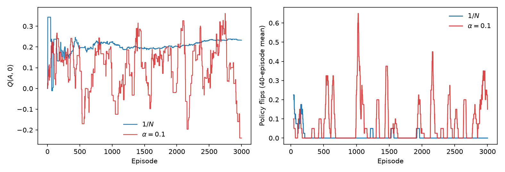

# Chapter 4: Monte Carlo Methods

[← Previous: Dynamic Programming](03-dynamic-programming.md) | [Table of contents](../main.md#chapters) | [Next: Temporal-Difference Learning](05-temporal-difference-learning.md) →


Dynamic Programming (Chapter 3) requires full knowledge of the transition probability $P(s',r \mid s,a)$. In real-world problems (e.g., robotics, games, complex simulators), $P$ is unknown or too complex to explicitly sum over.

What we want is still $V^\pi(s)$: the **expected return** the agent gets from state $s$ if it follows policy $\pi$. That expectation depends on $\pi$ (which actions are chosen) and on the environment dynamics (where those actions lead and what rewards arrive). Without $P$, we cannot expand the expectation analytically.

$G_t$ scores one trajectory from time $t$. To observe it, the rest of that trajectory must be generated through to the end. That end is already in the setup: a terminal yields no further rewards, and (1.9) is the return when the run stops at a finite $T$. An **episode** is one such trajectory, from a start $S_0$ until termination (a terminal, or $T$). Take the taxi introduced in Chapter 1: it starts at a pickup, turns at junctions, and the run ends at drop-off. One realized episode is
```math
S_0{=}\text{pickup},\;A_0{=}\text{left},\;R_1{=}-1,\;S_1{=}\text{junction},\;A_1{=}\text{straight},\;R_2{=}10,\;S_2{=}\text{drop-off}\quad\text{(terminal)}.
```
The return from the pickup is $G_0=R_1+\gamma R_2=-1+10\gamma$, known only after drop-off. The next fare starts a new episode; it does not continue this sequence. So that next trip gives another $G_0$ from pickup, because what we want is the expected return $V^\pi(\text{pickup})$, not this one realized $G_0$. One episode is a sample; later episodes are further samples of the same expectation.

A state may occur more than once before termination. Those are multiple visits in the same episode, each with its own return from that time to the end; they are not multiple episodes. For example, the taxi may return to the same junction before drop-off; the extra loop is another visit, with more fuel cost in the reward.

Monte Carlo estimates $V^\pi$ by simulation: generate episodes under $\pi$, record the return $G_t$ from each visit to $s$, and average those returns. That average is the Monte Carlo estimator <a href="#eq:A.24" data-reference-type="eqref" data-reference="eq:A.24">[eq:A.24]</a> of for $V^\pi(s)=\mathbb{E}_\pi[G_t\mid S_t=s]$, which converges by the law of large numbers in . $G_t$ is known only when the episode has ended, so value updates are episode-by-episode (not step-by-step during the episode, as in TD later). A task that never terminates does not produce an episode in this sense, and Monte Carlo does not apply.

## 4.1 First-Visit and Every-Visit

A state may occur more than once in an episode. The taxi may return to the same junction before drop-off; that extra loop is a second visit, each with its own $G_t$ from that time to the end of the trip. Monte Carlo then has two possibilities for which of those returns enter the average.

**First-visit** keeps only the $G_t$ from the first time $s$ appears in the episode. **Every-visit** keeps the $G_t$ from every visit to $s$. Both estimate $V^\pi(s)=\mathbb{E}_\pi[G_t\mid S_t=s]$. First-visit averages one return per episode that hits $s$; every-visit averages the returns from all visits to $s$. With enough episodes, both converge to $V^\pi(s)$.

The same two rules apply to action-values: a visit is a pair $(s,a)$, first-visit keeps the return from the first time that pair appears in an episode, and every-visit keeps every occurrence. Both converge to $Q^\pi(s,a)$.

> [!NOTE]
>
> Two episodes under $\pi$ (state-values only):
>
> ```math
> \begin{aligned}\text{Ep.~1:}\quad&S_0{=}A\xrightarrow{R_1{=}1}S_1{=}B\xrightarrow{R_2{=}0}S_2{=}A\xrightarrow{R_3{=}2}S_3{=}C\xrightarrow{R_4{=}3}S_4{=}A\xrightarrow{R_5{=}1}S_5{=}D\quad\text{(end)}.\\text{Ep.~2:}\quad&S_0{=}A\xrightarrow{R_1{=}1}S_1{=}B\xrightarrow{R_2{=}2}S_2{=}A\xrightarrow{R_3{=}4}S_3{=}D\quad\text{(end)}.\end{aligned}
> ```
>
> <div class="center" markdown="1">
>
> <table>
> <thead>
> <tr>
> <th style="text-align: left;"><p>$t$</p></th>
> <th style="text-align: left;"><table>
> <tbody>
> <tr>
> <td style="text-align: left;">$S_t$</td>
> </tr>
> <tr>
> <td style="text-align: left;">Ep. 1</td>
> </tr>
> </tbody>
> </table></th>
> <th style="text-align: left;"><table>
> <tbody>
> <tr>
> <td style="text-align: left;">$G_t$</td>
> </tr>
> <tr>
> <td style="text-align: left;">Ep. 1</td>
> </tr>
> </tbody>
> </table></th>
> <th style="text-align: left;"><table>
> <tbody>
> <tr>
> <td style="text-align: left;">$S_t$</td>
> </tr>
> <tr>
> <td style="text-align: left;">Ep. 2</td>
> </tr>
> </tbody>
> </table></th>
> <th style="text-align: left;"><table>
> <tbody>
> <tr>
> <td style="text-align: left;">$G_t$</td>
> </tr>
> <tr>
> <td style="text-align: left;">Ep. 2</td>
> </tr>
> </tbody>
> </table></th>
> </tr>
> </thead>
> <tbody>
> <tr>
> <td style="text-align: left;"><p>$0$</p></td>
> <td style="text-align: left;"><p>$A$</p></td>
> <td style="text-align: left;"><p>$1+\gamma\cdot 0+\gamma^2\cdot 2+\gamma^3\cdot 3+\gamma^4\cdot 1=5.4631$</p></td>
> <td style="text-align: left;"><p>$A$</p></td>
> <td style="text-align: left;"><p>$1+\gamma\cdot 2+\gamma^2\cdot 4=6.04$</p></td>
> </tr>
> <tr>
> <td style="text-align: left;"><p>$1$</p></td>
> <td style="text-align: left;"><p>$B$</p></td>
> <td style="text-align: left;"><p>$0+\gamma\cdot 2+\gamma^2\cdot 3+\gamma^3\cdot 1=4.959$</p></td>
> <td style="text-align: left;"><p>$B$</p></td>
> <td style="text-align: left;"><p>$2+\gamma\cdot 4=5.6$</p></td>
> </tr>
> <tr>
> <td style="text-align: left;"><p>$2$</p></td>
> <td style="text-align: left;"><p>$A$</p></td>
> <td style="text-align: left;"><p>$2+\gamma\cdot 3+\gamma^2\cdot 1=5.51$</p></td>
> <td style="text-align: left;"><p>$A$</p></td>
> <td style="text-align: left;"><p>$4$</p></td>
> </tr>
> <tr>
> <td style="text-align: left;"><p>$3$</p></td>
> <td style="text-align: left;"><p>$C$</p></td>
> <td style="text-align: left;"><p>$3+\gamma\cdot 1=3.9$</p></td>
> <td style="text-align: left;"><p>$D$</p></td>
> <td style="text-align: left;"><p>$0$</p></td>
> </tr>
> <tr>
> <td style="text-align: left;"><p>$4$</p></td>
> <td style="text-align: left;"><p>$A$</p></td>
> <td style="text-align: left;"><p>$1$</p></td>
> <td style="text-align: left;"></td>
> <td style="text-align: left;"></td>
> </tr>
> <tr>
> <td style="text-align: left;"><p>$5$</p></td>
> <td style="text-align: left;"><p>$D$</p></td>
> <td style="text-align: left;"><p>$0$</p></td>
> <td style="text-align: left;"></td>
> <td style="text-align: left;"></td>
> </tr>
> </tbody>
> </table>

For $A$, first-visit keeps one return per episode ($5.4631$ from ep.~1, $6.04$ from ep.~2); every-visit keeps every visit return ($5.4631$, $5.51$, $1$ from ep.~1 and $6.04$, $4$ from ep.~2):

```math
\begin{aligned}\text{first-visit:}\quad&N(A)=2,\quad V(A)=\frac{5.4631+6.04}{2}=5.75155\\\text{every-visit:}\quad&N(A)=5,\quad V(A)=\frac{5.4631+5.51+1+6.04+4}{5}=4.40262\end{aligned}
```

</div>

## 4.2 State-value estimates

The estimate of $V^\pi(s)=\mathbb{E}_\pi[G_t\mid S_t=s]$ is the average of the returns kept for $s$, first-visit or every-visit. After $N$ such returns $G^{(1)}(s),\ldots,G^{(N)}(s)$,

```math
\begin{aligned}V_N(s)&=\frac{1}{N}\sum_{i=1}^{N} G^{(i)}(s),\\\lim_{N\to\infty} V_N(s)&=\mathbb{E}_\pi[G_t \mid S_t=s]=V^\pi(s).\end{aligned}\quad (4.1)
```

Here $N$ is the number of visits kept for $s$ (Section 4.1). Both first-visit and every-visit use (4.1); both converge as that $N\to\infty$.

We can update this sample mean **without** storing every past return. After $N$ returns the estimate is $V_N(s)$. When the next return $G^{(N+1)}(s)$ arrives:

```math
\begin{aligned}V_{N+1}(s)&=\frac{1}{N+1}\sum_{i=1}^{N+1} G^{(i)}(s)\\&=\frac{1}{N+1}\Bigl( N\,V_N(s) + G^{(N+1)}(s) \Bigr)\\&=V_N(s) + \frac{1}{N+1}\Bigl( G^{(N+1)}(s) - V_N(s) \Bigr).\end{aligned}\quad (4.2)
```

So $V_N(s)$ summarizes the previous $N$ returns; the new return is folded in with weight $1/(N{+}1)$. Writing that weight as a step-size $\alpha$ gives

```math
V_{N+1}(S_t)\leftarrow V_N(S_t) + \alpha \bigl( G_t^{(N+1)} - V_N(S_t) \bigr)\quad (4.3)
```

Here $t$ is the time in that episode, so $G_t=R_{t+1}+\gamma G_{t+1}$ is the return from the visit $S_t$, and $(N{+}1)$ is the next sample for that state.

If the policy $\pi$ and the environment $P$ are stationary, vary the step. After $N$ samples the next one is sample $n=N{+}1$; write $\alpha_{N+1}$ for the step on that sample. Then (4.3) is

```math
V_{N+1}(S_t)\leftarrow V_N(S_t) + \alpha_{N+1} \bigl( G_t^{(N+1)} - V_N(S_t) \bigr).
```

Choose $\lbrace\alpha_n\rbrace$ so that

```math
\sum_{n=1}^{\infty}\alpha_n=\infty\qquad\text{and}\qquad\sum_{n=1}^{\infty}\alpha_n^2<\infty,
```

as derived in (). One choice that meets both is $\alpha_n=1/n$, i.e. $\alpha_{N+1}=1/(N{+}1)$, which recovers (4.2). Then $V\to V^\pi$. First-visit and every-visit take **a fixed $\pi$** and do not update it, so they use (4.2).

If the target moves, as in typical RL (control: $\pi$ changes with $Q$), keep $\alpha$ in (4.3) fixed in $(0,1]$. A constant step does not meet $\sum\alpha_n^2<\infty$.

The first-visit and every-visit updates wait for the episode to end, then compute the returns from the last time back to the first. $G_t=R_{t+1}+\gamma G_{t+1}$ needs $G_{t+1}$ first, so start from $G\leftarrow 0$ at termination; at time $t$ that variable already holds $G_{t+1}$, and $G\leftarrow R_{t+1}+\gamma G$ produces $G_t$.

Each kept return is folded into $V$ inside the loop via (4.2): increment $N(s)$ first, then use weight $1/N(s)$—the same as dividing by $N_{\text{old}}+1$ before incrementing. That is equivalent to storing all returns and averaging once at the end, but without waiting and without keeping the full list. $N$ and $V$ persist across episodes. There is no fixed terminating condition. In theory we keep generating episodes indefinitely and (4.1) improves as $N\to\infty$; in practice stop after a chosen number of episodes, or when $V$ barely changes.

**First-visit** updates $V$ only when $S_t$ has not appeared earlier in that episode (at most once per state per episode).

> [!NOTE]
>
> Input: $\pi$.
>
> Output: $V\approx V^\pi$.
>
> 1.  Initialize $V(s)$ arbitrarily and $N(s)\leftarrow 0$ for all $s$ (return count for $s$, not a global episode counter).
>
> 2.  Loop forever (for each episode):
>
>     - Generate an episode following $\pi$: $S_0,A_0,R_1,\;S_1,A_1,R_2,\;\ldots,\;S_{T-1},A_{T-1},R_T$.
>
>     - $G\leftarrow 0$.
>
>     - For $t=T{-}1,T{-}2,\ldots,0$:
>
>       - $G\leftarrow R_{t+1}+\gamma G$.
>
>       - If $S_t\notin\lbrace S_0,\ldots,S_{t-1}\rbrace$ (first visit):
>
>         - $N(S_t)\leftarrow N(S_t)+1$,
>
>         - $V(S_t)\leftarrow V(S_t)+\frac{1}{N(S_t)}\bigl(G-V(S_t)\bigr)$.
>
> 3.  After enough episodes, return $V$ ($\approx V^\pi$).

The same loop without that test. **Every-visit** updates $V$ on every visit to a state, not only the first (in the example of Section 4.1, episode 1 contributes $G_0$, $G_2$, and $G_4$ for $A$).

> [!NOTE]
>
> Input: $\pi$.
>
> Output: $V\approx V^\pi$.
>
> 1.  Initialize $V(s)$ arbitrarily and $N(s)\leftarrow 0$ for all $s$.
>
> 2.  Loop forever (for each episode):
>
>     - Generate an episode following $\pi$: $S_0,A_0,R_1,\;S_1,A_1,R_2,\;\ldots,\;S_{T-1},A_{T-1},R_T$.
>
>     - $G\leftarrow 0$.
>
>     - For $t=T{-}1,T{-}2,\ldots,0$:
>
>       - $G\leftarrow R_{t+1}+\gamma G$.
>
>       - $N(S_t)\leftarrow N(S_t)+1$,
>
>       - $V(S_t)\leftarrow V(S_t)+\frac{1}{N(S_t)}\bigl(G-V(S_t)\bigr)$.
>
> 3.  After enough episodes, return $V$ ($\approx V^\pi$).

To implement the first-visit and every-visit algorithms for $V^\pi$ in Python, initialize the states, terminals, and actions, and define helpers that take one transition and generate an episode under $\pi$:

```python
import random

STATES = ["A", "B", "C", "D", "E", "F", "G", "H"]  # non-terminal states
TERMINALS = {"I", "J"}  # more than one terminal is fine
ACTIONS = list(range(4))  # action set A = {0,1,2,3}

def step(s, a):
    """One transition: next state uniform over non-terminals and terminals."""
    s_next = random.choice(STATES + list(TERMINALS))
    r = 1.0 if s_next in TERMINALS else 0.0
    return s_next, r

def generate_episode(pi):
    """Roll out one episode under pi: list of (S_t, A_t, R_{t+1})."""
    episode = []
    s = "A"  # S_0
    while s not in TERMINALS:
        a = pi[s]
        s_next, r = step(s, a)
        episode.append((s, a, r))
        s = s_next
    return episode
```

The algorithms use that code. First-visit and every-visit for $V$ are:

```python
def mc_prediction_first_visit(pi, gamma=0.99, max_episodes=500):
    # Initialize V(s) arbitrarily, N(s)<-0 (algorithm step 1)
    V = {s: random.random() for s in STATES}
    N = {s: 0 for s in STATES}
    n_ep = 0
    while True:  # for each episode
        episode = generate_episode(pi)
        states = [s for s, a, r in episode]
        G = 0.0
        for t in range(len(episode) - 1, -1, -1):  # t = T-1, ..., 0
            s, a, r = episode[t]
            G = r + gamma * G
            if s not in states[:t]:  # first visit
                N[s] += 1
                V[s] += (G - V[s]) / N[s]
        n_ep += 1
        if n_ep >= max_episodes:
            break
    return V

def mc_prediction_every_visit(pi, gamma=0.99, max_episodes=500):
    V = {s: random.random() for s in STATES}
    N = {s: 0 for s in STATES}
    n_ep = 0
    while True:  # for each episode
        episode = generate_episode(pi)
        G = 0.0
        for t in range(len(episode) - 1, -1, -1):
            s, a, r = episode[t]
            G = r + gamma * G
            N[s] += 1
            V[s] += (G - V[s]) / N[s]
        n_ep += 1
        if n_ep >= max_episodes:
            break
    return V

if __name__ == "__main__":
    pi = {s: random.choice(ACTIONS) for s in STATES}  # fixed policy
    print("First-visit:", mc_prediction_first_visit(pi, gamma=0.9))
    print("Every-visit:", mc_prediction_every_visit(pi, gamma=0.9))
```

## 4.3 Action-value estimates

The same Monte Carlo idea applies to **action-values**. Recall $Q^\pi(s,a)=\mathbb{E}_\pi[G_t\mid S_t=s,A_t=a]$. A **visit** is now a pair $(s,a)$: after taking $a$ in $s$, record the return $G_t$ from that time and average. After $N$ such returns $G^{(1)}(s,a),\ldots,G^{(N)}(s,a)$,

```math
\begin{aligned}Q_N(s,a)&=\frac{1}{N}\sum_{i=1}^{N} G^{(i)}(s,a),\\\lim_{N\to\infty} Q_N(s,a)&=\mathbb{E}_\pi[G_t \mid S_t=s,A_t=a]=Q^\pi(s,a).\end{aligned}\quad (4.4)
```

Here $N$ counts returns kept for that pair $(s,a)$ (first-visit: at most one per episode; every-visit: every occurrence of $(s,a)$). The incremental form of the sample mean is

```math
\begin{aligned}Q_{N+1}(s,a)&=Q_N(s,a) + \frac{1}{N+1}\Bigl( G^{(N+1)}(s,a) - Q_N(s,a) \Bigr).\end{aligned}\quad (4.5)
```

With step-size $\alpha$ (the same two choices as after (4.3)), at a visit $(S_t,A_t)$ with return $G_t^{(N+1)}$,

```math
Q_{N+1}(S_t,A_t)\leftarrow Q_N(S_t,A_t) + \alpha \bigl( G_t^{(N+1)} - Q_N(S_t,A_t) \bigr).\quad (4.6)
```

Compact code: $Q(S_t,A_t)\leftarrow Q(S_t,A_t)+\alpha\bigl(G_t-Q(S_t,A_t)\bigr)$.

The returns for $Q$ are computed the same way as for $V$, from the last time back to the first. First-visit updates $Q$ only on the first occurrence of $(S_t,A_t)$ in the episode; every-visit updates on every occurrence.

After $Q\approx Q^\pi$ is in hand, we may also return the greedy policy

```math
\pi'(s)=\arg\max_a Q(s,a).
```

This $\pi'$ is greedy in $Q^\pi$, so it is an improvement of the $\pi$ that generated the episodes. It is $\pi^*$ only if that $\pi$ was already optimal. Here $\pi$ stays fixed while $Q$ is estimated. The evaluate–improve loop with $\pi\leftarrow\pi'$ is Section 4.4.

> [!NOTE]
>
> Input: $\pi$.
>
> Output: $Q\approx Q^\pi$ and greedy $\pi'(s)=\arg\max_a Q(s,a)$.
>
> 1.  Initialize $Q(s,a)$ arbitrarily and $N(s,a)\leftarrow 0$ for all $s,a$.
>
> 2.  Loop forever (for each episode):
>
>     - Generate an episode following $\pi$: $S_0,A_0,R_1,\;\ldots,\;S_{T-1},A_{T-1},R_T$.
>
>     - $G\leftarrow 0$.
>
>     - For $t=T{-}1,\ldots,0$:
>
>       - $G\leftarrow R_{t+1}+\gamma G$.
>
>       - If $(S_t,A_t)$ is a first visit in this episode:
>
>         - $N(S_t,A_t)\leftarrow N(S_t,A_t)+1$,
>
>         - $Q(S_t,A_t)\leftarrow Q(S_t,A_t)+\frac{1}{N(S_t,A_t)}\bigl(G-Q(S_t,A_t)\bigr)$.
>
> 3.  For each $s$, set $\pi'(s)=\arg\max_a Q(s,a)$. Return $Q$ and $\pi'$.

**Every-visit** updates $Q$ on every occurrence of $(S_t,A_t)$, not only the first.

> [!NOTE]
>
> Input: $\pi$.
>
> Output: $Q\approx Q^\pi$ and greedy $\pi'(s)=\arg\max_a Q(s,a)$.
>
> 1.  Initialize $Q(s,a)$ and $N(s,a)\leftarrow 0$ as above.
>
> 2.  Loop forever (for each episode):
>
>     - Generate an episode following $\pi$.
>
>     - $G\leftarrow 0$.
>
>     - For $t=T{-}1,\ldots,0$:
>
>       - $G\leftarrow R_{t+1}+\gamma G$.
>
>       - $N(S_t,A_t)\leftarrow N(S_t,A_t)+1$,
>
>       - $Q(S_t,A_t)\leftarrow Q(S_t,A_t)+\frac{1}{N(S_t,A_t)}\bigl(G-Q(S_t,A_t)\bigr)$.
>
> 3.  For each $s$, set $\pi'(s)=\arg\max_a Q(s,a)$. Return $Q$ and $\pi'$.

The toy environment of Section 4.2 is reused here. First-visit and every-visit for $Q$, with a greedy readout $\pi'$, are:

```python
# STATES, TERMINALS, ACTIONS, step, generate_episode: previous listing (Section 4.2)

def greedy_pi(Q):
    """pi'(s) = argmax_a Q(s,a) (algorithm output)."""
    return {s: max(ACTIONS, key=lambda a: Q[s][a]) for s in STATES}

def mc_q_prediction_first_visit(pi, gamma=0.99, max_episodes=500):
    # Initialize Q(s,a) arbitrarily, N(s,a)<-0 (algorithm step 1)
    Q = {s: {a: random.random() for a in ACTIONS} for s in STATES}
    N = {s: {a: 0 for a in ACTIONS} for s in STATES}
    n_ep = 0
    while True:  # for each episode
        episode = generate_episode(pi)
        G = 0.0
        seen = set()
        for t in range(len(episode) - 1, -1, -1):  # t = T-1, ..., 0
            s, a, r = episode[t]
            G = r + gamma * G
            if (s, a) in seen:  # first visit only
                continue
            seen.add((s, a))
            N[s][a] += 1
            Q[s][a] += (G - Q[s][a]) / N[s][a]
        n_ep += 1
        if n_ep >= max_episodes:
            break
    return Q, greedy_pi(Q)

def mc_q_prediction_every_visit(pi, gamma=0.99, max_episodes=500):
    Q = {s: {a: random.random() for a in ACTIONS} for s in STATES}
    N = {s: {a: 0 for a in ACTIONS} for s in STATES}
    n_ep = 0
    while True:  # for each episode
        episode = generate_episode(pi)
        G = 0.0
        for t in range(len(episode) - 1, -1, -1):
            s, a, r = episode[t]
            G = r + gamma * G
            N[s][a] += 1
            Q[s][a] += (G - Q[s][a]) / N[s][a]
        n_ep += 1
        if n_ep >= max_episodes:
            break
    return Q, greedy_pi(Q)

if __name__ == "__main__":
    pi = {s: random.choice(ACTIONS) for s in STATES}  # fixed policy
    Q1, pi1 = mc_q_prediction_first_visit(pi, gamma=0.9)
    Q2, pi2 = mc_q_prediction_every_visit(pi, gamma=0.9)
    print("First-visit Q:", Q1)
    print("First-visit pi':", pi1)
    print("Every-visit Q:", Q2)
    print("Every-visit pi':", pi2)
```

## 4.4 Monte Carlo Control

Sections 4.2–4.3 are prediction: $V^\pi$ or $Q^\pi$ for a given $\pi$, from episode returns, without $P$. This section is control: a policy that is (approximately) optimal in every state,

```math
\pi^*\in\arg\max_\pi V^\pi(s)\quad\text{for every }s
```

(equivalently, act greedily on $Q^*$).

In Sections 4.2–4.3 the input $\pi$ is **fixed**: every episode is generated under that same $\pi$, and only $V$ or $Q$ is updated. More episodes refine $Q\to Q^\pi$ (better values for **that** $\pi$), but the behavior policy never changes. Section 4.3 may return a greedy readout

```math
\pi'(s)=\arg\max_a Q(s,a)\quad (4.7)
```

after $Q$ is estimated; that $\pi'$ is taken from the finished table, not used to generate further episodes. So prediction improves the value estimates under a fixed policy—and can propose an improved $\pi'$—yet never updates the policy that collects data.

The gap for control is exactly that missing update of $\pi$. The fix is to run an **evaluate–improve** cycle: estimate $Q$ for the current $\pi$ by Monte Carlo ((4.4)–(4.6), as in Section 4.3), then replace $\pi$ by the greedy policy (4.7), then evaluate again under the new $\pi$, and so on until $\pi$ stops changing. Improve can wait until $Q$ has settled for the current $\pi$ (many episodes), or run after every episode—same Improve step, only a different schedule.

The $Q$ update in that cycle is still the sample mean (4.5), with weight $1/N$. The environment $P$ is unchanged; only $\pi$ changes, so the i.i.d. returns assumed in do not hold while Improve is still moving $\pi$. A constant $\alpha$, as after (4.3), never meets $\sum\alpha_n^2<\infty$, so $Q$ keeps moving and the greedy $\pi$ can keep flipping. The $1/N$ step is kept so that $Q$ can settle. In practice that freeze of $\pi$ happens after some episodes (Figure <a href="#fig-4-1" data-reference-type="ref" data-reference="fig-4-1">1.1</a>); Robbins–Monro then applies to the remaining $1/k$ steps.

<div class="book-figure" align="center" markdown="1" id="fig-4-1">



**Figure 4.1.** Monte Carlo ES, $1/N$ versus $\alpha=0.1$. Left: $Q(A,0)$. Right: greedy-action flips (40-episode mean).

</div>

A bare skeleton is:

> [!NOTE]
>
> Input: none (episodes generated under the current $\pi$).
>
> Output: $Q$ and $\pi$.
>
> 1.  Initialize $\pi$ arbitrarily. Initialize $Q(s,a)$ arbitrarily and $N(s,a)\leftarrow 0$.
>
> 2.  **Evaluate.** Generate episodes by following the current $\pi$. Update $Q$ by first- or every-visit Monte Carlo averaging of returns (until $Q$ has settled for this $\pi$, or after each episode).
>
> 3.  **Improve.** For each $s$, set $\pi(s)\leftarrow\arg\max_a Q(s,a)$.
>
> 4.  If $\pi$ changed, go to step 2. Otherwise return $Q$ and $\pi$.

The skeleton has a problem in Evaluate. Episodes follow the current $\pi$, so $Q$ is updated only for actions $\pi$ actually takes. After Improve, $\pi$ is greedy on $Q$: at each state it picks the single action $\pi(s)=\arg\max_a Q(s,a)$. The next Evaluate then follows that greedy $\pi$ again—so other actions are never tried, their $Q$ entries never improve, and Improve cannot switch to them. The loop can get stuck on a poor policy even though a better action exists.

To get every action tried often enough, change how episodes are generated—and, if needed, how Improve updates $\pi$. This can be done with **on-policy** or **off-policy** methods. An on-policy method evaluates and improves the **same** policy that generates the decisions (and thus the episodes). An off-policy method learns about one policy (the **target**) while generating data with a different exploring policy (the **behavior**). Three standard Monte Carlo methods are exploring starts, $\varepsilon$-greedy policies, and off-policy Monte Carlo. The first two are on-policy; the third is off-policy.

### 4.4.1 Exploring starts

In the skeleton, Improve sets $\pi(s)=\arg\max_a Q(s,a)$, so Evaluate always starts with the same action at $S_0$: $A_0=\pi(S_0)$. Exploring starts replace that first choice by drawing $(S_0,A_0)$ from a distribution that puts positive probability on every pair (e.g. uniform), **not** from $\pi$; then follow $\pi$ from $S_1$ onward and update $Q$ as usual. That draw is not possible if every episode must begin at a fixed $S_0$ with $A_0=\pi(S_0)$. Improve stays greedy as in the skeleton: $\pi(s)\leftarrow\arg\max_a Q(s,a)$. From $S_1$ the episode follows that $\pi$, so Evaluate and Improve are on the same policy that generates those later actions, and the method is on-policy.

> [!NOTE]
>
> Input: start distribution over $(s,a)$ with positive probability on every pair.
>
> Output: $Q\approx Q^*$ and $\pi\approx\pi^*$.
>
> 1.  Initialize $Q(s,a)$ arbitrarily, $N(s,a)\leftarrow 0$, and $\pi$ arbitrarily (e.g. random or greedy on $Q$).
>
> 2.  Loop forever (each episode):
>
>     - Draw $(S_0,A_0)$ from a distribution over $\mathcal{S}\times\mathcal{A}$ that puts positive probability on every pair (e.g. uniform).
>
>     - Generate the rest of the episode by following $\pi$: $S_0,A_0,R_1,\ldots,S_{T-1},A_{T-1},R_T$.
>
>     - $G\leftarrow 0$. For $t=T{-}1,\ldots,0$:
>
>       - $G\leftarrow R_{t+1}+\gamma G$.
>
>       - If $(S_t,A_t)$ is a first visit in this episode:
>
>         - $N(S_t,A_t)\leftarrow N(S_t,A_t)+1$,
>
>         - $Q(S_t,A_t)\leftarrow Q(S_t,A_t)+\frac{1}{N(S_t,A_t)}\bigl(G-Q(S_t,A_t)\bigr)$.
>
>     - For each $s$ appearing in the episode: $\pi(s)\leftarrow\arg\max_a Q(s,a)$.
>
> 3.  After enough episodes (or when $\pi$ stops changing), return $Q$ and $\pi$ ($\approx Q^*$, $\approx\pi^*$).

The environment of Section 4.2 is reused here. Exploring starts needs its own episode generator:

```python
# STATES, TERMINALS, ACTIONS, step: Section 4.2

def generate_episode(pi):
    """Exploring starts: choose (S_0, A_0) uniform, then follow pi.
    Returns list of (S_t, A_t, R_{t+1}).
    """
    s = random.choice(STATES)  # S_0
    a = random.choice(ACTIONS)  # A_0 (not from pi)
    episode = []
    while s not in TERMINALS:
        s_next, r = step(s, a)
        episode.append((s, a, r))
        s = s_next
        if s not in TERMINALS:
            a = pi[s]  # follow pi from S_1 onward
    return episode

def mc_es(gamma=0.99, max_episodes=500):
    # Initialize Q(s,a) arbitrarily, N(s,a)<-0, pi arbitrarily (algorithm step 1)
    Q = {s: {a: random.random() for a in ACTIONS} for s in STATES}
    N = {s: {a: 0 for a in ACTIONS} for s in STATES}
    pi = {s: random.choice(ACTIONS) for s in STATES}
    n_ep = 0
    while True:  # for each episode
        episode = generate_episode(pi)
        G = 0.0
        seen = set()
        for t in range(len(episode) - 1, -1, -1):  # t = T-1, ..., 0
            s, a, r = episode[t]
            G = r + gamma * G
            if (s, a) in seen:  # first visit
                continue
            seen.add((s, a))
            N[s][a] += 1
            Q[s][a] += (G - Q[s][a]) / N[s][a]
        # For each s appearing in the episode: pi(s)<-argmax_a Q(s,a)
        for s, a, r in episode:
            pi[s] = max(ACTIONS, key=lambda aa: Q[s][aa])
        n_ep += 1
        if n_ep >= max_episodes:
            break
    return Q, pi

if __name__ == "__main__":
    Q, pi = mc_es(gamma=0.9)
    print("MC ES Q:", Q)
    print("MC ES pi:", pi)
```

### 4.4.2 $\varepsilon$-greedy policies

Another way to try every action is to select with probability instead of always taking the greedy action. Unlike exploring starts, $A_0$ and the following actions are chosen by $\pi$. The greedy action in $Q$ is $A^*=\arg\max_a Q(s,a)$. If Improve set $\pi(s)=A^*$ as in exploring starts, that action would be locked. Therefore, instead of $\pi(s)=A^*$, Improve changes $\pi$ so that $A^*$ is taken with probability $1-\varepsilon$ and otherwise (probability $\varepsilon$) an action is chosen uniformly from $\mathcal{A}$ (the greedy action could also be picked). That selection rule is the policy $\pi$. Evaluate generates every $A_t$ from that same $\pi$. Because we act and learn with the same $\varepsilon$-greedy $\pi$, this is on-policy. The loop aims at the best such exploring policy; driving $\varepsilon\to 0$ carefully recovers a near-greedy optimum. This is the usual practical default.

> [!NOTE]
>
> Input: $\varepsilon\in(0,1]$.
>
> Output: $Q\approx Q^*$ and greedy $\pi\approx\pi^*$ (for acting); learning uses an $\varepsilon$-greedy behavior.
>
> 1.  Initialize $Q(s,a)$ arbitrarily, $N(s,a)\leftarrow 0$, and behavior $\pi$ as an arbitrary $\varepsilon$-greedy policy.
>
> 2.  Loop forever (each episode):
>
>     - Generate an episode by following $\pi$: $S_0,A_0,R_1,\ldots,R_T$.
>
>     - $G\leftarrow 0$. For $t=T{-}1,\ldots,0$:
>
>       - $G\leftarrow R_{t+1}+\gamma G$.
>
>       - If $(S_t,A_t)$ is a first visit in this episode:
>
>         - $N(S_t,A_t)\leftarrow N(S_t,A_t)+1$,
>
>         - $Q(S_t,A_t)\leftarrow Q(S_t,A_t)+\frac{1}{N(S_t,A_t)}\bigl(G-Q(S_t,A_t)\bigr)$.
>
>     - For each $s$ appearing in the episode:
>
>       - $A^*\leftarrow\arg\max_a Q(s,a)$,
>
>       - set $\pi(\,\cdot\mid s)$ $\varepsilon$-greedy on $A^*$: probability $1-\varepsilon+\varepsilon/|\mathcal{A}|$ on $A^*$, and $\varepsilon/|\mathcal{A}|$ on every other action.
>
> 3.  After enough episodes, return $Q$ and the greedy policy $\pi'(s)=\arg\max_a Q(s,a)$ as the estimate of $\pi^*$ (keep $\varepsilon$-greedy $\pi$ only while learning).

The environment of Section 4.2 is reused here, and `greedy_pi` from Section 4.3. On-policy $\varepsilon$-greedy control is:

```python
# STATES, TERMINALS, ACTIONS, step: Section 4.2
# greedy_pi: Section 4.3

def eps_greedy(Q, s, eps):
    """Sample from eps-greedy pi(*|s) on current Q."""
    if random.random() < eps:
        return random.choice(ACTIONS)
    return max(ACTIONS, key=lambda a: Q[s][a])

def generate_episode(Q, eps):
    """Generate one episode following eps-greedy pi in Q: list of (S_t, A_t, R_{t+1})."""
    episode = []
    s = "A"  # S_0 (fixed start; no exploring starts)
    while s not in TERMINALS:
        a = eps_greedy(Q, s, eps)  # A_t ~ pi(*|S_t)
        s_next, r = step(s, a)
        episode.append((s, a, r))
        s = s_next
    return episode

def on_policy_mc_control(eps=0.1, gamma=0.99, max_episodes=500):
    # Initialize Q(s,a) arbitrarily, N(s,a)<-0 (algorithm step 1)
    # Behavior pi is eps-greedy in Q
    Q = {s: {a: random.random() for a in ACTIONS} for s in STATES}
    N = {s: {a: 0 for a in ACTIONS} for s in STATES}
    n_ep = 0
    while True:  # for each episode
        episode = generate_episode(Q, eps)
        G = 0.0
        seen = set()
        for t in range(len(episode) - 1, -1, -1):  # t = T-1, ..., 0
            s, a, r = episode[t]
            G = r + gamma * G
            if (s, a) in seen:  # first visit
                continue
            seen.add((s, a))
            N[s][a] += 1
            Q[s][a] += (G - Q[s][a]) / N[s][a]
        # Improve: for each s in the episode, pi(*|s) is eps-greedy on A*=argmax Q
        # (next generate_episode samples that updated eps-greedy via Q)
        n_ep += 1
        if n_ep >= max_episodes:
            break
    return Q, greedy_pi(Q)

if __name__ == "__main__":
    Q, pi_prime = on_policy_mc_control(eps=0.1, gamma=0.9)
    print("On-policy MC Q:", Q)
    print("On-policy MC pi':", pi_prime)
```

### 4.4.3 Off-policy Monte Carlo

In the methods above, the same policy both **acts** and is **evaluated**. Off-policy learning splits that role. A **behavior** policy $b$ generates the episodes (and must keep exploring, e.g. $\varepsilon$-greedy). A **target** policy $\pi$ is the policy whose action-values we estimate. In this section that $\pi$ is greedy on $Q$: $\pi(s)=\arg\max_a Q(s,a)$. The question is how to estimate $Q^\pi$ when every sample comes from $b$. **Importance sampling** does that: it estimates an expectation under a target distribution $p$ from samples drawn from a **proposal** distribution $q$, by reweighting each sample with $p/q$.

The idea of importance sampling (derived in ) is to rewrite an expectation under a target distribution $p$ using samples from a proposal distribution $q$:

```math
\mathbb{E}_{x\sim p}[f(x)]=\mathbb{E}_{x\sim q}\bigl[w(x)\, f(x)\bigr],\qquad w(x)=\frac{p(x)}{q(x)}.
```

Two forms approximate that expectation from draws $x_i\sim q$—**ordinary** and **weighted** importance sampling (see ):

```math
\mathbb{E}_{x\sim p}[f(x)]\approx\frac{1}{N}\sum_{i=1}^{N} w(x_i)\, f(x_i),
```

```math
\mathbb{E}_{x\sim p}[f(x)]\approx\frac{\sum_{i=1}^{N} w(x_i)\, f(x_i)}{\sum_{i=1}^{N} w(x_i)}.
```

Here each sample $x$ will be a **trajectory**; $N$ is the number of such trajectory samples.

For action-values under the target policy,

```math
Q^\pi(s,a)=\mathbb{E}_\pi[G_t\mid S_t=s,A_t=a].\quad (4.8)
```

An episode generated by the behavior $b$ always starts at $t=0$:

```math
S_0,A_0,R_1,S_1,\ldots,S_{T-1},A_{T-1},R_T.
```

A trajectory from time $t$, given $S_t$, is

```math
A_t,R_{t+1},S_{t+1},A_{t+1},R_{t+2},\ldots,A_{T-1},R_T.
```

This is the sample $x$ in the importance-sampling formulas above. The same episode can contain the pair $(S_t,A_t)=(s,a)$ more than once; each occurrence starts its own trajectory sample. The return

```math
G_t=R_{t+1}+\gamma R_{t+2}+\cdots+\gamma^{T-t-1}R_T
```

is a function of this trajectory ($f(x)=G_t$). Under a policy $\pi$, the probability of the trajectory given $S_t$ is (chain rule; environment factors written as $P(s',r\mid s,a)$)

```math
\begin{aligned}&P_\pi(A_t,R_{t+1},S_{t+1},\ldots,R_T\mid S_t)\\&\quad=\prod_{k=t}^{T-1}\pi(A_k\mid S_k)\,P(S_{k+1},R_{k+1}\mid S_k,A_k).\end{aligned}
```

The same expansion under $b$ replaces each $\pi$ by $b$. The importance-sampling weight from the opening of this subsection is their ratio (require $b(a\mid s)>0$ whenever $\pi(a\mid s)>0$):

```math
w=\rho_{t:T-1}:=\frac{P_\pi(A_t,R_{t+1},S_{t+1},\ldots,R_T\mid S_t)}{P_b(A_t,R_{t+1},S_{t+1},\ldots,R_T\mid S_t)}.\quad (4.9)
```

Those environment factors do not depend on the policy: the same $P(S_{k+1},R_{k+1}\mid S_k,A_k)$ appears in $P_\pi$ and in $P_b$. They cancel, so

```math
\rho_{t:T-1}=\prod_{k=t}^{T-1}\frac{\pi(A_k\mid S_k)}{b(A_k\mid S_k)}.
```

Apply importance sampling <a href="#eq:A.13" data-reference-type="eqref" data-reference="eq:A.13">[eq:A.13]</a> to (4.8): the target is $\pi$, the proposal is $b$, the weight is (4.9), and $f=G_t$. Then

```math
Q^\pi(s,a)=\mathbb{E}_b\bigl[\rho_{t:T-1}\,G_t\mid S_t=s,A_t=a\bigr].\quad (4.10)
```

With $N$ trajectory samples from visits to $(s,a)$ under $b$—each sample $x_i$ the trajectory from that visit, with return $G^{(i)}$ and weight $\rho^{(i)}=\rho_{t:T-1}^{(i)}$—ordinary and weighted importance sampling give

```math
Q(s,a)\approx\frac{1}{N}\sum_{i=1}^{N}\rho^{(i)}G^{(i)},\quad (4.11)
```

```math
Q(s,a)\approx\frac{\sum_{i=1}^{N}\rho^{(i)}G^{(i)}}{\sum_{i=1}^{N}\rho^{(i)}}.\quad (4.12)
```

Write $Q_N(s,a)$ for the weighted estimate (4.12). When visit $N{+}1$ brings $G^{(N+1)}(s,a)$ and $\rho^{(N+1)}(s,a)$,

```math
Q_{N+1}(s,a)=Q_N(s,a)+\frac{\rho^{(N+1)}}{\sum_{i=1}^{N+1} \rho^{(i)}}\Bigl(G^{(N+1)}(s,a) - Q_N(s,a)\Bigr).\quad (4.13)
```

To apply (4.13) episode by episode, walk each episode **backward** ($t=T{-}1,\ldots,0$), as in Section 4.2. Start from $G\leftarrow 0$ and $\rho\leftarrow 1$: that is $G_T=0$ (no rewards after termination) and $\rho_{T:T-1}=1$ (empty product).

At each $t$ while $\rho\neq 0$: form $G_t$ by $G\leftarrow R_{t+1}+\gamma G$, apply (4.13) with the current $\rho$ ($C(s,a)$ stores $\sum_i\rho^{(i)}$), set $\pi(S_t)\leftarrow\arg\max_a Q(S_t,a)$, then $\rho\leftarrow\rho\cdot\pi(A_t\mid S_t)/b(A_t\mid S_t)$. Here $\pi$ is deterministic: it puts probability $1$ on its chosen action at $S_t$ and $0$ on every other action. So if behavior selected $A_t$, then $\pi(A_t\mid S_t)=1$ only when that $A_t$ is $\pi$’s action, and $0$ otherwise. When that factor is $0$, $\rho$ becomes $0$ and the loop stops—further multiplications for earlier times $t{-}1,t{-}2,\ldots$ would leave $\rho$ at $0$.

The behavior $b$ may be any policy. The only requirement is coverage of $\pi$: $b(a\mid s)>0$ whenever $\pi(a\mid s)>0$. Soft or $\varepsilon$-greedy policies always guarantee that, so the denominator of $\rho$ stays positive and a zero $\rho$ comes only from $\pi(A_t\mid S_t)$.

> [!NOTE]
>
> Input: behavior $b$ with coverage for $\pi$ (e.g. $\varepsilon$-greedy on $Q$).
>
> Output: $Q\approx Q^*$ and greedy $\pi\approx\pi^*$.
>
> 1.  Initialize $Q(s,a)$ arbitrarily and $C(s,a)\leftarrow 0$.
>
> 2.  Loop forever (each episode):
>
>     - $b\leftarrow$ any policy with coverage for $\pi$: $b(a\mid s)>0$ whenever $\pi(a\mid s)>0$ (soft or $\varepsilon$-greedy $b$ always guarantees coverage).
>
>     - Generate an episode by following $b$: $S_0,A_0,R_1,\ldots,S_{T-1},A_{T-1},R_T$.
>
>     - $G\leftarrow 0$, $\rho\leftarrow 1$.
>
>     - For $t=T{-}1,\ldots,0$ while $\rho\neq 0$:
>
>       - $G\leftarrow R_{t+1}+\gamma G$.
>
>       - $C(S_t,A_t)\leftarrow C(S_t,A_t)+\rho$,
>
>       - $Q(S_t,A_t)\leftarrow Q(S_t,A_t)+\frac{\rho}{C(S_t,A_t)}\bigl(G-Q(S_t,A_t)\bigr)$.
>
>       - $\pi(S_t)\leftarrow\arg\max_a Q(S_t,a)$.
>
>       - $\rho\leftarrow\rho\cdot\frac{\pi(A_t\mid S_t)}{b(A_t\mid S_t)}$ ($\pi$ puts probability $1$ on its action at $S_t$ and $0$ on all others; so $\pi(A_t\mid S_t)=1$ if behavior’s $A_t$ is that action, else $0$).
>
> 3.  After enough episodes, return $Q$ and the greedy $\pi(s)=\arg\max_a Q(s,a)$ ($\approx Q^*$, $\approx\pi^*$).

The environment of Section 4.2 is reused here, and `eps_greedy` and `generate_episode` from Section 4.4.2. Off-policy control is:

```python
# STATES, TERMINALS, ACTIONS, step: Section 4.2
# eps_greedy, generate_episode: Section 4.4.2

def b_prob(Q, s, a, eps):
    """b(a|s) under eps-greedy in Q (coverage for greedy pi)."""
    a_star = max(ACTIONS, key=lambda aa: Q[s][aa])
    nA = len(ACTIONS)
    if a == a_star:
        return 1.0 - eps + eps / nA
    return eps / nA

def off_policy_mc_control(eps=0.1, gamma=0.99, max_episodes=500):
    # Initialize Q(s,a) arbitrarily, C(s,a)<-0 (algorithm step 1)
    Q = {s: {a: random.random() for a in ACTIONS} for s in STATES}
    C = {s: {a: 0.0 for a in ACTIONS} for s in STATES}
    pi = {s: max(ACTIONS, key=lambda a: Q[s][a]) for s in STATES}
    n_ep = 0
    while True:  # for each episode
        episode = generate_episode(Q, eps)  # follow b (covers greedy pi)
        G = 0.0
        rho = 1.0
        for t in range(len(episode) - 1, -1, -1):  # t = T-1, ..., 0 while ?!=0
            if rho == 0.0:
                break
            s, a, r = episode[t]
            G = r + gamma * G
            b_sa = b_prob(Q, s, a, eps)  # b(A_t|S_t) before this step's Q update
            C[s][a] += rho
            Q[s][a] += (rho / C[s][a]) * (G - Q[s][a])
            pi[s] = max(ACTIONS, key=lambda aa: Q[s][aa])  # target pi greedy on Q
            # ? <- ? * pi(A_t|S_t) / b(A_t|S_t); pi puts 1 on its action, else 0
            pi_prob = 1.0 if a == pi[s] else 0.0
            rho *= pi_prob / b_sa
        n_ep += 1
        if n_ep >= max_episodes:
            break
    return Q, pi

if __name__ == "__main__":
    Q, pi = off_policy_mc_control(eps=0.1, gamma=0.9)
    print("Off-policy MC Q:", Q)
    print("Off-policy MC pi:", pi)
```

#### 4.4.3.1 Off-policy state-values

The same importance-sampling argument gives state-values. With $V^\pi(s)=\mathbb{E}_\pi[G_t\mid S_t=s]$ and the same weight (4.9),

```math
V^\pi(s)=\mathbb{E}_b\bigl[\rho_{t:T-1}\,G_t\mid S_t=s\bigr].\quad (4.14)
```

With $N$ trajectory samples from visits to $s$ under $b$, returns $G^{(i)}$, and weights $\rho^{(i)}=\rho_{t:T-1}^{(i)}$, ordinary and weighted importance sampling give

```math
V(s)\approx\frac{1}{N}\sum_{i=1}^{N}\rho^{(i)}G^{(i)},\quad (4.15)
```

```math
V(s)\approx\frac{\sum_{i=1}^{N}\rho^{(i)}G^{(i)}}{\sum_{i=1}^{N}\rho^{(i)}}.\quad (4.16)
```

Write $V_N(s)$ for the weighted estimate (4.16). When visit $N{+}1$ brings $G^{(N+1)}(s)$ and $\rho^{(N+1)}(s)$,

```math
V_{N+1}(s)=V_N(s)+\frac{\rho^{(N+1)}}{\sum_{i=1}^{N+1} \rho^{(i)}}\Bigl(G^{(N+1)}(s) - V_N(s)\Bigr).\quad (4.17)
```

[← Previous: Dynamic Programming](03-dynamic-programming.md) | [Table of contents](../main.md#chapters) | [Next: Temporal-Difference Learning](05-temporal-difference-learning.md) →
