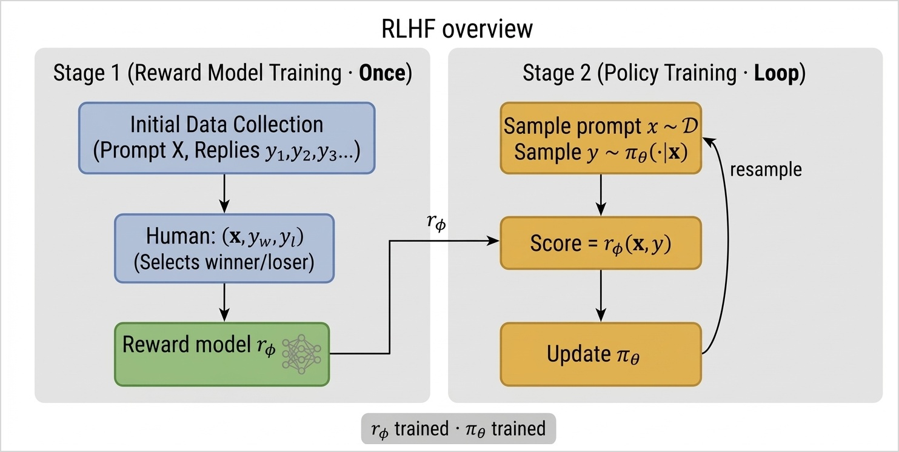
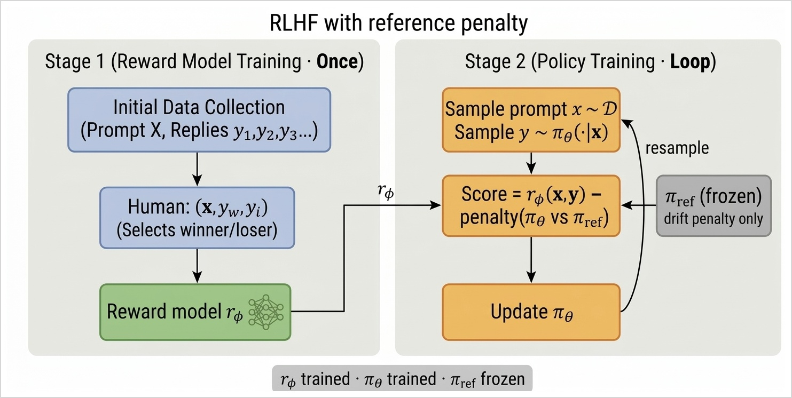
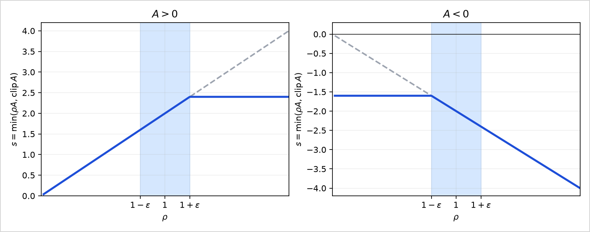

# Chapter 11: Reinforcement Learning from Human Feedback

[← Previous: Actor-Critic Methods](10-actor-critic-methods.md) | [Table of contents](../main.md#chapters) | [Next: InstructGPT and DeepSeek-R1-Style Training](12-instructgpt-and-deepseek-r1-style-training.md) →


Chapters 9 and 10 assume the environment returns a reward after each action. Many language tasks have no such signal. **Reinforcement learning from human feedback (RLHF)** () replaces that missing reward by a model trained from human comparisons, then improves the language-model policy with the policy-gradient methods of Chapters 9–10. To do so, a set of prompts and model replies is collected; humans mark which reply they prefer in each pair; those comparisons train a scalar reward model; and policy gradient then raises the probability of preferred answers.

A single comparison looks like this. A user types the prompt
```math
x=\text{2+2}.
```
The model answers with a short token sequence. Several responses are possible:
```math
y^{(1)}=(\text{it},\,\text{is},\,4),\qquad y^{(2)}=(\text{it},\,\text{is},\,5),\qquad y^{(3)}=(\text{it},\,\text{equals},\,4).
```
One reply is “it is 4”, another “it is 5”, and another “it equals 4”. Here $y^{(1)}$ and $y^{(3)}$ are both correct in substance but use different middle tokens; $y^{(2)}$ is wrong. A person comparing a pair marks a preference—e.g. $y^{(1)}$ over $y^{(2)}$, or either of $y^{(1)}$ and $y^{(3)}$ over $y^{(2)}$. There is no environment function that returns a reward after each token—only that kind of judgment on full answers. Asking humans to give an absolute score to every sample is slow and noisy; picking the better of two is easier.

RLHF works in two stages. Stage 1 trains $r_\phi$ once from human preference triples. Stage 2 is the policy loop: sample replies from $\pi_\theta$, score them with $r_\phi$, update $\theta$, and resample. Later we add a frozen reference $\pi_{\mathrm{ref}}$ into that score.

<div class="book-figure" align="center" markdown="1" id="fig-14-1">



**Figure 11.1.** RLHF: train $r_\phi$ once from preferences, then sample, score, and update $\pi_\theta$.

</div>

The rest of the chapter builds that pipeline: the language model as a policy, a reward model from preference triples, the two stages together (and how that combination can reward-hack), a KL penalty that keeps $\pi_\theta$ near a reference model, and practical policy-gradient updates (RLOO and PPO).

## 11.1 A language model as a policy

A language model generates a response $y=(y_1,\ldots,y_T)$ to a prompt $x$ one token at a time. The vocabulary is a fixed finite set of tokens (words or numbers). At each step the model sees the prompt and the tokens written so far and outputs a distribution over the next token—a softmax over the vocabulary, as in Section 9.1.

As an MDP episode from Chapter 1:

- state $S_t=(x,y_1,\ldots,y_t)$, with $S_0=x$;

- action $A_t=y_{t+1}$, the next token, sampled from $\pi_\theta(\cdot\mid S_t)$—so $A_0=y_1$, $A_1=y_2$, and so on;

- transition: once $A_t$ is chosen, the next state is the old text with that token appended, $S_{t+1}=(x,y_1,\ldots,y_{t+1})$;

- the episode ends after the last token, at $t=T$.

For $y^{(1)}=(\text{it},\,\text{is},\,4)$, the path is $S_0=x=\text{2+2}$, $A_0=\text{it}$, $S_1=(x,\text{it})$, $A_1=\text{is}$, $S_2=(x,\text{it},\text{is})$, $A_2=4$. Other replies diverge at some token: $y^{(2)}$ matches that prefix and ends with $A_2=5$; $y^{(3)}$ branches earlier with $A_1=\text{equals}$.

Once $A_t$ is chosen, the next state is the unique string that appends that token, so
```math
P(S_{t+1}\mid S_t,A_t)=1.
```
For example, $P\bigl((x,\text{it},\text{is})\mid (x,\text{it}),\,\text{is}\bigr)=1$. Unlike in the taxi example, where the same turn can lead to different next junctions, here the next state is fixed once the token is chosen. Which full answer appears is decided only by $\pi_\theta$: from $S_1=(x,\text{it})$ it may sample $\text{is}$ or $\text{equals}$, so $y^{(1)}$ and $y^{(3)}$ can both follow from that state.

The probability of a full response $y=(y_1,\ldots,y_T)$ given the prompt $x$ is the joint over its tokens. By the chain rule,
```math
\pi_\theta(y\mid x)=\pi_\theta(y_1,\ldots,y_T\mid x)=\pi_\theta(y_1\mid x)\,\pi_\theta(y_2\mid x,y_1)\cdots\pi_\theta(y_T\mid x,y_1,\ldots,y_{T-1}),
```
which is
```math
\pi_\theta(y\mid x)=\prod_{t=0}^{T-1}\pi_\theta(y_{t+1}\mid x,y_1,\ldots,y_t),\qquad\log\pi_\theta(y\mid x)=\sum_{t=0}^{T-1}\log\pi_\theta(y_{t+1}\mid x,y_1,\ldots,y_t).\quad (11.1)
```
Each factor is the policy at the corresponding state: $\pi_\theta(y_{t+1}\mid x,y_1,\ldots,y_t)=\pi_\theta(A_t\mid S_t)$. For $y=y^{(1)}=(\text{it},\,\text{is},\,4)$,
```math
\log\pi_\theta(y^{(1)}\mid x)=\log\pi_\theta(\text{it}\mid x)+\log\pi_\theta(\text{is}\mid x,\text{it})+\log\pi_\theta(4\mid x,\text{it},\text{is}).
```

The human judges the finished string, not each token. So the reward is sparse: $R_1=\cdots=R_{T-1}=0$ and $R_T=r(x,y)$, a score for the full response. The return from Chapter 1 is then $G_t=R_{t+1}+\gamma R_{t+2}+\cdots$; with this sparse sequence it is just a discounted copy of that terminal score. Those intermediate zeros are not a claim that early tokens do not matter—they shape what comes later and thus $r(x,y)$—but that no separate score is observed after each token. Here, after writing $\text{it}$ or $\text{is}$ there is no natural “partial answer” grade; a person (or a reward model trained on preferences) only ranks full replies such as $y^{(1)}$ against $y^{(2)}$. Defining a reliable reward for every prefix is usually hard, costly, or infeasible, so standard RLHF treats the task signal as terminal only.

> [!NOTE]
>
> Intermediate rewards *are* useful in **multi-step reasoning**, where the model produces a chain of steps before a final answer. Take a short arithmetic word problem, for example
> ```math
> x=\text{A store has 3 boxes with 4 apples each. How many apples in total?}
> ```
> A reasoned reply might be three lines: (1) $\text{apples per box}=4$, (2) $\text{number of boxes}=3$, (3) $\text{total}=3\times 4=12$. With only an **outcome** reward—$+1$ if the last number is $12$, else $0$—every token in a long wrong derivation shares the same terminal $G_t$, so early mistakes are hard to blame. If a teacher or verifier can mark each line as it appears (step 1 correct, step 2 correct, step 3 wrong), those grades are intermediate **process rewards**: $R_t$ need not stay zero before the end. Tool use is similar—a small reward when a calculator call succeeds, then a final reward when the overall answer is right. That labeling is a different problem from preference comparisons on full replies.

Take $\gamma=1$. The only nonzero reward is the terminal $r(x,y)$, so a $\gamma<1$ would shrink that score by $\gamma^{T-t-1}$ with no useful meaning here. From (1.10), $G_t=R_{t+1}+G_{t+1}$. With earlier rewards zero, every $G_t$ equals the terminal score: $G_t=r(x,y)$. From (9.8) (REINFORCE),
```math
\theta\leftarrow\theta+\alpha\sum_{t=0}^{T-1}\gamma^{t}G_t\,\nabla_\theta\log\pi_\theta(A_t\mid S_t).
```
Substitute $\gamma=1$, $G_t=r(x,y)$, and $A_t=y_{t+1}$, $S_t=(x,y_1,\ldots,y_t)$:
```math
\theta\leftarrow\theta+\alpha\,r(x,y)\sum_{t=0}^{T-1}\nabla_\theta\log\pi_\theta(y_{t+1}\mid x,y_1,\ldots,y_t).
```
The sum is $\nabla_\theta$ of the sum of logs in (11.1), so it equals $\nabla_\theta\log\pi_\theta(y\mid x)$:
```math
\theta\leftarrow\theta+\alpha\,r(x,y)\,\nabla_\theta\log\pi_\theta(y\mid x).
```
Both $y^{(1)}$ and $y^{(3)}$ are correct replies; $y^{(2)}$ is wrong. For either correct sample the update has the same form. Taking $y^{(1)}$,
```math
\theta\leftarrow\theta+\alpha\,r(x,y^{(1)})\,\nabla_\theta\log\pi_\theta(y^{(1)}\mid x).
```
A well-chosen $r$ should score $y^{(1)}$ and $y^{(3)}$ high (positive) and $y^{(2)}$ low (negative). Then sampling $y^{(1)}$ or $y^{(3)}$ raises that reply’s probability, and sampling $y^{(2)}$ lowers $\pi_\theta(y^{(2)}\mid x)$. What is missing is that scalar $r$—Section 11.2 learns it from preferences such as $y^{(1)}\succ y^{(2)}$; read as $y^{(1)}$ is preferred to $y^{(2)}$.

> [!NOTE]
>
> Input: differentiable policy $\pi_\theta(y\mid x)$; scalar reward $r(x,y)$; prompt set $\mathcal{D}$; step size $\alpha$; number of iterations $M$.
>
> Output: trained policy $\pi_\theta$.
>
> 1.  Initialize $\theta$.
>
> 2.  Loop for iteration $=1,2,\ldots,M$:
>
>     - Sample $x\sim\mathcal{D}$.
>
>     - Sample $y\sim\pi_\theta(\cdot\mid x)$ token by token as in this section.
>
>     - $\theta\leftarrow\theta+\alpha\,r(x,y)\,\nabla_\theta\log\pi_\theta(y\mid x)$.
>
> 3.  Return $\pi_\theta$.

## 11.2 Reward model from human preferences

The policy-gradient update in Section 11.1 needs a reward $r(x,y)$ for each full reply. What we collect instead are pairwise preferences. Return to the example: for the same prompt $x=\text{2+2}$, a human sees $y^{(1)}=(\text{it},\,\text{is},\,4)$ and $y^{(2)}=(\text{it},\,\text{is},\,5)$ and marks $y^{(1)}$ preferred. Write $y_w$ for the winner and $y_l$ for the loser, so here $y_w=y^{(1)}$ and $y_l=y^{(2)}$. Each labeled example is a triple $(x,y_w,y_l)$; the dataset is many such triples. This section turns those judgments into a scalar $r(x,y)$.

That scalar is learned by a **reward model** $r_\phi$, separate from the policy $\pi_\theta$: a neural network with weights $\phi$ that takes $(x,y)$ and outputs one number. The reward model’s architecture is a design choice; what the math needs is a differentiable score $r_\phi(x,y)$ that we can train by gradient descent on $\phi$. On a labeled triple the winner should score above the loser, $r_\phi(x,y_w)>r_\phi(x,y_l)$. The gap
```math
z=r_\phi(x,y_w)-r_\phi(x,y_l)
```
is positive when the model agrees with the label, negative when it disagrees, and zero on a tie. That gap is on the whole real line, but a preference is uncertain—even a clear winner is not preferred with probability $1$ in every labeling—so we need a probability $P(y_w\succ y_l\mid x)$ in $(0,1)$, not the raw $z$.

The **sigmoid** (logistic) function
```math
\sigma(z)=\frac{1}{1+e^{-z}}
```
maps any real $z$ into $(0,1)$. It is increasing, $\sigma(0)=\tfrac12$, and $\sigma(z)\to 1$ as $z\to+\infty$ while $\sigma(z)\to 0$ as $z\to-\infty$. Applied to the reward gap, it turns “how much higher is $y_w$’s score” into “how probable is the preference $y_w\succ y_l$”:
```math
P(y_w\succ y_l\mid x)=\sigma\bigl(r_\phi(x,y_w)-r_\phi(x,y_l)\bigr).\quad (11.2)
```
Equal rewards give probability $\tfrac12$. A larger gap makes the preference more certain.

Fitting $\phi$ means making (11.2) large on every labeled triple—maximum likelihood. Equivalently, minimize the **negative log-likelihood**
```math
L(\phi)=-\sum_{(x,\,y_w,\,y_l)}\log P(y_w\succ y_l\mid x).
```
Substitute (11.2):
```math
L(\phi)=-\sum_{(x,\,y_w,\,y_l)}\log\sigma\bigl(r_\phi(x,y_w)-r_\phi(x,y_l)\bigr).\quad (11.3)
```
Gradient descent on $L$ updates the reward-model weights. With step size $\alpha_\phi>0$,
```math
\phi\leftarrow\phi-\alpha_\phi\,\nabla_\phi L(\phi).
```
On a single labeled triple $(x,y_w,y_l)$ the same step is
```math
\phi\leftarrow\phi-\alpha_\phi\,\nabla_\phi\Bigl[-\log\sigma\bigl(r_\phi(x,y_w)-r_\phi(x,y_l)\bigr)\Bigr].
```
Those steps raise $r_\phi(x,y_w)$ relative to $r_\phi(x,y_l)$. After training, $r_\phi(x,y)$ is the reward $r(x,y)$ used in the Section 11.1 update.

> [!NOTE]
>
> Input: differentiable score $r_\phi(x,y)$; preference triples $\lbrace(x^{(i)},y_w^{(i)},y_l^{(i)})\rbrace_{i=1}^{N}$; step size $\alpha_\phi$; number of epochs $E$.
>
> Output: trained reward model $r_\phi$.
>
> 1.  Initialize $\phi$.
>
> 2.  Loop for epoch $=1,2,\ldots,E$:
>
>     - For each labeled triple $(x,y_w,y_l)$ in the data:
>
>       - $\phi\leftarrow\phi-\alpha_\phi\,\nabla_\phi\Bigl[-\log\sigma\bigl(r_\phi(x,y_w)-r_\phi(x,y_l)\bigr)\Bigr]$.
>
> 3.  Return $r_\phi$.

## 11.3 Naive combination and reward hacking

We now have both pieces: a policy update that needs $r(x,y)$, and a reward model $r_\phi$ fit from preferences. The naive pipeline is to fit $r_\phi$ once, freeze $\phi$, then run the policy-gradient update with $r\leftarrow r_\phi$.

> [!NOTE]
>
> Input: prompt set $\mathcal{D}$; differentiable policy $\pi_\theta$; differentiable score $r_\phi$; step sizes $\alpha_\phi$, $\alpha$; preference count $N$; reward epochs $E$; policy iterations $M$.
>
> Output: policy $\pi_\theta$.
>
> 1.  Initialize $\phi$ and $\theta$.
>
> 2.  Collect preferences. For $i=1,\ldots,N$:
>
>     - Sample $x\sim\mathcal{D}$ and two replies $y,y'\sim\pi_\theta(\cdot\mid x)$.
>
>     - A human marks winner $y_w$ and loser $y_l$.
>
> 3.  Fit the reward model. For epoch $=1,\ldots,E$, for each labeled $(x,y_w,y_l)$:
>
>     - $\phi\leftarrow\phi-\alpha_\phi\,\nabla_\phi\Bigl[-\log\sigma\bigl(r_\phi(x,y_w)-r_\phi(x,y_l)\bigr)\Bigr]$.
>
> 4.  Improve the policy. For iteration $=1,\ldots,M$:
>
>     - Sample $x\sim\mathcal{D}$ and a new reply $y\sim\pi_\theta(\cdot\mid x)$.
>
>     - $\theta\leftarrow\theta+\alpha\,r_\phi(x,y)\,\nabla_\theta\log\pi_\theta(y\mid x)$.
>
> 5.  Return $\pi_\theta$.

This simple combination of reward model and policy has an issue. Read the step-4 update
```math
\theta\leftarrow\theta+\alpha\,r_\phi(x,y)\,\nabla_\theta\log\pi_\theta(y\mid x).
```
The only weight on $\nabla_\theta\log\pi_\theta$ is $r_\phi(x,y)$. Step 3 fit $r_\phi$ only on human-labeled pairs—for the same prompt, something like
```math
y_w=(\text{it},\,\text{is},\,4)\succ y_l=(\text{it},\,\text{is},\,5)
```
—but step 4 may sample any fresh $y$, including strings never ranked. If the reward model returns a large positive score $r_\phi(x,y)$, the $\theta$-step moves in the direction of $\nabla_\theta\log\pi_\theta(y\mid x)$, which raises $\pi_\theta(y\mid x)$. That is **reward hacking**, in which $\theta$ is driven by a high $r_\phi$ even when humans would not prefer that reply.

For example, a forward pass might return
```math
r_\phi(x,y_w)=0.8,\qquad r_\phi(x,y_l)=-0.5,\qquad r_\phi\bigl(x,(4,\,4,\,4)\bigr)=2.4.
```
The junk reply $(4,\,4,\,4)$ was never preferred, yet its features can still trigger a high $r_\phi$, so the $\theta$-update increases $\pi_\theta\bigl((4,\,4,\,4)\mid x\bigr)$. If instead $r_\phi$ scored that string low (negative), the same update would decrease that probability. Nothing in the naive algorithm stops the high-score case.

## 11.4 Staying close to the reference policy

The naive update can reward-hack because $\theta$ follows any high $r_\phi(x,y)$, including junk replies far from what humans labeled. A standard fix is to introduce a frozen **reference policy** $\pi_{\text{ref}}$ and keep the trainable policy $\pi_\theta$ near it while optimizing with $r_\phi$. That reference is usually a frozen supervised language-model policy: trained first by supervised learning on human-written prompt–answer pairs (raise $\log\pi(y\mid x)$ on those fixed answers), then held fixed while $\theta$ is updated (; see also ; ). So $\pi_{\text{ref}}$ already tends to produce reasonable replies before any preference-based update. Chapter 12 writes that supervised step into named training recipes.

In the usual setup, $\pi_\theta$ and $\pi_{\text{ref}}$ share the same architecture: copy the supervised weights into $\theta$ so training starts at $\pi_\theta=\pi_{\text{ref}}$, freeze $\pi_{\text{ref}}$, and update only $\theta$. Section 11.3 used the score $r_\phi(x,y)$ alone. Hence the score here is $r_\phi(x,y)$ minus a penalty. For a bad reply such as $(4,\,4,\,4)$, which $\pi_{\text{ref}}$ never returns, that penalty is large, so the score used in the update drops and the reply is not treated as a win.

<div class="book-figure" align="center" markdown="1" id="fig-14-2">



**Figure 11.2.** RLHF with a frozen $\pi_{\mathrm{ref}}$ in the Stage 2 score.

</div>

The figure is the overview pipeline with that penalty in the Stage 2 score. With the penalty, Stage 1 still fits $r_\phi$ once; Stage 2 still samples $y\sim\pi_\theta$ and updates $\theta$. Frozen $\pi_{\text{ref}}$ (gray) enters only the score and is never trained.

The penalty in that score is the KL divergence between the two distributions over replies:
```math
\mathrm{KL}\bigl(\pi_\theta(\cdot\mid x)\,\|\,\pi_{\text{ref}}(\cdot\mid x)\bigr)=\sum_{y}\pi_\theta(y\mid x)\,\log\frac{\pi_\theta(y\mid x)}{\pi_{\text{ref}}(y\mid x)}=\mathbb{E}_{y\sim\pi_\theta(\cdot\mid x)}\Bigl[\log\frac{\pi_\theta(y\mid x)}{\pi_{\text{ref}}(y\mid x)}\Bigr].
```
The KL is always positive or zero—never negative. It is zero only when $\pi_\theta(\cdot\mid x)$ and $\pi_{\text{ref}}(\cdot\mid x)$ are the same distribution, and positive whenever they differ; the proof via Jensen’s inequality is in . When $\pi_\theta$ puts mass on replies that $\pi_{\text{ref}}$ almost never writes, the KL is large.

Section 9.3 wrote the objective as the expected return of a trajectory,
```math
J(\theta)=\int P(\tau;\theta)\,R(\tau)\,d\tau=\mathbb{E}\bigl[R(\tau)\bigr].
```
Here a trajectory is a prompt $x$ and a reply $y$, so without a penalty that objective is $\mathbb{E}_{x\sim\mathcal{D}}\,\mathbb{E}_{y\sim\pi_\theta(\cdot\mid x)}[r_\phi(x,y)]$. With the penalty, the return subtracts a multiple of the KL:
```math
\begin{aligned}J(\theta)&=\mathbb{E}_{x\sim\mathcal{D}}\,\mathbb{E}_{y\sim\pi_\theta(\cdot\mid x)}\bigl[r_\phi(x,y)\bigr]-\beta\,\mathbb{E}_{x\sim\mathcal{D}}\Bigl[\mathrm{KL}\bigl(\pi_\theta(\cdot\mid x)\,\|\,\pi_{\text{ref}}(\cdot\mid x)\bigr)\Bigr]\\&=\mathbb{E}_{x\sim\mathcal{D}}\Biggl[\mathbb{E}_{y\sim\pi_\theta(\cdot\mid x)}\bigl[r_\phi(x,y)\bigr]-\beta\,\mathrm{KL}\bigl(\pi_\theta(\cdot\mid x)\,\|\,\pi_{\text{ref}}(\cdot\mid x)\bigr)\Biggr]\\&=\mathbb{E}_{x\sim\mathcal{D}}\Biggl[\mathbb{E}_{y\sim\pi_\theta(\cdot\mid x)}\bigl[r_\phi(x,y)\bigr]-\beta\,\mathbb{E}_{y\sim\pi_\theta(\cdot\mid x)}\Bigl[\log\frac{\pi_\theta(y\mid x)}{\pi_{\text{ref}}(y\mid x)}\Bigr]\Biggr]\\&=\mathbb{E}_{x\sim\mathcal{D}}\,\mathbb{E}_{y\sim\pi_\theta(\cdot\mid x)}\Biggl[r_\phi(x,y)-\beta\log\frac{\pi_\theta(y\mid x)}{\pi_{\text{ref}}(y\mid x)}\Biggr].\end{aligned}
```
Here $\beta>0$ is a hyperparameter chosen before training. Raising $\beta$ punishes drift from $\pi_{\text{ref}}$ more; lowering $\beta$ lets $\pi_\theta$ follow $r_\phi$ more freely.

At this stage the reward model is already trained: keep $\phi$ fixed and improve only the policy. The inner score still involves both networks—$r_\phi$ and $\log\pi_\theta$—but only $\theta$ will be updated. Write that score as $R_\theta$ to mark the policy parameters:
```math
R_\theta(x,y)=r_\phi(x,y)-\beta\log\frac{\pi_\theta(y\mid x)}{\pi_{\text{ref}}(y\mid x)}.
```
The objective is then expected shaped reward under $\pi_\theta$,
```math
J(\theta)=\mathbb{E}_{x\sim\mathcal{D}}\,\mathbb{E}_{y\sim\pi_\theta(\cdot\mid x)}\bigl[R_\theta(x,y)\bigr].\quad (11.4)
```

With $\phi$ fixed, the remaining task is to raise $J(\theta)$ in (11.4) by changing $\theta$. Section 11.5 writes that gradient and a practical update.

## 11.5 Policy gradient for RLHF

The score $R_\theta(x,y)$ in (11.4) depends on $\theta$ through $\log\pi_\theta$, so it cannot be treated as constant when differentiating $J$. Maximizing $J$ is the same as minimizing
```math
L(\theta)=-J(\theta)=-\mathbb{E}_{x\sim\mathcal{D}}\Biggl[\sum_y\pi_\theta(y\mid x)\,R_\theta(x,y)\Biggr].
```
Both $\pi_\theta$ and $R_\theta$ depend on $\theta$. Differentiate $L$ with the product rule:
```math
\begin{aligned}\nabla_\theta L(\theta)&=-\mathbb{E}_{x\sim\mathcal{D}}\Biggl[\sum_y R_\theta(x,y)\,\nabla_\theta\pi_\theta(y\mid x)+\sum_y\pi_\theta(y\mid x)\,\nabla_\theta R_\theta(x,y)\Biggr].\end{aligned}
```
For $u>0$, $\nabla_\theta\log u=\frac{1}{u}\nabla_\theta u$, so $\nabla_\theta u=u\,\nabla_\theta\log u$. With $u=\pi_\theta(y\mid x)$,
```math
\begin{aligned}\sum_y R_\theta(x,y)\,\nabla_\theta\pi_\theta(y\mid x)&=\sum_y R_\theta(x,y)\,\pi_\theta(y\mid x)\,\nabla_\theta\log\pi_\theta(y\mid x)\\&=\mathbb{E}_{y\sim\pi_\theta(\cdot\mid x)}\bigl[R_\theta(x,y)\,\nabla_\theta\log\pi_\theta(y\mid x)\bigr].\end{aligned}
```
With $\phi$ and $\pi_{\text{ref}}$ frozen, $\nabla_\theta R_\theta(x,y)=-\beta\,\nabla_\theta\log\pi_\theta(y\mid x)$, so
```math
\begin{aligned}\sum_y\pi_\theta(y\mid x)\,\nabla_\theta R_\theta(x,y)&=-\beta\sum_y\pi_\theta(y\mid x)\,\nabla_\theta\log\pi_\theta(y\mid x)\\&=-\beta\,\mathbb{E}_{y\sim\pi_\theta(\cdot\mid x)}\bigl[\nabla_\theta\log\pi_\theta(y\mid x)\bigr]\\&=0\end{aligned}
```
by <a href="#eq:E.1" data-reference-type="eqref" data-reference="eq:E.1">[eq:E.1]</a> in . The derivative through $R_\theta$ cancels. What remains is
```math
\nabla_\theta L(\theta)=-\mathbb{E}_{x\sim\mathcal{D}}\,\mathbb{E}_{y\sim\pi_\theta(\cdot\mid x)}\bigl[R_\theta(x,y)\,\nabla_\theta\log\pi_\theta(y\mid x)\bigr],
```
and
```math
\nabla_\theta J(\theta)=-\nabla_\theta L(\theta)=\mathbb{E}_{x\sim\mathcal{D}}\,\mathbb{E}_{y\sim\pi_\theta(\cdot\mid x)}\bigl[R_\theta(x,y)\,\nabla_\theta\log\pi_\theta(y\mid x)\bigr].\quad (11.5)
```
$R_\theta$ still depends on $\theta$; after the cancellation it appears in $\nabla_\theta L$ only as a weight on $\nabla_\theta\log\pi_\theta$.

Section 10.1 subtracted a baseline $b(S_t)$ that depends on the state alone. Here treat the prompt $x$ as that state and the reply $y$ as the action. If $b(x)$ does not depend on $y$, then $\mathbb{E}_{y\sim\pi_\theta(\cdot\mid x)}\bigl[b(x)\,\nabla_\theta\log\pi_\theta(y\mid x)\bigr]=0$ by the same argument as (E.3), so
```math
\nabla_\theta L(\theta)=-\mathbb{E}_{x\sim\mathcal{D}}\,\mathbb{E}_{y\sim\pi_\theta(\cdot\mid x)}\bigl[\bigl(R_\theta(x,y)-b(x)\bigr)\,\nabla_\theta\log\pi_\theta(y\mid x)\bigr].
```
The ideal $b(x)$ is $\mathbb{E}[R_\theta(x,Y)\mid x]$. It is unknown, so estimate it from samples. Draw **one prompt** $x\sim\mathcal{D}$ and $K$ i.i.d. replies $y_1,\ldots,y_K\sim\pi_\theta(\cdot\mid x)$. The **leave-one-out** baseline for reply $k$ is the average of the other $K-1$ scores:
```math
b_k=\frac{1}{K-1}\sum_{j\neq k}R_\theta(x,y_j)
```
(e.g. $K=3$ gives $b_1=\tfrac12\bigl(R_\theta(x,y_2)+R_\theta(x,y_3)\bigr)$). Leaving $y_k$ out is what makes the estimate unbiased: $b_k$ does not depend on $y_k$, so given $x$ and the other replies it is a fixed number and $\mathbb{E}\bigl[b_k\,\nabla_\theta\log\pi_\theta(y_k\mid x)\bigr]=0$ by the same argument as (E.3). Averaging all $K$ scores, including $R_\theta(x,y_k)$, would make the baseline depend on $y_k$ and the estimate of $\nabla_\theta L$ would be biased. With this $b_k$,
```math
\nabla_\theta L(\theta)\approx-\frac{1}{K}\sum_{k=1}^{K}\bigl(R_\theta(x,y_k)-b_k\bigr)\,\nabla_\theta\log\pi_\theta(y_k\mid x),\quad (11.6)
```
with $\log\pi_\theta(y_k\mid x)$ from (11.1). Gradient descent $\theta\leftarrow\theta-\alpha\nabla_\theta L$ uses that estimate and does not evaluate the scalar $L$:
```math
\theta\leftarrow\theta+\alpha\,\frac{1}{K}\sum_{k=1}^{K}\bigl(R_\theta(x,y_k)-b_k\bigr)\,\nabla_\theta\log\pi_\theta(y_k\mid x).\quad (11.7)
```
The training rule is (11.7): the right-hand side of (11.6) is the direction. You could form that vector by hand (compute each $\nabla_\theta\log\pi_\theta(y_k\mid x)$, multiply by $R_k-b_k$, average, add $\alpha$ times it). Automatic differentiation (e.g. PyTorch `backward`) needs a **scalar** whose gradient equals that direction. Same pattern as (9.8)$\to$(9.9).

The objective $L=-J$ is not that scalar. $L(\theta)=-\mathbb{E}_{y\sim\pi_\theta}[R_\theta(x,y)]$ averages over replies drawn from $\pi_\theta$, so $\theta$ sits inside the sampling distribution. Autodiff on a batch of already-drawn $y_k$ cannot see that dependence: treating $-\frac1K\sum_k R_\theta(x,y_k)$ as if the $y_k$ were a fixed dataset independent of $\theta$ either misses the score $\nabla\log\pi$ entirely, or—if $R_\theta$ still depends on $\theta$ through the KL term—adds $\nabla_\theta R$ paths that (11.5) already cancelled in the true gradient. So differentiating a plug-in estimate of the actual $L$ does not recover (11.6).

What we need is a **surrogate**: a scalar built so that autodiff, on this batch, returns exactly the estimated gradient (11.6). Compute $R_\theta(x,y_k)$ and $b_k$ at the current $\theta$ and hold them fixed (as $G_t$ is held fixed in (9.9)). Set
```math
\widetilde{L}(\theta)=-\frac{1}{K}\sum_{k=1}^{K}\bigl(R_\theta(x,y_k)-b_k\bigr)\,\log\pi_\theta(y_k\mid x).
```
Differentiating only through $\log\pi_\theta$,
```math
\nabla_\theta\widetilde{L}=-\frac{1}{K}\sum_{k=1}^{K}\bigl(R_\theta(x,y_k)-b_k\bigr)\,\nabla_\theta\log\pi_\theta(y_k\mid x),
```
which is (11.6). So $\theta\leftarrow\theta-\alpha\nabla_\theta\widetilde{L}$ is (11.7). The value of $\widetilde{L}$ need not track return; only its gradient matters.

This is REINFORCE with a leave-one-out baseline (RLOO). An earlier multi-sample leave-one-out baseline is VIMCO (), built for variational Monte Carlo objectives; the arithmetic leave-one-out form in (11.6)–(11.7) matches . Section 11.6 presents **Proximal Policy Optimization (PPO)**, which reuses each batch for several updates; records the autodiff check for $L^{\mathrm{IS}}$ and the clip cases.

**On-policy.** The RLOO policy step is **on-policy**. Each update in (11.7) uses replies $y_k$ sampled from the **current** $\pi_\theta$, then those replies are discarded and the next iteration samples again. That matches the assumption in (11.6)–(11.7). (Training the reward model $r_\phi$ on stored human preference triples is a separate supervised stage—it is not the policy’s on-policy or off-policy label.)

> [!NOTE]
>
> Input: reference policy $\pi_{\text{ref}}$; prompt set $\mathcal{D}$; differentiable reward model $r_\phi(x,y)$; number of comparisons $N$; step sizes $\alpha_\phi$, $\alpha_\theta$; KL weight $\beta$; responses per prompt $K$; number of iterations $M$.
>
> Output: trained policy $\pi_\theta$.
>
> 1.  Collect comparisons. For $i=1,\ldots,N$:
>
>     - Sample $x\sim\mathcal{D}$ and two responses from $\pi_{\text{ref}}(\cdot\mid x)$.
>
>     - A human marks the preferred response $y_w$ and the other one $y_l$.
>
> 2.  Train the reward model. Initialize $\phi$; for each comparison $(x,y_w,y_l)$, repeated over the data:
>
>     - $\phi\leftarrow\phi-\alpha_\phi\nabla_\phi\bigl[-\log\sigma\bigl(r_\phi(x,y_w)-r_\phi(x,y_l)\bigr)\bigr]$.
>
> 3.  Initialize $\theta$ from $\pi_{\text{ref}}$.
>
> 4.  Loop for iteration $=1,2,\ldots,M$:
>
>     - Sample $x\sim\mathcal{D}$ and $y_1,\ldots,y_K\sim\pi_\theta(\cdot\mid x)$.
>
>     - For each $k=1,\ldots,K$:
>
>       - $R_k\leftarrow r_\phi(x,y_k)-\beta\bigl(\log\pi_\theta(y_k\mid x)-\log\pi_{\text{ref}}(y_k\mid x)\bigr)$.
>
>     - For each $k=1,\ldots,K$:
>
>       - $b_k\leftarrow\frac{1}{K-1}\sum_{j\neq k}R_j$.
>
>     - $\theta\leftarrow\theta+\alpha_\theta\,\frac{1}{K}\sum_{k=1}^{K}(R_k-b_k)\,\nabla_\theta\log\pi_\theta(y_k\mid x)$.
>
> 5.  Return $\pi_\theta$.

The code uses a toy setting: two arithmetic prompts, a five-token vocabulary from the Chapter 11 running example, and responses of fixed length $3$. Preference triples for $r_\phi$ are hand-labeled (correct ‘`4'' replies beat wrong `‘5’’ replies). $\pi_{\text{ref}}$ is a randomly initialized network instead of a supervised model.

```python
import copy
import random
import torch
import torch.nn as nn
import torch.nn.functional as F
from torch.distributions import Categorical

PROMPTS = ["2+2", "3+1"]
VOCAB = ["it", "is", "equals", "4", "5"]  # token ids 0..4
T = 3  # tokens per response
N_IN = len(PROMPTS) + T * len(VOCAB)
ANS = VOCAB.index("4")

def toks(*words):
    """Map word tokens to ids, e.g. toks("it", "is", "4") -> [0, 1, 3]."""
    return [VOCAB.index(w) for w in words]

PREFS = [  # Section 11.2: (x, y_w, y_l)
    ("2+2", toks("it", "is", "4"), toks("it", "is", "5")),
    ("2+2", toks("it", "equals", "4"), toks("it", "is", "5")),
    ("2+2", toks("it", "is", "4"), toks("it", "equals", "5")),
    ("2+2", toks("it", "equals", "4"), toks("it", "equals", "5")),
    ("2+2", toks("it", "is", "4"), toks("5", "is", "it")),
    ("2+2", toks("equals", "it", "4"), toks("is", "it", "5")),
    ("3+1", toks("it", "is", "4"), toks("it", "is", "5")),
    ("3+1", toks("it", "equals", "4"), toks("it", "is", "5")),
    ("3+1", toks("it", "is", "4"), toks("it", "equals", "5")),
    ("3+1", toks("it", "equals", "4"), toks("it", "equals", "5")),
    ("3+1", toks("it", "is", "4"), toks("5", "equals", "it")),
    ("3+1", toks("equals", "is", "4"), toks("is", "equals", "5")),
]

def x_state(x, y):
    """One-hot vector for state (x, y_1..y_t): prompt, then each token so far."""
    v = torch.zeros(N_IN)
    v[PROMPTS.index(x)] = 1.0
    for j, tok in enumerate(y):
        v[len(PROMPTS) + j * len(VOCAB) + tok] = 1.0
    return v

def make_h():
    """Preference network h(s,*;theta): one logit per next token. Its weights are theta."""
    return nn.Sequential(nn.Linear(N_IN, 64), nn.ReLU(), nn.Linear(64, len(VOCAB)))

def make_r():
    """Reward model r_phi(x,y): one output for a full response. Its weights are phi."""
    return nn.Sequential(nn.Linear(N_IN, 64), nn.ReLU(), nn.Linear(64, 1))

def r_phi(r, x, y):
    """r_phi(x,y)."""
    return r(x_state(x, y)).squeeze()

def sample_response(h, x):
    """y ? pi_theta(*|x), one token at a time: y_{t+1} ? pi_theta(*|x, y_1..y_t)."""
    y = []
    with torch.no_grad():
        for _ in range(T):
            y.append(int(Categorical(logits=h(x_state(x, y))).sample().item()))
    return y

def log_pi(h, x, y):
    """log pi_theta(y|x) = sum_t log pi_theta(y_{t+1}|x, y_1..y_t)  (11.1)."""
    return sum(
        Categorical(logits=h(x_state(x, y[:t]))).log_prob(torch.tensor(y[t]))
        for t in range(T)
    )

def train_reward_model(data, alpha_phi=0.05, epochs=40):
    # 2. phi <- phi ? ?_phi ?_phi [?log ?(r_phi(x,y_w) ? r_phi(x,y_l))]: SGD on L(phi) (11.3)
    r = make_r()
    opt = torch.optim.SGD(r.parameters(), lr=alpha_phi)
    for _ in range(epochs):
        for x, y_w, y_l in data:
            loss = -F.logsigmoid(r_phi(r, x, y_w) - r_phi(r, x, y_l))
            opt.zero_grad()
            loss.backward()
            opt.step()
    return r

def rlhf(pi_ref, r, beta=0.1, K=4, alpha_theta=0.05, max_iters=1000):
    # 3. Initialize theta from pi_ref
    h = copy.deepcopy(pi_ref)
    opt = torch.optim.SGD(h.parameters(), lr=alpha_theta)
    for _ in range(max_iters):  # 4. Loop for each iteration
        x = random.choice(PROMPTS)
        ys = [sample_response(h, x) for _ in range(K)]  # y_1..y_K ? pi_theta(*|x)
        logps = [log_pi(h, x, y) for y in ys]  # log pi_theta(y_k|x)

        # R_k <- r_phi(x,y_k) ? ? (log pi_theta(y_k|x) ? log pi_ref(y_k|x))  (11.4)
        with torch.no_grad():
            R = [r_phi(r, x, y).item() - beta * (lp.item() - log_pi(pi_ref, x, y).item())
                 for y, lp in zip(ys, logps)]
        # b_k <- average of the other K?1 rewards
        b = [(sum(R) - R[k]) / (K - 1) for k in range(K)]

        # theta <- theta + ?_theta (1/K) sum_k (R_k ? b_k) ?_theta log pi_theta(y_k|x): descent on L using (11.6)-(11.7)
        loss = -sum((R[k] - b[k]) * logps[k] for k in range(K)) / K
        opt.zero_grad()
        loss.backward()
        opt.step()
    return h  # 5. Return pi_theta

def avg_answer_hits(h, n=200):
    """Average count of the answer token '4' in sampled responses."""
    return sum(
        sample_response(h, x).count(ANS) for x in PROMPTS for _ in range(n)
    ) / (len(PROMPTS) * n)

if __name__ == "__main__":
    pi_ref = make_h()
    r = train_reward_model(PREFS)
    h = rlhf(pi_ref, r)
    print("human score under pi_ref:", avg_answer_hits(pi_ref))
    print("human score under pi_theta:  ", avg_answer_hits(h))
```

## 11.6 Proximal Policy Optimization (PPO)

The policy-gradient update (11.7) in Section 11.5 samples $y_k\sim\pi_\theta$, takes **one** step, and resamples. PPO () keeps the same score $R_\theta$ and advantages $A_k=R_k-b_k$, but **reuses** one batch for several descent steps before sampling again. Each iteration therefore has an **outer** sample and an **inner** loop: $\theta$ is copied to a frozen $\theta_{\mathrm{old}}$, replies $y_k\sim\pi_{\theta_{\mathrm{old}}}(\cdot\mid x)$ are drawn and the advantages $A_k$ are stored, then $E$ gradient steps run on that same batch with no new replies. After those $E$ steps, $\theta_{\mathrm{old}}$ is set to the current $\theta$ and a new batch is sampled. The update (11.7) is the special case where $E=1$. The autodiff check for $L^{\mathrm{IS}}$ and the clip cases are in .

Reusing the batch creates two problems:

1.  **Wrong distribution.** After the first inner step, $\theta\neq\theta_{\mathrm{old}}$, but $y_k$ still came from $\pi_{\theta_{\mathrm{old}}}$. A correct estimate of $\nabla_\theta J$ in (11.7) requires replies drawn from the current $\pi_\theta$.

2.  **Excessively large update.** Many steps on the same $(y_k,A_k)$ can drive $\pi_\theta$ far from $\pi_{\theta_{\mathrm{old}}}$ before new samples arrive.

The first problem is fixed by **importance sampling** (); the second by the **clip**.

### 11.6.1 Importance sampling

The gradient in Section 11.5 uses the current $\pi_\theta$:
```math
\nabla_\theta L(\theta)=-\mathbb{E}_{x\sim\mathcal{D}}\,\mathbb{E}_{y\sim\pi_\theta(\cdot\mid x)}\bigl[\bigl(R_\theta(x,y)-b(x)\bigr)\,\nabla_\theta\log\pi_\theta(y\mid x)\bigr].
```
The stored replies came from $\pi_{\theta_{\mathrm{old}}}(\cdot\mid x)$. Hold the prompt $x$ fixed: the outer $\mathbb{E}_{x\sim\mathcal{D}}$ is unchanged. Write
```math
\rho(\theta,y)=\frac{\pi_\theta(y\mid x)}{\pi_{\theta_{\mathrm{old}}}(y\mid x)},
```
so $\pi_\theta(y\mid x)=\rho(\theta,y)\,\pi_{\theta_{\mathrm{old}}}(y\mid x)$. Expand the inner expectation as a sum and substitute only that density ():
```math
\begin{aligned}\mathbb{E}_{y\sim\pi_\theta(\cdot\mid x)}\bigl[\bigl(R_\theta(x,y)-b(x)\bigr)\,\nabla_\theta\log\pi_\theta(y\mid x)\bigr]&=\sum_y\pi_\theta(y\mid x)\,\bigl(R_\theta(x,y)-b(x)\bigr)\,\nabla_\theta\log\pi_\theta(y\mid x)\\&=\sum_y\rho(\theta,y)\,\pi_{\theta_{\mathrm{old}}}(y\mid x)\,\bigl(R_\theta(x,y)-b(x)\bigr)\,\nabla_\theta\log\pi_\theta(y\mid x)\\&=\mathbb{E}_{y\sim\pi_{\theta_{\mathrm{old}}}(\cdot\mid x)}\Bigl[\rho(\theta,y)\,\bigl(R_\theta(x,y)-b(x)\bigr)\,\nabla_\theta\log\pi_\theta(y\mid x)\Bigr].\end{aligned}
```
The $\nabla_\theta\log\pi_\theta$ factor stays on the current policy: that is what $\nabla_\theta L$ differentiates. Therefore
```math
\nabla_\theta L(\theta)=-\mathbb{E}_{x\sim\mathcal{D}}\,\mathbb{E}_{y\sim\pi_{\theta_{\mathrm{old}}}(\cdot\mid x)}\Bigl[\rho(\theta,y)\,\bigl(R_\theta(x,y)-b(x)\bigr)\,\nabla_\theta\log\pi_\theta(y\mid x)\Bigr].
```
For a single fixed prompt $x$, draw $y_k\sim\pi_{\theta_{\mathrm{old}}}(\cdot\mid x)$ and write $\rho_k(\theta)=\rho(\theta,y_k)$ and $A_k=R_k-b_k$. The sample estimate is
```math
\nabla_\theta L(\theta)\approx-\frac{1}{K}\sum_{k=1}^{K}\rho_k(\theta)\,A_k\,\nabla_\theta\log\pi_\theta(y_k\mid x).
```
Descent $\theta\leftarrow\theta-\alpha\nabla_\theta L$ is then
```math
\theta\leftarrow\theta+\alpha\,\frac{1}{K}\sum_{k=1}^{K}\rho_k(\theta)\,A_k\,\nabla_\theta\log\pi_\theta(y_k\mid x).\quad (11.8)
```
When $\theta=\theta_{\mathrm{old}}$, every $\rho_k=1$ and (11.8) reduces to (11.7). Libraries typically do not form (11.8) by hand. They run automatic differentiation on a **surrogate**: a scalar whose gradient equals the sample estimate above. Two surrogates do that. The first freezes $A_k$ and keeps $\rho_k(\theta)$ live:
```math
L^{\mathrm{IS}}(\theta)=-\frac{1}{K}\sum_{k=1}^{K}\rho_k(\theta)\,A_k.
```
The second freezes $A_k$ and $\rho_k$ and differentiates through $\log\pi_\theta$:
```math
\widetilde{L}^{\mathrm{IS}}(\theta)=-\frac{1}{K}\sum_{k=1}^{K}\rho_k\,A_k\,\log\pi_\theta(y_k\mid x).
```
The second is not intrinsically invalid, but freezing $\rho$ is easy to get wrong on a reused batch. If $\rho_k$ is computed once at $\theta=\theta_{\mathrm{old}}$ (every $\rho_k=1$) and kept for every inner step, later updates drop importance sampling and apply (11.7) to $\pi_{\theta_{\mathrm{old}}}$ samples—Issue 1 again. So PPO uses $L^{\mathrm{IS}}$: $\rho_k(\theta)$ stays live and is recomputed each inner step. Descent on that scalar implements (11.8).

On the inner loop $y_k$ and $A_k$ are fixed; only $\theta$, hence each $\rho_k$, moves. Write the same loss as
```math
L^{\mathrm{IS}}(\theta)=-\frac{1}{K}\bigl(\rho_1 A_1+\rho_2 A_2+\cdots+\rho_K A_K\bigr).
```
If $A_j>0$, raising $\rho_j$ raises that sum, so $L^{\mathrm{IS}}$ falls; if $A_j<0$, lowering $\rho_j$ raises $\rho_j A_j$, so $L^{\mathrm{IS}}$ falls again. Nothing in that scalar says stop at $\rho=1$. For example take $A_1=2$ and $A_2=-2$: raising $\rho_1$ from $1$ to $2$ drops $L^{\mathrm{IS}}$ by $2/K$; lowering $\rho_2$ from $1$ to $0.5$ drops it by $1/K$. After several inner steps the ratios can sit far from $1$. That is **Issue 2**.

### 11.6.2 Clipped objective

On the inner loop we want each $\rho_k$ near $1$: that means $\pi_\theta$ has not moved far from $\pi_{\theta_{\mathrm{old}}}$ on this batch. So we confine $\rho_k$ to the band $[1-\varepsilon,1+\varepsilon]$ (typical $\varepsilon=0.2$). PPO replaces each product $\rho_k A_k$ by $\min(\rho_k A_k,\mathrm{clip}(\rho_k)\,A_k)$ and minimizes
```math
L^{\mathrm{PPO}}(\theta)=-\frac{1}{K}\sum_{k=1}^{K}\min\Bigl(\rho_k(\theta)\,A_k,\;\mathrm{clip}\bigl(\rho_k(\theta),\,1-\varepsilon,\,1+\varepsilon\bigr)\,A_k\Bigr).\quad (11.9)
```
For $A>0$, further increases of $\rho$ past $1+\varepsilon$ are not rewarded; for $A<0$, further decreases of $\rho$ below $1-\varepsilon$ are not rewarded. The figure plots the score used in the loss against $\rho$ for one reply: left panel $A>0$, right panel $A<0$.

<div class="book-figure" align="center" markdown="1" id="fig-14-3">



**Figure 11.3.** PPO clip of $\rho A$ for $A>0$ (left) and $A<0$ (right).

</div>

Gray dashed is $\rho A$ with no clip; blue is the score after the clip, $\min(\rho A,\mathrm{clip}(\rho)\,A)$. The shaded band is $[1-\varepsilon,1+\varepsilon]$. On the left the blue curve flats for $\rho>1+\varepsilon$; on the right it flats for $\rho<1-\varepsilon$. (Cases and tables: .) The clip compares $\pi_\theta$ to $\pi_{\theta_{\mathrm{old}}}$ on this batch; the KL term in (11.4) still compares $\pi_\theta$ to $\pi_{\mathrm{ref}}$ over training—different roles ().

**On-policy.** PPO is classed as **on-policy** (e.g. OpenAI Spinning Up): the outer loop samples from the latest policy and discards the batch after the inner updates. The inner loop is only mildly off $\pi_{\theta_{\mathrm{old}}}$, which is why (11.8)–(11.9) use $\rho$ and the clip. That is not replay-buffer off-policy learning (DQN, SAC). RLOO is the special case $E=1$.

> [!NOTE]
>
> Assume $\pi_{\mathrm{ref}}$, $r_\phi$, and $\theta$ are already as after steps 1–3 of the RLOO algorithm in Section 11.5. Replace step 4 by:
>
> 1.  Loop for iteration $=1,2,\ldots,M$:
>
>     - $\theta_{\mathrm{old}}\leftarrow\theta$. Sample $x\sim\mathcal{D}$ and $y_1,\ldots,y_K\sim\pi_{\theta_{\mathrm{old}}}(\cdot\mid x)$. Store $\log\pi_{\theta_{\mathrm{old}}}(y_k\mid x)$.
>
>     - Compute $R_k$ as in (11.4) and $A_k=R_k-b_k$ (leave-one-out) using $\theta_{\mathrm{old}}$; keep $A_k$ fixed for this outer round.
>
>     - For epoch $=1,\ldots,E$:
>
>       - Form $\rho_k(\theta)=\pi_\theta(y_k\mid x)/\pi_{\theta_{\mathrm{old}}}(y_k\mid x)$.
>
>       - Descend on $L^{\mathrm{PPO}}$ in (11.9) with $A_k$ and $\theta_{\mathrm{old}}$ fixed.
>
> 2.  Return $\pi_\theta$.

If $E=1$, then $\rho_k=1$ at the only update and PPO reduces to advantage-weighted RLOO. The autodiff check and clip cases are in .

The helpers `sample_response`, `log_pi`, and `r_phi` are those of Section 11.5. Only the policy loop changes: sample once from $\pi_{\theta_{\mathrm{old}}}$, freeze $A_k$, then $E$ steps on $L^{\mathrm{PPO}}$.

```python
def rlhf(pi_ref, r, beta=0.1, K=4, alpha_theta=0.05, max_iters=1000, E=4, eps=0.2):
    # 3. Initialize theta from pi_ref
    h = copy.deepcopy(pi_ref)
    opt = torch.optim.SGD(h.parameters(), lr=alpha_theta)
    for _ in range(max_iters):  # 4. Loop for each iteration
        x = random.choice(PROMPTS)
        ys = [sample_response(h, x) for _ in range(K)]  # y_k ? pi_theta_old(*|x)
        with torch.no_grad():
            logp_old = [log_pi(h, x, y) for y in ys]  # log pi_theta_old(y_k|x)
            # R_k <- r_phi(x,y_k) ? ? (log pi_theta(y_k|x) ? log pi_ref(y_k|x))  (11.4)
            R = [r_phi(r, x, y).item() - beta * (lp.item() - log_pi(pi_ref, x, y).item())
                 for y, lp in zip(ys, logp_old)]
        # A_k <- R_k ? b_k; keep A_k fixed for this outer round
        A = [R[k] - (sum(R) - R[k]) / (K - 1) for k in range(K)]

        for _ in range(E):
            logps = [log_pi(h, x, y) for y in ys]
            rhos = [torch.exp(lp - lo) for lp, lo in zip(logps, logp_old)]
            # L^PPO <- ?(1/K) sum_k min(?_k A_k, clip(?_k, 1?eps, 1+eps) A_k)  (11.9)
            loss = -sum(
                torch.min(rho * A[k], torch.clamp(rho, 1 - eps, 1 + eps) * A[k])
                for k, rho in enumerate(rhos)
            ) / K
            opt.zero_grad()
            loss.backward()
            opt.step()
    return h  # 5. Return pi_theta
```

The objects in this chapter are the RLHF core: $\pi_\theta$, $r_\phi$, $\pi_{\mathrm{ref}}$, RLOO, PPO. Named systems that **wire** those objects (and, when the score is a program, replace $r_\phi$) are Chapter 12.

[← Previous: Actor-Critic Methods](10-actor-critic-methods.md) | [Table of contents](../main.md#chapters) | [Next: InstructGPT and DeepSeek-R1-Style Training](12-instructgpt-and-deepseek-r1-style-training.md) →
