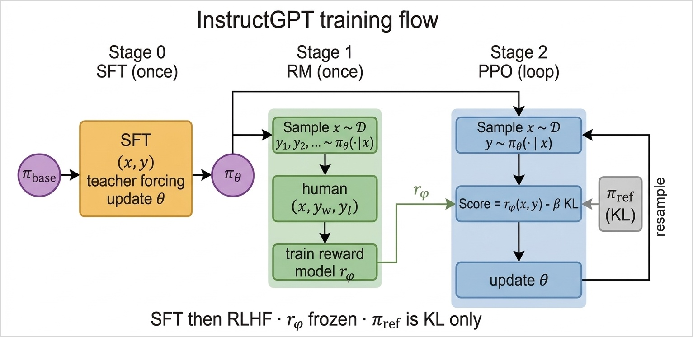
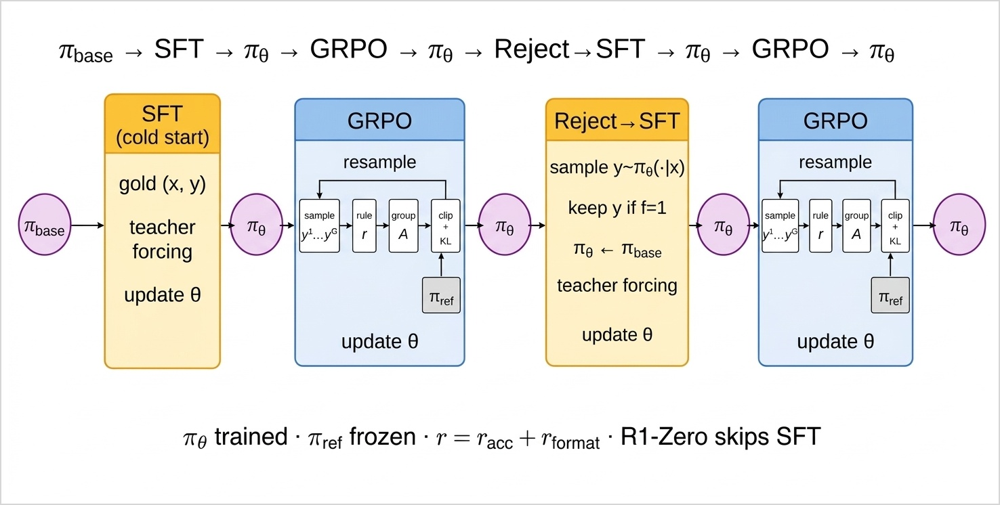
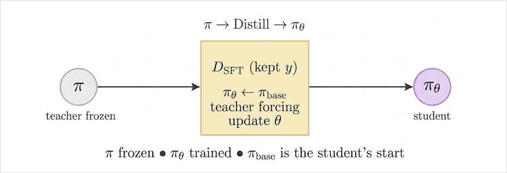

# Chapter 12: InstructGPT and DeepSeek-R1-Style Training

[← Previous: Reinforcement Learning from Human Feedback](11-reinforcement-learning-from-human-feedback.md) | [Table of contents](../main.md#chapters) | [Next: Summary](13-summary.md) →


Chapter 11 built RLHF from a language-model policy $\pi_\theta$, a reward model $r_\phi$, a frozen reference $\pi_{\mathrm{ref}}$, and the updates RLOO and PPO. The policy loop in that chapter samples a reply $y$ from $\pi_\theta$, scores it with $r_\phi$, and steps $\theta$. That loop already assumes a starting $\pi_\theta$ and a frozen $\pi_{\mathrm{ref}}$: both are a copy of a supervised checkpoint, trained on fixed demo pairs before any preference data are used. Chapter 11 did not derive that supervised step.

This chapter does. It derives **supervised fine-tuning (SFT)** — the procedure that produces that checkpoint — and, when the answer *is* checkable, replaces $r_\phi$ by a fixed **program**. Those pieces are then used in InstructGPT and in DeepSeek-R1-style training. Neither is a new kind of policy gradient.

**InstructGPT** () uses SFT on human-written demo pairs $(x,y)$. From a pretrained checkpoint it raises the probability of those replies. The resulting weights initialize $\pi_\theta$ and are frozen as $\pi_{\mathrm{ref}}$. Preference comparisons then train $r_\phi$, and the policy loop of Chapter 11 improves $\pi_\theta$.

When a program can score $y$, the same policy-gradient loop no longer needs a reward model $r_\phi$. published two systems of that kind. **DeepSeek-R1-Zero** applies **group relative policy optimization (GRPO)** to the base model with a rule verifier and no SFT. **DeepSeek-R1** begins with a small cold-start SFT, applies GRPO, clones only traces that pass a hard filter, applies GRPO a second time, then SFT smaller dense models on those kept traces. For one prompt, GRPO samples a **group** of replies, turns those group scores into advantages, and clips the importance ratio as PPO does. Each reply in those GRPO stages is scored by a **verifier**: a fixed program that checks the final answer and the format, not a reward model $r_\phi$.

We are not training those published systems (InstructGPT and DeepSeek-R1) in this chapter — not their base models, data, or infrastructure. The rest of this chapter derives SFT, the program score, GRPO, and rejection sampling, and uses a pipeline of the same shape on the Chapter 11 toy. That toy already has checkable answers, so a program can score $y$. Section 12.1 is SFT, used by both. Section 12.2 is InstructGPT (that SFT plus Chapter 11’s RLHF). Section 12.3 is the DeepSeek-R1-style group: rule reward, GRPO, and reject then SFT.

## 12.1 Supervised fine-tuning

SFT starts from a pretrained checkpoint $\pi_{\mathrm{base}}$ and a dataset of **fixed** prompt–reply pairs
```math
\mathcal{D}_{\mathrm{SFT}}=\bigl\lbrace(x^{(n)}, y^{(n)})\bigr\rbrace_{n=1}^{N}.
```
The replies are written (or already accepted) strings — human demos in InstructGPT, long chain-of-thought traces in a DeepSeek-R1-style cold start. The goal is to raise the probability of those strings: maximize $\pi_\theta(y\mid x)$ on $\mathcal{D}_{\mathrm{SFT}}$. There is no sampler and no reward.

On one training pair $(x,y)$ with $y=(y_1,\ldots,y_T)$,
```math
\log\pi_\theta(y\mid x)=\sum_{t=0}^{T-1}\log\pi_\theta(y_{t+1}\mid x, y_1,\ldots,y_t).
```
The statistical target is the **total** log-likelihood of the dataset
```math
J_{\mathrm{SFT}}(\theta)=\sum_{n=1}^{N}\log\pi_\theta\bigl(y^{(n)}\mid x^{(n)}\bigr).\quad (12.1)
```
```math
L_{\mathrm{SFT}}(\theta)=-\frac1N J_{\mathrm{SFT}}(\theta).\quad (12.2)
```

In ordinary autoregressive generation the prefix $y_1,\ldots,y_t$ is sampled from the model’s previous outputs: $y_1\sim\pi_\theta(\cdot\mid x)$, then $y_2\sim\pi_\theta(\cdot\mid x,y_1)$, and so on.

**Teacher forcing** does not use those samples. For the SFT loss, each term $\log\pi_\theta(y_{t+1}\mid x, y_1,\ldots,y_t)$ uses the **gold** prefix $y_1,\ldots,y_t$ from $\mathcal{D}_{\mathrm{SFT}}$, and the target is gold $y_{t+1}$. If the gold sentence is “The cat sat” and the model predicts `dog` instead of `cat`, training still feeds gold **`cat`** as the next input and applies a loss against gold `sat`. At inference, `dog` would be fed and the rest of the string would drift. Teacher forcing is that training setup — not a second teacher network.

Differentiating (12.2) gives
```math
\nabla_\theta L_{\mathrm{SFT}}(\theta)=-\frac1N\sum_{n=1}^{N}\sum_{t=0}^{T_n-1}\nabla_\theta\log\pi_\theta\bigl(y^{(n)}_{t+1}\mid x^{(n)}, y^{(n)}_1,\ldots,y^{(n)}_t\bigr).\quad (12.3)
```
Gradient descent with step size $\alpha>0$ is
```math
\theta\leftarrow\theta-\alpha\,\nabla_\theta L_{\mathrm{SFT}}(\theta).\quad (12.4)
```
In practice: a mini-batch forward, $L_{\mathrm{SFT}}$, `backward`, optimizer step.

After enough steps, $\pi_\theta(y\mid x)$ is larger than it was under $\pi_{\mathrm{base}}$ on the demos. That is **behavioral cloning** of fixed strings. SFT does not sample its own replies, does not call a verifier, and does not optimize “any correct trace” — only the traces in $\mathcal{D}_{\mathrm{SFT}}$. The model is also biased toward gold prefixes; at use time the prefix is its **own** tokens (exposure bias). Sampling scored by a reward is what closes that gap (Sections 11.5–11.6 and 12.3.2).

> [!NOTE]
>
> **Input:** pretrained $\pi_{\mathrm{base}}$; $\mathcal{D}_{\mathrm{SFT}}=\lbrace(x^{(n)},y^{(n)})\rbrace$; step size $\alpha$; epochs $E$. **Output:** fine-tuned $\pi_\theta$.
>
> 1.  Set $\theta\leftarrow\theta_{\mathrm{base}}$.
>
> 2.  For epoch $=1,\ldots,E$, for each mini-batch $B\subset\mathcal{D}_{\mathrm{SFT}}$:
>
>     - Form $L_{\mathrm{SFT}}$ on $B$.
>
>     - $\theta\leftarrow\theta-\alpha\nabla_\theta L_{\mathrm{SFT}}$.
>
> 3.  Return $\pi_\theta$.

We use `log_pi` and `make_h` from Section 11.5. On a gold pair, `log_pi(h, x, y)` **is** teacher forcing: each term conditions on the gold prefix $y_{:t}$.

```python
def sft(pi_base, demos, alpha=0.05, epochs=20):
    # 1. theta <- theta_base
    h = copy.deepcopy(pi_base)
    opt = torch.optim.SGD(h.parameters(), lr=alpha)
    for _ in range(epochs):
        for x, y in demos:  # gold (x, y) ? D_SFT
            loss = -log_pi(h, x, y)  # L_SFT on one pair (12.2)
            opt.zero_grad()
            loss.backward()
            opt.step()  # (12.4)
    return h
```

## 12.2 InstructGPT: SFT then RLHF

**InstructGPT** () begins with SFT on human demo pairs, as in Section 12.1. The resulting checkpoint initializes $\pi_\theta$ and is frozen as $\pi_{\mathrm{ref}}$, which is the reference already used in Section 11.4. Chapter 11’s reward model and policy loop follow.

**Stage 0 (SFT, once).** Humans write demo pairs $(x,y)$. Run the SFT algorithm from $\pi_{\mathrm{base}}$. The resulting checkpoint is $\pi_\theta$. A frozen copy is $\pi_{\mathrm{ref}}$.

**Stage 1 (reward model, once).** After SFT, a **prompt set** $\mathcal{D}$ is used: queries $x$ only, no gold replies. For each prompt, several replies are sampled from the SFT policy. A human marks a preferred reply $y_w$ and a rejected reply $y_l$. Those triples train $r_\phi$ as in (11.3); then $\phi$ is frozen.

**Stage 2 (policy loop).** The same prompt set is used again. A prompt $x$ is drawn from $\mathcal{D}$, a reply $y$ is sampled from the **current** $\pi_\theta$, and the score is $R=r_\phi(x,y)-\beta\,\mathrm{KL}$ as in (11.4). PPO clips and updates $\theta$ as in Section 11.6, then a new batch is sampled. $\pi_{\mathrm{ref}}$ never samples.

<div class="book-figure" align="center" markdown="1" id="fig-15-1">



**Figure 12.1.** InstructGPT: SFT, reward model, then PPO.

</div>

That is the same math as Chapter 11. SFT is (12.1)–(12.4); it produces the frozen $\pi_{\mathrm{ref}}$.

## 12.3 DeepSeek-R1-style training

Section 12.2 needs humans (or $r_\phi$ trained from humans) because a chat reply has no gold answer to check. When $y$ *is* checkable, a program scores the reply. **DeepSeek-R1-Zero** is GRPO from $\pi_{\mathrm{base}}$ with no SFT. **DeepSeek-R1** (and the toy here) uses SFT (Section 12.1) as a cold start, then the chain below:

<div class="book-figure" align="center" markdown="1" id="fig-15-2">



**Figure 12.2.** DeepSeek-R1-style training: SFT, GRPO, reject then SFT, GRPO.

</div>

GRPO is derived in Section 12.3.2; reject-then-SFT in Section 12.3.3. The second GRPO freezes a **new** $\pi_{\mathrm{ref}}$ at the start of that stage. Distillation is not a box on that chain: it runs SFT on a smaller student. DeepSeek-R1 uses the kept traces from Reject→SFT for that SFT.

### 12.3.1 Rule-based reward

Math, code with unit tests, and short-answer STEM have a key: a gold number, a test suite, or a short target string. A fixed **verifier**, usually a program that implements rules instead of a reward model $r_\phi$, scores each reply. That reward is an **accuracy** term plus a **format** term:
```math
r(x,y)=r_{\mathrm{acc}}(x,y)+r_{\mathrm{format}}(y).\quad (12.5)
```
No $\phi$ is trained, and humans do not label each sampled $y$. Each prompt $x$ in $\mathcal{D}$ is stored with a **key** the policy does not see — a gold answer or unit tests — and the verifier uses that key to score $y$. The two terms in (12.5) are $0$–$1$ checkers:

- $r_{\mathrm{format}}(y)\in\lbrace0,1\rbrace$: $1$ if the reply has the required format (for example `<think>…</think>` tags).

- $r_{\mathrm{acc}}(x,y)\in\lbrace0,1\rbrace$: $1$ if the extracted answer matches the key. Math: take only a specified slot such as `\{}boxed{…}` and match gold (numbers as numbers; expressions with a computer-algebra check). Code: run tests. If that slot is missing, $r_{\mathrm{acc}}=0$ even when the digits appear in prose. The chain of thought is not scored.

Adding them gives $r\in\lbrace0,1,2\rbrace$. For example, take $x=$ `2+2` with gold $4$. A tagged reply with `\{}boxed{4}` scores $r=2$; tagged with `\{}boxed{5}` scores $r=1$; untagged `the answer is 4` scores $r=0$ if $r_{\mathrm{acc}}$ looks only in the boxed slot.

Those scores are a design choice. If $r_{\mathrm{acc}}$ also accepts the number in prose, the same untagged reply `the answer is 4` scores $r=1$.

The RL **loop** is the same shape as Chapter 11 Stage 2: sample $y$ from $\pi_\theta$, score, update $\theta$, resample, KL to a frozen $\pi_{\mathrm{ref}}$. The score is now (12.5) instead of $r_\phi$, and the advantage is formed as in Section 12.3.2. Leave $r_\phi$ out of (12.5): this stage is scored by the program only.

### 12.3.2 GRPO

**GRPO** (Group Relative Policy Optimization) was introduced in DeepSeekMath (): for one prompt, sample a **group** of replies, turn those group scores into advantages, and apply a PPO-style clip. DeepSeek-R1-Zero then used that update with a **rule** reward from the base model (no SFT). DeepSeek-R1 uses the same update after a cold-start SFT, and again after reject-then-SFT ().

We do not implement those papers’ models or training stack. We follow a similar update on the Chapter 11 toy. The toy already has a gold key, so a program can score $y$ and we skip $r_\phi$ (Section 12.3.1). Section 11.6 already forms $A_k$ from **other replies to the same** $x$ (leave-one-out). GRPO is that idea with a group mean and std.

Fix one prompt $x\in\mathcal{D}$ with a key. Copy $\theta_{\mathrm{old}}\leftarrow\theta$. **Sample** a group of $G$ replies, i.i.d. given that same $x$:
```math
y^{(1)},\ldots,y^{(G)}\sim\pi_{\theta_{\mathrm{old}}}(\cdot\mid x),\qquad y^{(i)}=\bigl(y^{(i)}_1,\ldots,y^{(i)}_{T_i}\bigr).
```
The sampling condition is only $x$: reply $i$ does not see the other replies. As in (11.1), each $y^{(i)}$ is generated with
```math
\pi_{\theta_{\mathrm{old}}}\bigl(y^{(i)}\mid x\bigr)=\prod_{t=0}^{T_i-1}\pi_{\theta_{\mathrm{old}}}\bigl(y^{(i)}_{t+1}\mid x,y^{(i)}_1,\ldots,y^{(i)}_t\bigr).
```

Score each finished reply with (12.5): $r_i=r_{\mathrm{acc}}\bigl(x,y^{(i)}\bigr)+r_{\mathrm{format}}\bigl(y^{(i)}\bigr)$.

**Group advantage.** Baseline is this group’s own mean, then scale by the group’s std so $A$ is order-1 when $r$ is $0/1/2$:
```math
A_i=\frac{r_i-\mathrm{mean}(r)}{\mathrm{std}(r)+\delta}.\quad (12.6)
```
$\delta>0$ is a small constant added so we never divide by zero (typical $10^{-8}$). If every $r_i$ is equal, then $\mathrm{mean}(r)=r_i$ as well, so the numerator is $0$ and $\mathrm{std}(r)=0$. Without $\delta$ that is $0/0$ (undefined), not a blow-up. With $\delta$ you get $A_i=0/\delta=0$ — no update (the group has nothing to prefer). There is no “nonzero numerator over zero std” case: $\mathrm{std}(r)=0$ if and only if every $r_i$ is the same, which forces the numerator to $0$ too. Section 11.6 uses $A_k=R_k-b_k$ with leave-one-out $b_k$. Here the baseline is the group’s mean of the $G$ rule scores; the std only rescales.

> [!NOTE]
>
> **Toy** ($G=4$, $x=$ `2+2`). Say $r=(2,1,0,1)$. Then $\mathrm{mean}=1$, $\mathrm{std}=\sqrt{1/2}$, so $A\approx(1.41,\;0,\;-1.41,\;0)$. The $r=2$ reply is pushed up; the $r=0$ reply is pushed down; the two $r=1$ replies sit at $0$.

The importance ratio remains the same as in (11.8):
```math
\rho_i(\theta)=\frac{\pi_\theta\bigl(y^{(i)}\mid x\bigr)}{\pi_{\theta_{\mathrm{old}}}\bigl(y^{(i)}\mid x\bigr)}.
```
Freeze $A_i$ and minimize the same clip scalar as (11.9),
```math
L_{\mathrm{clip}}(\theta)=-\frac1G\sum_{i=1}^{G}\min\bigl(\rho_i(\theta)\,A_i,\;\mathrm{clip}(\rho_i(\theta),1-\varepsilon,1+\varepsilon)\,A_i\bigr).
```
**KL.** In (11.4) the score $R_\theta$ is $r_\phi-\beta\log(\pi_\theta/\pi_{\mathrm{ref}})$, so the log-ratio goes into $A_k$. Here $r_i$ is only (12.5). Subtracting the KL from $r_i$ would send it through the group mean and std in (12.6), so $A_i$ would mix the rule score with drift from $\pi_{\mathrm{ref}}$. Therefore the KL is added to the loss instead:
```math
L_{\mathrm{GRPO}}(\theta)=L_{\mathrm{clip}}(\theta)+\beta\,\mathrm{KL}\bigl(\pi_\theta(\cdot\mid x)\,\|\,\pi_{\mathrm{ref}}(\cdot\mid x)\bigr).\quad (12.7)
```
The KL is estimated by averaging over the $G$ sampled replies:
```math
\frac1G\sum_{i=1}^{G}\log\frac{\pi_\theta\bigl(y^{(i)}\mid x\bigr)}{\pi_{\mathrm{ref}}\bigl(y^{(i)}\mid x\bigr)}\approx\mathrm{KL}\bigl(\pi_\theta(\cdot\mid x)\,\|\,\pi_{\mathrm{ref}}(\cdot\mid x)\bigr).
```
$\pi_{\mathrm{ref}}$ is a freeze of $\pi_\theta$ **at the start of this RL stage**. It only enters (12.7). It never samples.

$A_i$ and $\theta_{\mathrm{old}}$ stay frozen on the inner loop of $E$ gradient-descent steps on (12.7). If $E=1$, there is only one step, so $\rho=1$ and the clip does not act. If $E>1$, several steps on the same batch can drive $\pi_\theta$ far from $\pi_{\theta_{\mathrm{old}}}$; the clip in Section 11.6.2 stops that (Issue 2).

> [!NOTE]
>
> **Input:** policy $\pi_\theta$; prompt set $\mathcal{D}$ with keys; rule $r(x,y)=r_{\mathrm{acc}}(x,y)+r_{\mathrm{format}}(y)$; group size $G$; inner steps $E$; clip $\varepsilon$; KL weight $\beta$; step size $\alpha$; $\delta>0$. **Output:** updated $\pi_\theta$. Frozen $\pi_{\mathrm{ref}}$.
>
> 1.  $\pi_{\mathrm{ref}}\leftarrow\pi_\theta$ (freeze).
>
> 2.  Repeat:
>
>     - Sample $x\in\mathcal{D}$. Set $\theta_{\mathrm{old}}\leftarrow\theta$.
>
>     - Sample $y^{(1)},\ldots,y^{(G)}\sim\pi_{\theta_{\mathrm{old}}}(\cdot\mid x)$.
>
>     - For each $i=1,\ldots,G$:
>
>       - $r_i\leftarrow r_{\mathrm{acc}}\bigl(x,y^{(i)}\bigr)+r_{\mathrm{format}}\bigl(y^{(i)}\bigr)$.
>
>     - For each $i=1,\ldots,G$:
>
>       - $A_i\leftarrow\bigl(r_i-\mathrm{mean}(r)\bigr)/\bigl(\mathrm{std}(r)+\delta\bigr)$.
>
>       - Store $\log\pi_{\theta_{\mathrm{old}}}\bigl(y^{(i)}\mid x\bigr)$.
>
>     - For $e=1,\ldots,E$:
>
>       - Form $\rho_i(\theta)=\pi_\theta\bigl(y^{(i)}\mid x\bigr)/\pi_{\theta_{\mathrm{old}}}\bigl(y^{(i)}\mid x\bigr)$.
>
>       - Descend on $L_{\mathrm{GRPO}}(\theta)=L_{\mathrm{clip}}(\theta)+\beta\,\mathrm{KL}\bigl(\pi_\theta(\cdot\mid x)\,\|\,\pi_{\mathrm{ref}}(\cdot\mid x)\bigr)$, with $A_i$ and $\theta_{\mathrm{old}}$ frozen.
>
> 3.  Return $\pi_\theta$.

We use `sample_response`, `log_pi`, and `make_h` from Section 11.5. The rule `r_rule` is (12.5) on the toy vocabulary: accuracy is the answer token `4`; format is a first-token habit (`it`).

```python
def r_rule(y):
    r_acc = 1.0 if y[-1] == ANS else 0.0
    r_format = 1.0 if y[0] == VOCAB.index("it") else 0.0
    return r_acc + r_format  # (12.5)

def grpo(pi_start, beta=0.1, G=4, alpha=0.05, max_iters=1000, E=4, eps=0.2, delta=1e-8):
    # 1. pi_ref <- pi_theta (freeze)
    h = copy.deepcopy(pi_start)
    pi_ref = copy.deepcopy(h)
    opt = torch.optim.SGD(h.parameters(), lr=alpha)
    for _ in range(max_iters):
        x = random.choice(PROMPTS)
        ys = [sample_response(h, x) for _ in range(G)]  # y^(i) ? pi_theta_old
        with torch.no_grad():
            logp_old = [log_pi(h, x, y) for y in ys]
            logp_ref = [log_pi(pi_ref, x, y) for y in ys]
            r = [r_rule(y) for y in ys]  # (12.5); no r_phi, no KL
            mu = sum(r) / G
            sd = (sum((ri - mu) ** 2 for ri in r) / G) ** 0.5
            A = [(ri - mu) / (sd + delta) for ri in r]  # (12.6)
        for _ in range(E):
            logps = [log_pi(h, x, y) for y in ys]
            rhos = [torch.exp(lp - lo) for lp, lo in zip(logps, logp_old)]
            clip = -sum(
                torch.min(rho * A[i], torch.clamp(rho, 1 - eps, 1 + eps) * A[i])
                for i, rho in enumerate(rhos)
            ) / G
            kl = sum(lp - lr for lp, lr in zip(logps, logp_ref)) / G
            loss = clip + beta * kl  # (12.7)
            opt.zero_grad()
            loss.backward()
            opt.step()
    return h
```

### 12.3.3 Rejection sampling then SFT

GRPO learns from its **own** samples, but a small SFT on **filtered** traces is still useful: keep only replies that pass a checker, then start from $\pi_{\mathrm{base}}$ and run SFT on those keepers to update $\theta$ (Section 12.1).

The keep-chance is a **hard filter** $f(x,y)\in\lbrace0,1\rbrace$: $f=1$ only if $r_{\mathrm{acc}}=1$ and $r_{\mathrm{format}}=1$ (optionally also a readability check). Sample $y\sim\pi(\cdot\mid x)$ from the current rollout policy (usually the actor after GRPO). If $f=1$, keep the pair; if $f=0$, drop it. That is the hard-filter special case of **rejection sampling**, derived in .

> [!NOTE]
>
> **Kept mix.** A kept reply has distribution
> ```math
> p(y\mid x)=\frac{\pi(y\mid x)\,f(x,y)}{Z(x)},\qquad Z(x)=P(f=1\mid x).
> ```
> This is only the closed form of that mix (). The algorithm never uses it: it samples from $\pi$ and checks $f$.
>
> **Toy.** Four replies with $\pi=(0.40,0.10,0.30,0.20)$ and $f=(1,1,0,0)$ give $Z=0.50$ and $p=(0.80,0.20,0,0)$.

Let $\mathcal{D}_{\mathrm{keep}}$ be the kept pairs and $\mathcal{D}_{\mathrm{gen}}$ optional ordinary supervised data (writing, chat) so the SFT does not forget non-reasoning skills. Then $\mathcal{D}_{\mathrm{SFT}}=\mathcal{D}_{\mathrm{keep}}\cup\mathcal{D}_{\mathrm{gen}}$. The GRPO actor is only the **sampler**. Set $\pi_\theta\leftarrow\pi_{\mathrm{base}}$, then SFT runs as usual (Section 12.1).

> [!NOTE]
>
> **Input:** rollout $\pi$; prompts $\mathcal{D}$; filter $f\in\lbrace0,1\rbrace$; optional $\mathcal{D}_{\mathrm{gen}}$; $\pi_{\mathrm{base}}$; step size $\alpha$. **Output:** SFT policy $\pi_\theta$.
>
> 1.  $\mathcal{D}_{\mathrm{keep}}\leftarrow\emptyset$.
>
> 2.  For many $x\in\mathcal{D}$: sample one or more $y\sim\pi(\cdot\mid x)$; if $f(x,y)=1$, add $(x,y)$ to $\mathcal{D}_{\mathrm{keep}}$.
>
> 3.  $\mathcal{D}_{\mathrm{SFT}}\leftarrow\mathcal{D}_{\mathrm{keep}}\cup\mathcal{D}_{\mathrm{gen}}$.
>
> 4.  $\pi_\theta\leftarrow\pi_{\mathrm{base}}$.
>
> 5.  For several epochs, for each mini-batch $B\subset\mathcal{D}_{\mathrm{SFT}}$: form $L_{\mathrm{SFT}}$ on $B$ (teacher forcing); $\theta\leftarrow\theta-\alpha\nabla_\theta L_{\mathrm{SFT}}$.
>
> 6.  Return $\pi_\theta$.

We use `sample_response` and `make_h` from Section 11.5. `sft` is that of Section 12.1. On the toy, $f=1$ iff both terms of (12.5) are $1$.

```python
def f(y):
    r_acc = 1.0 if y[-1] == ANS else 0.0
    r_format = 1.0 if y[0] == VOCAB.index("it") else 0.0
    return 1.0 if r_acc == 1.0 and r_format == 1.0 else 0.0

def reject_then_sft(pi, pi_base, d_gen=(), n_y=4, alpha=0.05, epochs=20):
    # 1. D_keep <- ?
    d_keep = []
    # 2. For many x ? D: sample y ? pi(*|x); keep if f=1
    for x in PROMPTS:
        for _ in range(n_y):
            y = sample_response(pi, x)  # y ? pi(*|x); pi is the GRPO actor
            if f(y) == 1:
                d_keep.append((x, y))
    # 3. D_SFT <- D_keep ? D_gen
    d_sft = d_keep + list(d_gen)
    # 4-6. pi_theta <- pi_base; teacher forcing on D_SFT
    return sft(pi_base, d_sft, alpha=alpha, epochs=epochs)
```

**Distillation** is the same SFT, on a **smaller** network. The last $\pi_\theta$ on the chain above (after the second GRPO) is the trained R1-style model. Distillation does not continue that chain: it trains a different student from **its own** pretrained $\pi_{\mathrm{base}}$ (not a copy of the teacher), by teacher-forcing on a set $\mathcal{D}_{\mathrm{SFT}}$ of teacher traces. In general those traces need not be rejection-sampled: any teacher strings can be the SFT data, and $f$ is optional. DeepSeek-R1 uses the replies **already kept** in Reject→SFT — those $y$ with $f=1$, already in $\mathcal{D}_{\mathrm{SFT}}$ — and does not run a second rejection loop. It runs that SFT on smaller dense models (Qwen, Llama). That student is not updated by GRPO.

<div class="book-figure" align="center" markdown="1" id="fig-15-3">



**Figure 12.3.** Distillation: SFT a smaller student from $\pi_{\mathrm{base}}$ on kept $\mathcal{D}_{\mathrm{SFT}}$.

</div>

> [!NOTE]
>
> **Input:** $\mathcal{D}_{\mathrm{SFT}}$ (teacher traces; here the kept set); student pretrained $\pi_{\mathrm{base}}$ (smaller network); step size $\alpha$. **Output:** student $\pi_\theta$.
>
> 1.  $\pi_\theta\leftarrow\pi_{\mathrm{base}}$ (student; not a copy of the teacher).
>
> 2.  For several epochs, for each mini-batch $B\subset\mathcal{D}_{\mathrm{SFT}}$: form $L_{\mathrm{SFT}}$ on $B$ (teacher forcing); $\theta\leftarrow\theta-\alpha\nabla_\theta L_{\mathrm{SFT}}$.
>
> 3.  Return $\pi_\theta$.

We use the same `sft` as Section 12.1. `d_sft` is the kept set from reject then SFT above. The student network is a new `make_h()` from Section 11.5, not a copy of the teacher.

```python
def distill(pi_base, d_sft, alpha=0.05, epochs=20):
    # 1-3. pi_theta <- pi_base (student); teacher forcing on D_SFT already kept
    return sft(pi_base, d_sft, alpha=alpha, epochs=epochs)
   
```

[← Previous: Reinforcement Learning from Human Feedback](11-reinforcement-learning-from-human-feedback.md) | [Table of contents](../main.md#chapters) | [Next: Summary](13-summary.md) →
