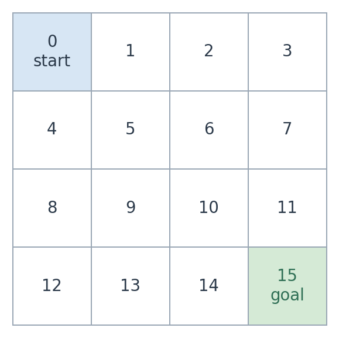
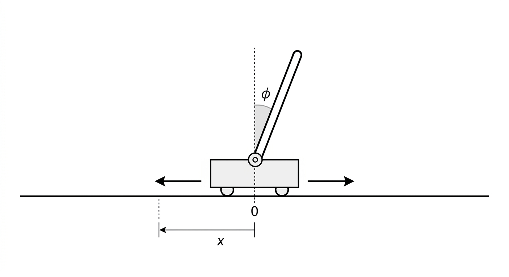
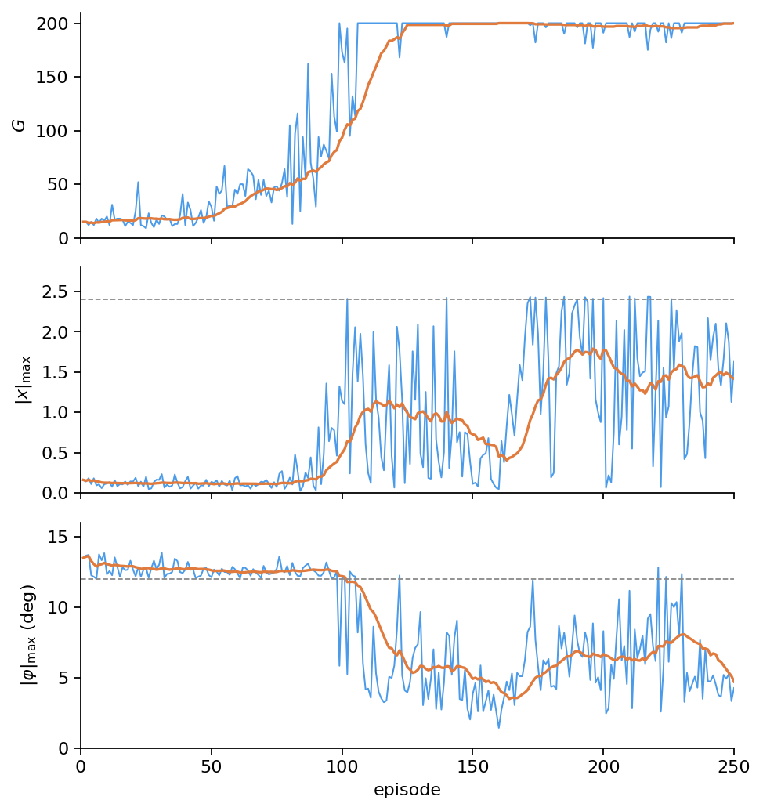

# Chapter 14: Exercises and Code Solutions

[← Previous: Summary](13-summary.md) | [Table of contents](../main.md#chapters) | [Next: Appendix Index](../appendix.md) →


Two small environments. The $4\times 4$ GridWorld is tabular: the same $P$, $r$, and goal, four backups. CartPole has a continuous $s$, so a table cannot store $Q(s,a)$; DQN uses $\hat{Q}(s,a;\theta)$.

## 14.1 Exercise 1: One GridWorld, four backups

States $0,\ldots,15$ on a $4\times 4$ grid; $0$ is the start, $15$ is the goal (terminal). Actions are $0$ up, $1$ right, $2$ down, $3$ left. A move that would leave the grid leaves $s$ unchanged. Reward is $-1$ every step and $0$ on entering the goal.

The object to learn is a policy $\pi$, not a list of moves and not the training loop. Value-iteration sweeps and the MC, SARSA, and Q-learning episodes only **compute** $\pi$ (or $Q$, then $\pi(s)=\arg\max_a Q(s,a)$). After that, given a start state, take $\pi(s)$ at the current cell, observe $s'$, and repeat until $15$. Because $P$ is deterministic and every non-goal step costs $-1$, that walk is an **optimal trajectory** (a shortest path) from the given start to $15$. You do not re-run the backups to produce the path.

<div class="book-figure" align="center" markdown="1" id="fig-14-1">



**Figure 14.1.** GridWorld: start $0$, goal $15$ ($r=0$); every other step $r=-1$. Wall: stay in $s$. Actions: $0$ up, $1$ right, $2$ down, $3$ left.

</div>

The GridWorld **is** an MDP in every case. The four approaches only differ in how they compute $\pi$:

- **Value iteration** (dynamic programming) uses $P(s',r\mid s,a)$ and no samples.

- **Monte Carlo control** uses samples, with target the finished $G_t$.

- **SARSA** uses samples, with one-step target $R+\gamma Q(s',A')$ and $A'\sim\pi$ (on-policy, $Q^\pi$).

- **Q-learning** uses samples, with one-step target $R+\gamma\max_{a'}Q(s',a')$ (off-policy, $Q^*$).

All four return a greedy $\pi(s)=\arg\max_a Q(s,a)$ (value iteration reads it from $V$). Following that $\pi$ from a start cell is the path.

```python
import random
import numpy as np

N_S, N_A, GOAL = 16, 4, 15  # 4x4 cells; actions 0 up, 1 right, 2 down, 3 left

def step_logic(s, a):
    # One transition. Terminal: stay, r=0. Else clip at the wall; r=-1, or r=0 if s' is the goal.
    if s == GOAL:
        return s, 0.0, True
    row, col = divmod(s, 4)
    if a == 0:
        row = max(0, row - 1)
    elif a == 1:
        col = min(3, col + 1)
    elif a == 2:
        row = min(3, row + 1)
    else:
        col = max(0, col - 1)
    s_next = row * 4 + col
    done = s_next == GOAL
    r = 0.0 if done else -1.0
    return s_next, r, done

def build_P():
    # P[s][a] = [(prob, s', r), ...] for value iteration (here prob=1).
    P = {s: {a: [] for a in range(N_A)} for s in range(N_S)}
    for s in range(N_S):
        for a in range(N_A):
            s_next, r, _ = step_logic(s, a)
            P[s][a].append((1.0, s_next, r))
    return P

def value_iteration(P, gamma=0.99, eps=1e-8):
    # Optimality backup: V(s) <- max_a sum P [r + gamma V(s')]; then pi(s) = argmax.
    V = np.zeros(N_S)
    pi = np.full(N_S, -1, dtype=np.int64)  # -1 on the goal
    while True:
        delta = 0.0
        for s in range(N_S):
            if s == GOAL:
                continue
            v = V[s]
            best, best_a = -np.inf, 0
            for a in range(N_A):
                score = 0.0
                for p, s_next, r in P[s][a]:
                    score += p * (r + gamma * V[s_next])
                if score > best:
                    best, best_a = score, a
            V[s] = best
            pi[s] = best_a
            delta = max(delta, abs(v - V[s]))
        if delta < eps:
            break
    return V, pi

def eps_greedy(Q, s, eps):
    # How A_t is chosen (explore); not which backup is used.
    if random.random() < eps:
        return random.randrange(N_A)
    return int(np.argmax(Q[s]))

def greedy_pi(Q):
    # pi(s) = argmax_a Q(s,a). This is the object we keep after learning.
    pi = np.full(N_S, -1, dtype=np.int64)
    for s in range(N_S):
        if s != GOAL:
            pi[s] = int(np.argmax(Q[s]))
    return pi

def generate_episode(Q, eps, max_steps=100):
    # One sample trajectory from start 0: list of (S_t, A_t, R_{t+1}).
    traj = []
    s = 0
    for _ in range(max_steps):
        if s == GOAL:
            break
        a = eps_greedy(Q, s, eps)
        s_next, r, done = step_logic(s, a)
        traj.append((s, a, r))
        s = s_next
        if done:
            break
    return traj

def mc_control(eps=0.1, gamma=0.99, episodes=8000):
    # First-visit MC: target is the finished G_t; N is the visit count.
    Q = np.zeros((N_S, N_A))
    N = np.zeros((N_S, N_A))
    for _ in range(episodes):
        traj = generate_episode(Q, eps)
        G = 0.0
        seen = set()
        for s, a, r in reversed(traj):
            G = r + gamma * G
            if (s, a) in seen:
                continue
            seen.add((s, a))
            N[s, a] += 1
            Q[s, a] += (G - Q[s, a]) / N[s, a]
    return Q, greedy_pi(Q)

def sarsa(eps=0.1, alpha=0.1, gamma=0.99, episodes=4000, max_steps=100):
    # On-policy TD: backup uses A' ~ pi (eps-greedy). Estimates Q^pi.
    Q = np.zeros((N_S, N_A))
    for _ in range(episodes):
        s = 0
        a = eps_greedy(Q, s, eps)
        for _ in range(max_steps):
            if s == GOAL:
                break
            s_next, r, done = step_logic(s, a)
            if done:
                q_next = 0.0  # no bootstrap from the terminal
                a_next = None
            else:
                a_next = eps_greedy(Q, s_next, eps)  # A_{t+1} from pi
                q_next = Q[s_next, a_next]
            Q[s, a] += alpha * (r + gamma * q_next - Q[s, a])
            s, a = s_next, a_next
            if done:
                break
    return Q, greedy_pi(Q)

def q_learning(eps=0.1, alpha=0.1, gamma=0.99, episodes=4000, max_steps=100):
    # Off-policy TD: backup uses max_a' Q(s', a'). Estimates Q*.
    Q = np.zeros((N_S, N_A))
    for _ in range(episodes):
        s = 0
        for _ in range(max_steps):
            if s == GOAL:
                break
            a = eps_greedy(Q, s, eps)  # behavior; not in the backup
            s_next, r, done = step_logic(s, a)
            q_next = 0.0 if done else np.max(Q[s_next])
            Q[s, a] += alpha * (r + gamma * q_next - Q[s, a])
            s = s_next
            if done:
                break
    return Q, greedy_pi(Q)

def fmt(pi):
    # Helper: print arrows for pi(s) and G on the goal. Not used for learning.
    arrows = {0: "^", 1: ">", 2: "v", 3: "<", -1: "G"}
    lines = []
    for i in range(4):
        lines.append(" ".join(arrows[int(pi[4 * i + j])] for j in range(4)))
    return "\n".join(lines)

if __name__ == "__main__":
    random.seed(0)
    np.random.seed(0)
    P = build_P()
    _, pi_vi = value_iteration(P)
    _, pi_mc = mc_control()
    _, pi_sarsa = sarsa()
    _, pi_q = q_learning()
    print("VI\n" + fmt(pi_vi))
    print("MC\n" + fmt(pi_mc))
    print("SARSA\n" + fmt(pi_sarsa))
    print("Q-learning\n" + fmt(pi_q))
```

VI and Q-learning typically agree on a shortest path to $15$. SARSA can differ on cells where $\varepsilon$-greedy exploration is costly. MC is noisier: its target is a full $G_t$.

## 14.2 Exercise 2: CartPole with DQN

The task is to **balance**: keep a pole upright on a cart that rolls on a track. The state is $s = (x, \dot{x}, \varphi, \dot{\varphi}) \in \mathbb{R}^4$: cart position and velocity, pole angle and angular velocity. The pole angle is $\varphi$, not the DQN weights $\theta$. Actions are two horizontal forces on the cart (not on the pole). If the pole is falling one way, the cart must move under it — the same idea as balancing a stick on a palm.

Here $x$ is the cart’s horizontal displacement as the cart rocks back and forth while balancing the pole. The episode ends when $\lvert x\rvert > 2.4$ or $\lvert \varphi \rvert > 12^\circ$, or after $200$ steps. Reward is $1$ every surviving step, so within one episode $G$ rises by $1$ while the pole is up. Across episodes $G$ is not monotone: $\varepsilon$-greedy still falls. $G$ cannot exceed $200$: the episode is cut there even if the pole is still up. A good $\pi$ is a plateau at $200$, not a line that keeps climbing.

The object to learn is $\pi(s)$: which force given $s$. DQN computes $\hat{Q}$, then $\pi(s) = \arg\max_a \hat{Q}(s,a;\theta)$. Acting that $\pi$ every step is how the pole stays up. You do not write a balancing formula by hand.

A table cannot store $Q(s,a)$ for every $s$. The network $\hat{Q}(s,a;\theta)$, replay $\mathcal{D}$, and frozen $\theta^-$ are the DQN update $y = r + \gamma(1-d)\max_{a'} \hat{Q}(s',a';\theta^-)$. SGD on this task is slow; Adam uses the same gradient with an adaptive step. $\varepsilon$ decays as in (6.8).

<div class="book-figure" align="center" markdown="1">



**Figure 14.2.** CartPole balancing task.

</div>

```python
import math
import random
from collections import deque

import torch
import torch.nn as nn

GRAVITY = 9.8                          # m/s^2
MASS_CART = 1.0                        # kg
MASS_POLE = 0.1                        # kg
TOTAL_MASS = MASS_POLE + MASS_CART     # kg; cart + pole
LENGTH = 0.5                           # m; pole half-length
POLEMASS_LENGTH = MASS_POLE * LENGTH   # kg*m; used in the accelerations
FORCE_MAG = 10.0                       # N; |force| for a=0 left, a=1 right
TAU = 0.02                             # s; one physics step
PHI_MAX = 12 * 2 * math.pi / 360       # rad; fail if |phi| > 12?
X_MAX = 2.4                            # m; fail if |x| > 2.4
MAX_STEPS = 200                        # episode cutoff; G cannot exceed this
STATE_DIM, N_ACTIONS = 4, 2            # s = (x, xdot, phi, phi); two forces

def cartpole_reset():
    # s = (x, x, phi, phi); small random start near upright.
    return [(random.random() - 0.5) * 0.1 for _ in range(4)]

def cartpole_step(s, a):
    # One physics step. a=1 pushes right, a=0 left. Then test |x|, |phi|. r=1 until fail.
    x, x_dot, phi, phi_dot = s  # pole angle phi; not DQN weights theta
    force = FORCE_MAG if a == 1 else -FORCE_MAG
    cosphi = math.cos(phi)
    sinphi = math.sin(phi)
    temp = (force + POLEMASS_LENGTH * phi_dot ** 2 * sinphi) / TOTAL_MASS
    phiacc = (GRAVITY * sinphi - cosphi * temp) / (
        LENGTH * (4.0 / 3.0 - MASS_POLE * cosphi ** 2 / TOTAL_MASS)
    )
    xacc = temp - POLEMASS_LENGTH * phiacc * cosphi / TOTAL_MASS
    x = x + TAU * x_dot
    x_dot = x_dot + TAU * xacc
    phi = phi + TAU * phi_dot
    phi_dot = phi_dot + TAU * phiacc
    s_next = [x, x_dot, phi, phi_dot]
    done = abs(x) > X_MAX or abs(phi) > PHI_MAX  # every step: off the track or pole too tilted
    r = 0.0 if done else 1.0
    return s_next, r, done

def make_q():
    # Q(s, a; theta): R^4 -> 2 action-values. No table: s is continuous.
    return nn.Sequential(
        nn.Linear(STATE_DIM, 64),
        nn.ReLU(),
        nn.Linear(64, N_ACTIONS),
    )

def eps_greedy(theta, state, eps):
    # theta is Q(*,*;theta), Chapter 8 weights -- not the pole angle phi.
    if random.random() < eps:
        return random.randrange(N_ACTIONS)
    with torch.no_grad():
        q = theta(torch.tensor(state, dtype=torch.float32))
        return int(q.argmax().item())

def dqn_train(episodes=250, gamma=0.99, alpha=1e-3, batch_size=32, C=100):
    # theta online, theta^- frozen target, D replay. Same backup as (8.2).
    theta = make_q()
    theta_ = make_q()
    theta_.load_state_dict(theta.state_dict())  # theta^- <- theta
    opt = torch.optim.Adam(theta.parameters(), lr=alpha)
    D = deque(maxlen=10000)
    k = 0
    returns = []
    max_xs, max_phis = [], []  # one |x|_max, |phi|_max per episode
    for ep in range(episodes):
        eps = max(0.05, 0.99 ** ep)  # (6.8)-style decay
        s = cartpole_reset()
        G = 0.0
        mx, mph = abs(s[0]), abs(s[2])
        for _ in range(MAX_STEPS):
            a = eps_greedy(theta, s, eps)
            s_next, r, done = cartpole_step(s, a)
            d = 1.0 if done else 0.0
            D.append((s, a, r, s_next, d))
            G += r
            if len(D) >= batch_size:
                batch = random.sample(D, batch_size)
                states = torch.tensor([b[0] for b in batch], dtype=torch.float32)
                actions = torch.tensor([b[1] for b in batch], dtype=torch.int64)
                rewards = torch.tensor([b[2] for b in batch], dtype=torch.float32)
                next_states = torch.tensor(
                    [b[3] for b in batch], dtype=torch.float32
                )
                dones = torch.tensor([b[4] for b in batch], dtype=torch.float32)
                q_sa = theta(states)[range(batch_size), actions]
                with torch.no_grad():
                    # y = r + gamma(1-d) max_a' Q(s', a'; theta^-)
                    y = (
                        rewards
                        + gamma
                        * (1.0 - dones)
                        * theta_(next_states).max(dim=1).values
                    )
                loss = ((y - q_sa) ** 2).mean()
                opt.zero_grad()
                loss.backward()
                opt.step()
            k += 1
            if k % C == 0:
                theta_.load_state_dict(theta.state_dict())  # copy theta -> theta^-
            s = s_next
            mx = max(mx, abs(s[0]))
            mph = max(mph, abs(s[2]))
            if done:
                break  # |x| or |phi| failed this step; else the loop hits MAX_STEPS
        returns.append(G)
        max_xs.append(mx)
        max_phis.append(mph)
    return theta, returns, max_xs, max_phis

if __name__ == "__main__":
    import matplotlib.pyplot as plt

    random.seed(0)
    torch.manual_seed(0)
    theta, returns, max_xs, max_phis = dqn_train()
    print("last-20 train mean:", sum(returns[-20:]) / 20)

    def mean20(seq):
        # Helper: 20-episode mean of a per-episode series.
        w = 20
        return [
            sum(seq[max(0, i - w + 1) : i + 1]) / min(i + 1, w)
            for i in range(len(seq))
        ]

    ep = range(1, len(returns) + 1)
    deg = 180.0 / math.pi
    max_phis_deg = [t * deg for t in max_phis]
    # Helper: G, |x|_max, |phi|_max vs episode. Blue = one episode; orange = 20-episode mean.
    fig, axes = plt.subplots(3, 1, sharex=True, figsize=(6.2, 6.6))
    axes[0].plot(ep, returns, color="#4C9BE8", lw=0.9)
    axes[0].plot(ep, mean20(returns), color="#E07A3D", lw=1.5)
    axes[0].set_ylabel("$G$")
    axes[0].set_ylim(0, 210)
    axes[1].plot(ep, max_xs, color="#4C9BE8", lw=0.9)
    axes[1].plot(ep, mean20(max_xs), color="#E07A3D", lw=1.5)
    axes[1].axhline(X_MAX, color="#888888", ls="--", lw=0.8)
    axes[1].set_ylabel(r"$|x|_{\mathrm{max}}$")
    axes[1].set_ylim(0, 2.8)
    axes[2].plot(ep, max_phis_deg, color="#4C9BE8", lw=0.9)
    axes[2].plot(ep, mean20(max_phis_deg), color="#E07A3D", lw=1.5)
    axes[2].axhline(12, color="#888888", ls="--", lw=0.8)
    axes[2].set_ylabel(r"$|\varphi|_{\mathrm{max}}$ (deg)")
    axes[2].set_xlabel("episode")
    axes[2].set_ylim(0, 16)
    axes[2].set_xlim(0, len(returns))
    axes[2].set_xticks(range(0, len(returns) + 1, 50))
    for ax in axes:
        ax.spines["top"].set_visible(False)
        ax.spines["right"].set_visible(False)
    plt.tight_layout()
    plt.show()
```

<div class="book-figure" align="center" markdown="1" id="fig-14-2">



**Figure 14.3.** CartPole DQN, seed $0$: $G$, $|x|_{\max}$, and $|\varphi|_{\max}$ vs episode (blue) and $20$-episode mean (orange). Dashed: fail bounds $2.4$ and $12^\circ$.

</div>

Early $G$ near $20$ means the pole (or cart) failed after that many steps. The rise near episode $100$ is balancing starting to work. Orange $G$ flat at $200$ is the step cutoff, not unbounded gain. Late blue dips in $G$ are leftover $\varepsilon$-greedy failures.

Either bound can fail; the other need not. $|\varphi|_{\max}$ above $12^\circ$ with $|x|_{\max}$ still small is a **pole fall**: the episode stops on $\varphi$, so $x$ never reaches $2.4$. That is the early stretch. $|x|_{\max}$ on $2.4$ with $|\varphi|$ still below $12^\circ$ is a **cart** fail. The dashed lines are the fail check, not a clip: the failing coordinate can step slightly past the bound, then we stop. After learning, both stay below the dashes for $200$ steps except leftover $\varepsilon$-greedy dips.

[← Previous: Summary](13-summary.md) | [Table of contents](../main.md#chapters) | [Next: Appendix Index](../appendix.md) →
